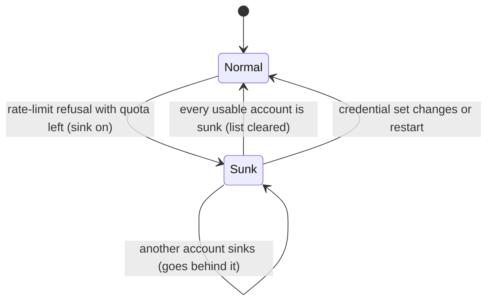

# Data Model: Account Routing Modes

## ProviderRouting (config, one for each provider)

Setting `auth.routing.<provider>`. It is a record, merged per provider across the settings layers.

| Field | Type | Default | Rule |
|---|---|---|---|
| `mode` | `"smart" \| "order" \| "rotate" \| "weight" \| "usage" \| "pace"` | `smart` | Any other value is an error. |
| `stays` | `"auto" \| "session" \| "turn" \| "off" \| "strict"` | `auto` | Any other value is an error. |
| `sink` | boolean | `false` | Has no effect when `mode` is `rotate` or `weight`. |

Unknown fields are an error. A provider with no entry uses all defaults.

## AuthAccountPolicy (config, existing type, changed)

Setting `auth.accountPolicies[]`.

| Field | Type | Change | Rule |
|---|---|---|---|
| `provider` | string | – | Not empty. |
| `account.email` / `accountId` / `projectId` / `orgId` | string | – | Matches OAuth accounts. |
| `account.keySuffix` | string | **new** | At least 4 characters. Matches an API key that ends with it. It cannot be used together with the OAuth fields. |
| `priority` | number | – | Finite. Higher values go first in `order` and `smart`. |
| `weight` | integer | **new** | 1–1000, default 1. Used only by `weight` mode. |
| `capPct` | number | **new; replaces `reservePct`** | 1–100. The cap on every reserve-scoped window. |
| `windowCapPct` | record of window id → number | **new** | Each value is 1–100. It overrides `capPct` for that window. |

`reservePct` is removed with no alias, so a config that still uses it fails with an "unknown field" error.

Every selector must match at most one stored credential. Two policies must not match the same credential.

### Effective cap for one account and one window

```
cap(w) = windowCapPct[w] ?? capPct ?? (mode == "order" ? none : 100 − retry.usageReservePct)
inReserve = some reserve-scoped window w has used(w) ≥ cap(w)
```

`retry.usageReservePct` applies only when the provider has at least one account policy. This is today's rule (select.ts:652). The health check that the usage-aware fallback uses keeps today's rule: it always applies `retry.usageReservePct`, except in `order` mode.

## SessionAffinity (runtime, existing)

No new persisted fields for pins. The selector decides from `stays` and from the request option `withinTurn`. The strict hold is the one exception. It records, for each strict session, the account's credential id, its identity key (`identityKey`, the same key `sessions.restrict` uses), a label, and, once the account is removed, the provider's credential ids at that time (no tokens). A hold restored from a session file has credential id -1 and no identity key. It has the session-file pin hash (`pinHash`) instead, and it goes back to the account whose pin hash matches when that account signs in again. An in-memory cache of 256 sessions for each provider sits in front of persisted `session:strict:<provider>:<session>` cache rows, which expire with the session pin. A broker client, whose cache rows are in memory, restores the hold on resume from the session-file pin hash (`sessions.holdGone`).

| stays | Pin kept first |
|---|---|
| `auto` | When warm and not evicted (today's rule) |
| `session` | When usable |
| `turn` | When usable and `withinTurn` is true |
| `off` | Never |
| `strict` | Always. No rotation happens. Turn recovery does not wait or retry a usage-limit refusal, and errors go to the user at once. |

An explicit pin set by the user does not change (FR-014).

## Request option (runtime, new)

`AuthApiKeyOptions.withinTurn?: boolean`. It is true only when the last message in the request context has role `toolResult`. A new user message, a steering or follow-up message, an error retry, and a re-sample all give `false`. Callers that do not set it are treated as being at a new turn.

## Selector state (in memory, for each provider)

The state is lost on restart. A change to the provider's credential set clears it. A settings change does not. The strict hold (see Session affinity) is not part of this state: it is persisted.

| State | Shape | Used by |
|---|---|---|
| Rotate index | `Map<providerKey, number>` (existing `#providerRoundRobinIndex`) | `rotate` |
| Weight round | `Map<providerKey, Map<credentialId, currentWeight>>` | `weight` |
| Sink list | `Map<provider, credentialId[]>`, in refusal order | `sink` |
| Recent tokens | `Map<provider, Map<credentialId, { tokens, atMs }>>`, one-hour half-life | `usage`, `pace` |
| Learn-once tried set | `Map<provider, Set<credentialId>>`. An id is added when the learn rule puts the account first. | `usage`, `pace` (header-reporting providers only) |

### Sink list transitions



## Routing preview (runtime, new; used by `omp usage`)

`{ mode, stays, sink, next?: { label, reason } }`

`reason` is one of:
- `first in order`
- `its turn`
- `its share`
- `least used: N%`
- `most to lose: N%/h`
- `soonest reset`

There is no `next` when the provider has fewer than 2 credentials, or in `smart` mode when no credential has a usage report (the pick then depends on the session). A single OAuth account beside API keys is the `next` account with the reason `only account`, because OAuth accounts go first.
