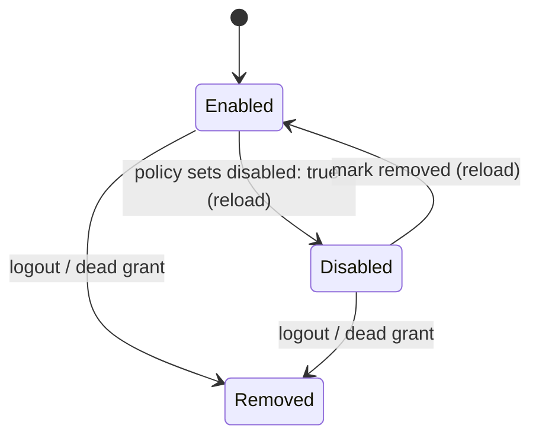

# Data Model: Disable a Signed-In Account

## AuthAccountPolicy (changed)

`packages/ai/src/auth/types.ts`, one entry of `auth.accountPolicies`.

| Field | Type | Default | Rule |
|---|---|---|---|
| `provider` | string | required | unchanged |
| `account` | selector | required | unchanged. It matches at most one stored credential. |
| `priority` | number | `0` | unchanged. It has no effect while `disabled` is true. |
| `weight` | integer 1–1000 | `1` | unchanged. It has no effect while `disabled` is true. |
| `capPct` | number 1–100 | unset | unchanged. It has no effect while `disabled` is true. |
| `windowCapPct` | record | `{}` | unchanged. It has no effect while `disabled` is true. |
| **`disabled`** | **boolean** | **`false`** | **New.** When it is true, routing never selects the matched credential. A value that is not boolean is a configuration error. |

The policy holds no new state. `isDisabled` reads the live policy list, so a reload changes the result at the next selection.

## Credential states seen by selection

- **Enabled:** a candidate in every mode, subject to blocks, plan checks, and caps.
- **Disabled:** stored and refreshed (R2), and listed by `omp usage` with a `disabled` marker. It is never a candidate, never a fallback, and never `next`.
- **Removed:** the stored row is gone or tombstoned. The existing behavior is unchanged.

## Session pin outcomes when the pinned credential becomes disabled

| Pin kind | Stays | Result |
|---|---|---|
| automatic | `auto`, `session`, `turn`, `off` | The next selection ranks the enabled credentials and records a new automatic pin. No warning. |
| explicit | any | A sibling serves and becomes the new automatic pin. The user gets one warning (contract W1). |
| automatic | `strict` | Each request throws E2. The pin and the hold are unchanged. The next request after the mark is removed uses the same account. |
