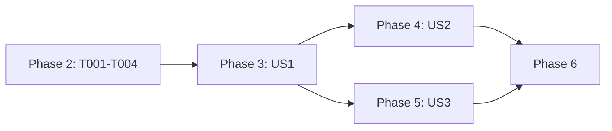

# Tasks: Disable a Signed-In Account

**Input**: Design documents from `specs/011-account-disable/`

**Prerequisites**: plan.md, spec.md, research.md, data-model.md, contracts/disable-config.md, quickstart.md

**Tests**: Included. The spec's independent tests and `quickstart.md` name the checks. Tests must prove properties: generated pools with a fixed, printed seed, and no copies of the implementation.

**Rules for every task**:
- Do not run build, lint, format, or test commands until Phase 6.
- Line numbers are approximate. Find the code by symbol name.
- The message texts V1, W1, E2, and E3 come from `contracts/disable-config.md` and must match it exactly.

## Format: `[ID] [P?] [Story] Description`

- **[P]**: can run in parallel (different files, no dependency on unfinished tasks)
- **[Story]**: the user story (US1, US2, US3)

---

## Phase 1: Setup

No setup. The feature uses existing packages and test fixtures.

---

## Phase 2: Foundational (blocks all stories)

- [X] T001 Add `readonly disabled?: boolean` to `AuthAccountPolicy` in `packages/ai/src/auth/types.ts` (about line 60-71). Write a doc comment: "When true, routing never selects the matched credential. It stays stored and refreshed."
- [X] T002 In `validateAccountPolicies` in `packages/ai/src/auth/policy.ts` (about line 76-146), throw `AIError.ConfigurationError` with text V1 (`${path}.disabled must be a boolean`) when `policy.disabled !== undefined` and it is not a boolean. Add `isDisabled(provider: string, credential: AuthCredential): boolean` to `AccountPolicies`, after `forCredential` (about line 294). It returns `this.forCredential(provider, credential)?.disabled === true`.
- [X] T003 [P] In `parseAuthAccountPolicies` in `packages/ai/src/auth-broker/discover.ts`, add `"disabled"` to `policyFields` (about line 129). Copy the field into the rebuilt policy object (about line 170-186) with `...(policy.disabled !== undefined ? { disabled: policy.disabled as boolean } : {})`. The type check stays in T002, which runs at the end of the parse.
- [X] T004 [P] In `packages/ai/src/auth/select.ts`, move the label rule from `preview` (about line 772-774) into one module-level function, `credentialLabel(credential: AuthCredential, credentialId: number | undefined): string`. OAuth gives `email ?? accountId ?? projectId ?? "cred <id>"`. An API key gives `key …<last 4>`. Make `preview` call it. T008, T010, and T012 use it too.

**Checkpoint**: the field parses, validates, and can be looked up.

---

## Phase 3: User Story 1 - Stop using one account without signing out (Priority: P1) 🎯 MVP

**Goal**: no routing mode selects a disabled credential, not even as the last fallback. The account stays signed in and refreshed.

**Independent Test**: with generated pools in all 6 modes, no selection returns a disabled credential. This is still true when every other credential is blocked or past its cap. After the mark is removed, the credential can be selected again.

### Tests for User Story 1

- [X] T005 [P] [US1] In `packages/ai/test/auth-storage-routing-modes.test.ts`, add a property test that uses the existing `withPool` and `withKeyPool` helpers and a fixed, printed seed. For each mode in `smart`, `order`, `rotate`, `weight`, `usage`, and `pace`, it generates pools of 1-6 OAuth accounts and pools of API keys, with random `priority`, `weight`, caps, blocks, and disable marks. Over many selections, it asserts that:
  - a selected credential is never disabled;
  - when every credential is disabled, the result is error E3 and never a disabled key;
  - when every enabled credential is blocked or past its cap, the result is never a disabled credential.

  Then it calls `setAccountPolicies` without the marks and asserts that each previously disabled credential is selectable again with the same stored row (no new sign-in).
- [X] T005a [P] [US1] In `packages/ai/test/auth-storage-routing-modes.test.ts`, add a test that uses the real save path. It uses a real SQLite credential store and an `AuthStorage` whose `refreshOAuthCredential` option fakes the token endpoint. The fake counts its calls, records each call's promise, and returns a new access token, a new refresh token, and an `expires` in the future (`refresh.ts:514-528` throws otherwise). Before each assertion, the test awaits `Promise.allSettled` on the recorded promises. Then it yields once with `await Bun.sleep(0)`, because `refreshStored` saves the row after the fake returns. It uses no other waits. It covers three cases:
  - (a) One of two OAuth accounts is disabled, and its token expires within `OAUTH_REFRESH_SKEW_MS`. A selection returns the other account. The fake is called once for the disabled account. The disabled account's row, read back from the store (not from the pool), holds the new access and refresh tokens.
  - (b) Every account is disabled, and their tokens are expired. A request rejects with E3, and the fake is still called once for each account.
  - (c) The disabled account's token is fresh. The fake is not called.
- [X] T006 [P] [US1] In `packages/ai/test/auth-broker-config-discovery.test.ts`, add cases:
  - `disabled: true` is parsed and kept.
  - `disabled: "yes"` fails with text V1.
  - `disabled` together with `priority` and `capPct` is accepted.
- [X] T006a [P] [US1] In `packages/coding-agent/test/auth-broker-live-settings.test.ts`, add two cases to the existing live-settings harness:
  - (a) A settings change that adds `disabled: true` for one account applies to the next selection. That account is no longer returned, and no restart happens.
  - (b) A change to `disabled: "yes"` is refused with text V1. The active policies stay unchanged, and the account that was disabled before stays disabled.

  Also add `disabled: "yes"` to the existing invalid-value table (about line 223-228).

### Implementation for User Story 1

- [X] T007 [US1] In `packages/ai/src/auth/select.ts`, filter disabled credentials in the 4 list builders with `this.#deps.policies.isDisabled(provider, entry.credential)`:
  - `resolveOAuth`: in the `credentials` filter at about line 832, next to `affinity.allows`. Keep `stored` unfiltered for `#backToStrictAccount`, as the comment at about line 833 already says.
  - `selectApiKey`: in the `.filter` at about line 407-410, before the `length === 0` and `length === 1` early returns.
  - `selectByType`: in the `.filter` at about line 308-318.
  - `preview`: filter `pool` at about line 716, before the `pool.length < 2` check.

  Do not change `isRoutable` or `compareHard` in `routing.ts`.
- [X] T008 [US1] In `resolveOAuth` in `packages/ai/src/auth/select.ts`, right after the T007 filter and **before** the `if (credentials.length === 0) return undefined;` early return (about line 836), start a refresh for each disabled stored OAuth credential whose token is near expiry (`Date.now() + OAUTH_REFRESH_SKEW_MS >= credential.expires`). Read the row id from `this.#deps.pool.entries(provider)[index]?.id`, not from `credentialIds`, because `credentialIds` is created after the early return. Skip an entry whose id is `undefined`: without an id, `refresh` does not save the result. Call `void this.#deps.refresher.refresh(provider, credential, id).catch(error => logger.debug(...))`, and do not wait for it. Do not add a second merge-and-save step, because `refreshStored` already saves the token (research R2). Do not rank, pin, or block the account. Add the comment `// FR-003: selection is local mode's only refresh trigger, so keep disabled accounts signed in, also when every account is disabled.`
- [X] T009 [P] [US1] Skip disabled credentials in these places:
  - the sibling checks in `packages/ai/src/auth/rotation.ts` (`remainingCredentials` at about line 191-199, and `hasSibling` at about line 494-501);
  - the fallback health check in `packages/ai/src/auth/health.ts` (about line 218);
  - `routing.weights` in `packages/ai/src/auth-storage.ts` (about line 154-163).

  If a module has no `policies` dependency, pass it through the existing deps object that `auth-storage.ts` builds.

**Checkpoint**: US1 works without US2 and US3.

---

## Phase 4: User Story 2 - Running sessions follow the change (Priority: P2)

**Goal**: sessions leave a disabled account at their next selection. An explicit pin moves and warns once. A `strict` automatic pin fails with E2. When disable marks leave no key, the error is E3.

**Independent Test**: a session pinned to account A moves after A is disabled. An explicit pin produces exactly one W1 notice. A strict session gets E2 on every request until the mark is removed, and then it uses A again.

### Tests for User Story 2

- [X] T010 [P] [US2] In `packages/ai/test/auth-storage-routing-modes.test.ts`, add tests:
  - Under `auto`, `session`, `turn`, and `off`, an automatic pin on A moves to an enabled account after `setAccountPolicies` disables A.
  - An explicit pin (`sessions.pin`) on A that becomes disabled moves to B. `sessions.onAccountDisabled` fires exactly once over 5 requests, with `{ provider, sessionId, label: A, nextLabel: B }`.
  - Under `strict` with an automatic pin on A: after A is disabled, 3 requests each reject with text E2, and no other account is used. After the mark is removed, the next request uses A.
  - Every credential disabled: the error is E3 and lists the labels.
  - A pin restored with `sessions.pin(provider, sessionId, id, { restoredAtMs })` on a disabled account (an automatic pin from a resumed session) moves to an enabled account on the first request, with no W1 event.
  - The same restored pin under `strict` rejects with E2 and does not move.
  - A child session that gets the parent's pins through `sessions.inherit` (the subagent path) never uses the disabled account.
  - Under `strict` with an explicit pin on A: after A is disabled, the session moves to B and `onAccountDisabled` fires once.
- [X] T011 [P] [US2] In `packages/ai/test/auth-storage-session-restriction.test.ts`, add a test: a session restricted to a pool whose accounts are all disabled gets error E3 and never uses a disabled account.
- [X] T012 [P] [US2] In `packages/coding-agent/test/sdk-credential-disabled-bridge.test.ts`, add a test with the existing harness. An `onAccountDisabled` event for the session's own id emits one `notice` event with level `warning`, source `auth`, and text W1. An event for another session id emits nothing.

### Implementation for User Story 2

- [X] T013 [US2] In `packages/ai/src/auth/select.ts`, add the strict check. Add `disabledError(provider, sessionId, label)` next to `signedOutError` (about line 88). It returns `MissingApiKeyError` with text E2.
  - In `resolveOAuth`, before the T007 filter: when `sessionId` is set, `stays === "strict"`, and the session pin is an automatic OAuth pin whose credential in `stored` is disabled, throw `disabledError`.
  - In `#backToStrictAccount` (about line 203), after the account is found again: if it is disabled, throw `disabledError` before the pin is recorded again. Leave the hold unchanged.
  - Do not set `goneFrom`.
- [X] T014 [US2] Add the warning event:
  - In `packages/ai/src/auth/types.ts`, add `SessionAccountDisabledEvent { provider: string; sessionId: string; label: string; nextLabel: string }` and `onAccountDisabled(listener: (event: SessionAccountDisabledEvent) => void): () => void` to `SessionsApi`.
  - Put the listener set in the object that `AuthStorage.sessions` returns (`packages/ai/src/auth-storage.ts:~125`). Give the selector an `emitAccountDisabled` dependency.
  - In `resolveOAuth` in `packages/ai/src/auth/select.ts`, record before the T007 filter whether the explicit pin (`sessionPinIsExplicit`) points at a disabled credential. After `tryOAuth` serves a different credential, emit the event once, with labels from `credentialLabel`. Do not keep any deduplication state. The new automatic pin makes the warning show once (research R3).
- [X] T015 [US2] Add `disabledLabels(provider: string, sessionId?: string): string[]` to `CredentialSelector` in `packages/ai/src/auth/select.ts`. It returns the labels of the stored credentials that are disabled and that `affinity.allows` lets the session use. In `KeyCascade.#resolve` in `packages/ai/src/auth/cascade.ts`, use it at the final `return undefined` (about line 517) and in the restricted-pool branch (about line 411). When the list is not empty, throw `new AIError.MissingApiKeyError(provider, <text E3>)` instead. All earlier sources (runtime, config, OAuth, login, fallback, environment, and stored keys) still win first.
- [X] T016 [US2] Add `formatSessionAccountDisabledNotice(event)` with text W1 to `packages/coding-agent/src/session/credential-disabled-notice.ts`. In `packages/coding-agent/src/sdk.ts`, next to the `credentials.onDisabled` subscription (about line 1796-1807), subscribe to `authStorage.sessions.onAccountDisabled`. When `credentialNoticeSession` exists and `event.sessionId === credentialNoticeSession.sessionId`, call `credentialNoticeSession.emitNotice("warning", text, CREDENTIAL_DISABLED_NOTICE_SOURCE)`. Register the unsubscribe call with `startupCleanup.defer`, as the existing subscription does.

**Checkpoint**: US1 and US2 work. Print mode shows W1 on stderr through the existing `auth` source path.

---

## Phase 5: User Story 3 - See which accounts are disabled (Priority: P3)

**Goal**: `omp usage` marks disabled accounts and never names one as `next`.

**Independent Test**: one disabled account of 3 shows `policy: disabled …`. The routing line's `next:` never names it. With only 1 account enabled, the routing line does not appear.

### Tests for User Story 3

- [X] T017 [P] [US3] In `packages/coding-agent/test/usage-cli.test.ts`, add the cases from the Independent Test above. Follow the existing policy-line format (about line 737-741).

### Implementation for User Story 3

- [X] T018 [US3] In `packages/coding-agent/src/cli/usage-cli.ts`:
  - In `formatPolicyLine` (about line 680), start the line with `disabled` when `policy?.disabled` is true, and keep the priority and cap parts.
  - Change the routing-line gate (about line 853-854) to count only credentials whose policy is not disabled. `preview` already leaves disabled credentials out (T007).
  - Keep the existing red `✗ … disabled …` lines for stored rows unchanged.

**Checkpoint**: all 3 stories work.

---

## Phase 6: Polish & Cross-Cutting Concerns

- [X] T019 [P] In `docs/settings.md`, add the row `auth.accountPolicies[].disabled` (boolean, `false`) after the `weight` row (about line 1056). Add `disabled` to the field list in the `auth.accountPolicies` row (about line 1054). Describe what happens to `strict` sessions, explicit pins, and the error when nothing is usable.
- [X] T020 [P] In `docs/auth-broker-gateway.md`, add `disabled` to the field row (about line 306) and to the YAML example (about line 327-331). In the mode text (about line 338), add "disabled by policy" to the list of things every mode skips first. State that a disabled credential is never a fallback. In the stays rules (about line 359-365), add the explicit-pin warning and the strict error.
- [X] T021 [P] Add `[Unreleased]` entries to `packages/ai/CHANGELOG.md` (the field, the selection filter, refresh, the event, E2/E3) and to `packages/coding-agent/CHANGELOG.md` (the W1 notice and the `omp usage` marker).
- [X] T022 [P] In the "Per-provider account routing" entry in `UPSTREAM_DIVERGENCES.md`, add `disabled` to the first decision line. Add `packages/ai/test/auth-storage-session-restriction.test.ts` and `packages/coding-agent/test/sdk-credential-disabled-bridge.test.ts` to its Checks.
- [X] T023 Run each changed test file in its own process (the list is in `quickstart.md`). Then run `bun run check:types`, `bunx oxlint` on the changed files, and `bunx oxfmt --check` on the changed files. Fix all failures.
- [X] T024 Run the manual smoke steps in `quickstart.md` that a local login allows. At least run step 3 (`omp usage`) and step 4 (a print-mode prompt) with a disabled account. Record the result.

---

## Dependencies & Execution Order



- T001 and T002 come before everything else. T003 and T004 depend only on T001.
- T007 comes before T008, T013, T014, and T015, because they all edit `resolveOAuth` or depend on the filter. Run them one after another in `select.ts`.
- T014 comes before T016, because the SDK needs the event type.
- US3 depends on US1 (T007 `preview`) and not on US2.

## Parallel Opportunities

- Phase 2: T003 and T004 (different files).
- US1: T005, T005a, T006, and T006a (tests), and T009 together with T007 and T008 (`rotation.ts`, `health.ts`, and `auth-storage.ts` versus `select.ts`).
- US2: T010, T011, and T012 (tests in different files). T016 runs after T014, in parallel with T015.
- US3 can run in parallel with US2 after US1.
- Phase 6: T019-T022.

## Parallel Example: User Story 1

```text
Agent A: T007 → T008   (packages/ai/src/auth/select.ts)
Agent B: T009          (rotation.ts, health.ts, auth-storage.ts)
Agent C: T005, T005a, T006, T006a    (tests)
```

## Implementation Strategy

### MVP First (User Story 1 Only)

1. Finish Phase 2.
2. Finish Phase 3. A disabled account is never selected and stays refreshed.
3. Stop and check: run T005, T005a, T006, and T006a, and the quickstart step 4.

### Incremental Delivery

1. Add US2 (session moves, W1, E2, E3).
2. Add US3 (`omp usage`).
3. Do Phase 6 (docs, changelogs, divergence entry, checks).

## Notes

- One integration owner edits `select.ts`, because T007, T008, T013, T014, and T015 all change it.
- Commit with the smart-commit skill after Phase 6. Do not push.

## Phase 7: Convergence

- [X] T025 Skip disabled credentials in `KeyCascade.describe` in `packages/ai/src/auth/cascade.ts`: add `!this.#deps.policies.isDisabled(provider, entry.credential)` to the `typed` filter in `describeStored`. In `packages/ai/test/auth-storage-routing-modes.test.ts`, add one agreement case with generated pools and a fixed seed. When every credential is disabled, `keys.source()` and `describe()` both return `undefined`. In a mixed pool, `describe()` names the credential that `keys.get` serves. Per spec Assumptions (model picker sees a signed-out provider) and FR-002 (partial)
- [X] T026 Count enabled credentials only in the `omp usage` routing-line gate in `packages/coding-agent/src/cli/usage-cli.ts`. Put a `disabled` bit on each row from `collectStoredAccounts`, computed from the stored credential with `AccountPolicies.isDisabled`. Count only rows that are not disabled, and remove the `ponytail:` comment. In `packages/coding-agent/test/usage-cli.test.ts`, add one case with 1 enabled OAuth account and 1 disabled API key: it prints no `routing:` line. Per plan: usage-cli.ts "routing line counts enabled credentials" and FR-010 (partial)

## Phase 8: Convergence

- [X] T027 Exclude disabled credentials from the unpinned fallback in `SessionAffinity.activeOAuth` (`packages/ai/src/auth/affinity.ts:520-550`). Today it returns `oauthCredentials[0]` when the session has no pin, and that row can be disabled. Then `oauth.identity()` names a disabled account as the session's active account: in the status line (`status-line-host.ts:58`), in the `/usage` active marker (`usage-report.ts:177`), and in the account id that Anthropic web search sends (`web/search/providers/anthropic.ts:333`). Pass `policies` through the existing `SessionAffinity` constructor deps, and filter with `isDisabled` in the `oauthCredentials` list. Keep a sticky pin as it is: a strict automatic pin on a disabled account still names that account, because the session stays on it (FR-007). In `packages/ai/test/auth-storage-routing-modes.test.ts`, add a property case with generated pools: for a session with no pin, `oauth.identity()` never names a disabled account, and it is `undefined` when every OAuth account is disabled. Per FR-002 (partial)

## Phase 9: Convergence

- [X] T028 Stop naming a disabled pinned account as a session's active account, except for a `stays: strict` session whose pin came from automatic selection. In `SessionAffinity.activeOAuth` (`packages/ai/src/auth/affinity.ts:553-554`), return the pinned credential only when it is not disabled, or when `stays` is `strict` and the pin is not explicit. Otherwise use the enabled fallback. In `OAuthAccounts.accounts()` (`packages/ai/src/auth/oauth.ts:257-263`), mark no account `active` under the same condition. Today, after a reload disables the pinned account, `oauth.identity()` and `oauth.accounts()` name it until the next request. The status line, `/usage`, logout, credential-pin hash, and the Anthropic web-search `accountId` (which `anthropic.ts:333` reads before its key lookup) all use these. Add a property case to `packages/ai/test/auth-storage-routing-modes.test.ts`: after the pinned account becomes disabled, `identity()` and the `active` row never name it for automatic or explicit pins, and still name it for a strict automatic pin. Per FR-005 and FR-006 (partial)
- [X] T029 Leave disabled accounts out of the implicit account choice of the security scan in `selectOAuthAccount` (`packages/coding-agent/src/security/auth.ts:64-67`). Today, with no requested credential id, it takes the `active` account or the only stored account, and that account can be disabled. The scan then authenticates with it. Keep the explicit `requestedCredentialId` branch unchanged. Read the mark through the existing public policy lookup (`authStorage.oauth.policy(provider, identity)?.disabled`). Add one test: a provider whose only OAuth account is disabled gets no implicit scan account. Per FR-002 (partial)

## Phase 10: Convergence

- [X] T030 Rewrite the T029 test in `packages/coding-agent/test/security/auth.test.ts` ("never picks a disabled account implicitly…") as a generated property with a fixed, printed seed. Generate 1 to 4 account rows with random `active` and `disabled` flags. Assert three things. First, the implicit pick is never a disabled row. Second, when an enabled `active` row exists, the pick is that row. Third, an explicit id selects its row even when it is disabled. Do not compute the expected pick with the code's own `find(active) ?? length === 1` expression. When no account can be picked, assert the exact error message, not a bare `toThrow()`. Per T029 and the project test rules (partial)
- [X] T031 When every stored OAuth account is disabled, make the implicit pick in `selectOAuthAccount` (`packages/coding-agent/src/security/auth.ts:84-88`) throw an error that names the disabled accounts. Today it throws "Multiple OAuth accounts are available… supply credentialId", which gives the wrong reason. Per FR-009 (partial)

## Phase 11: Convergence

- [X] T032 Make an explicit `credentialId` on a disabled account fail in `selectOAuthAccount` (`packages/coding-agent/src/security/auth.ts:66-67`) with the T031 disabled error, instead of selecting the account. A scan has no session to move, and the disable mark overrides an explicit choice. Change the explicit-id assertion of the T030 property to match. Per FR-002 and spec Assumptions (contradicts)
- [X] T033 Leave disabled accounts out of `/models` discovery in `resolveOAuthDiscoveryAccounts` (`packages/coding-agent/src/config/model-provider-discovery.ts:160`). Today it fetches the provider's `/models` with the token of every stored account, disabled ones included. A disabled account whose refresh fails must not abort discovery. `omp dry-balance` keeps disabled accounts, because check commands keep them visible. Per US1 and US1/AC1 (contradicts)

## Phase 12: Convergence

- [X] T034 Leave disabled accounts out of `OAuthAccounts.accessAll` (`packages/ai/src/auth/oauth.ts:287-297`), before it resolves or refreshes them, so no caller gets their tokens. Today `omp dry-balance` (`dry-balance-cli.ts:475-485`) sends a real completion with every account's token, which spends a disabled account's quota. This one filter also covers `/models` discovery and the catalog script, so remove the T033 filter in `model-provider-discovery.ts` and its stub test. `oauth.accounts()` keeps listing disabled rows. Add a seeded property test: `accessAll` never returns a disabled account. Per US1 and FR-002 (contradicts)
