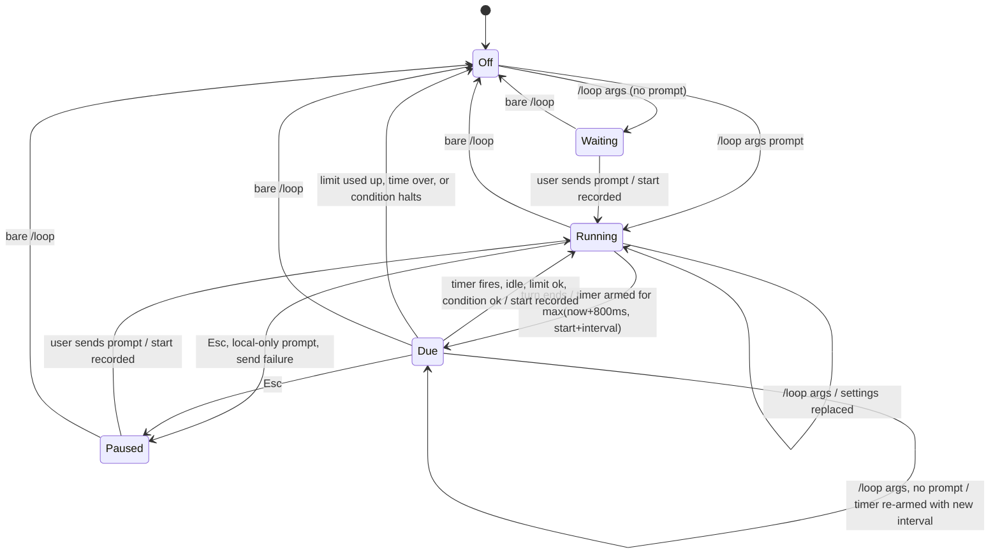

# Data Model: Fixed Interval for /loop

All state lives in memory for the life of the interactive session. Nothing is saved to disk.

## ParsedLoopArgs (`packages/coding-agent/src/modes/loop-limit.ts`)

| Field | Type | Change | Rule |
|---|---|---|---|
| `limit` | `LoopLimitConfig?` | same | Count or total time. |
| `intervalMs` | `number?` | **new** | Positive whole milliseconds. Present only when `every <duration>` parsed. |
| `condition` | `LoopConditionConfig?` | same | `--while` / `--until`. |
| `prompt` | `string?` | same | The text that is left. |

## Loop runtime state (`InteractiveMode`, `packages/coding-agent/src/modes/interactive-mode.ts`)

| Field | Type | Change | Rule |
|---|---|---|---|
| `loopModeEnabled` | `boolean` | same | |
| `loopModePaused` | `boolean` | same | |
| `loopPrompt` | `string?` | same | |
| `loopLimit` | `LoopLimitRuntime?` | same | Set again on replace. |
| `loopCondition` | `LoopConditionConfig?` | same | Set again on replace. |
| `loopIntervalMs` | `number?` | **new** | Public, for the autocomplete text. Set on enable and on replace. Cleared on disable. |
| `#loopRunStartedAt` | `number?` | **new** | Epoch ms. Set in `setLoopPrompt` and when `#runLoopIteration` consumes a run. Cleared on disable and on pause. |
| `#loopNextRunAt` | `number?` | **new** | Epoch ms, the due time of the armed interval run. `#armLoopDueTimer` sets it at a 1-second step when the session is idle, so a timer armed during a turn shows `next` on the first idle step. Cleared when the due timer fires and in `#cancelLoopAutoSubmit` (so in `setLoopPrompt`, pause, and disable). It never holds a past due time during a turn (FR-011). |

`InteractiveModeContext` in `packages/coding-agent/src/modes/types.ts` (line 133) gets `loopIntervalMs?: number`, next to `loopLimit`.

## Status line context (`packages/tui/src/status-line/types.ts`)

`SegmentContext["loopMode"]`:

| Field | Type | Change |
|---|---|---|
| `state` | `"waiting" \| "running" \| "paused"` | same |
| `limit` | `LoopLimitRuntime?` | same |
| `condition` | `LoopConditionConfig?` | same |
| `intervalMs` | `number?` | **new** |
| `nextRunAt` | `number?` | **new**, epoch ms |

`StatusLine.setLoopModeStatus` compares `intervalMs` and `nextRunAt` too, so a changed due time renders again.

## State transitions

`Due` is not a separate field. It means: loop on, prompt set, not paused, session idle, and a timer armed.
