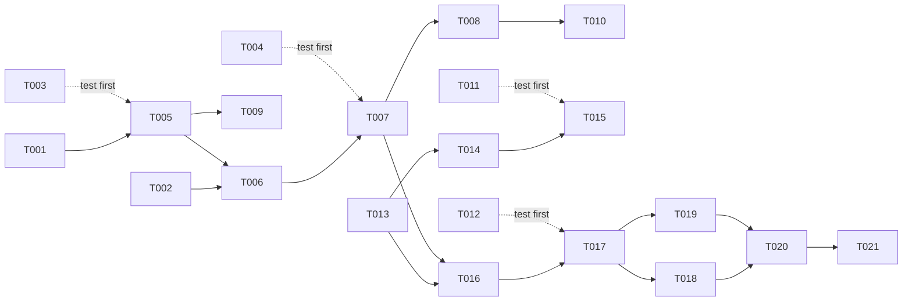

# Tasks: Fixed Interval for /loop

**Input**: Design documents from `specs/012-loop-every-interval/`

**Prerequisites**: plan.md, spec.md, research.md, data-model.md, contracts/loop-command.md, quickstart.md

**Tests**: Included. `plan.md` and research R9 name the checks. Tests must prove properties: generated inputs with a fixed, printed seed, and no copies of the implementation.

**Rules for every task**:
- Do not run build, lint, format, or test commands until Phase 6.
- Line numbers are approximate. Find the code by symbol name.
- Message texts, grammar, and parse results come from `contracts/loop-command.md` and must match it exactly.
- Keep the no-interval behavior exactly as it is today, except for FR-015 to FR-018 (FR-013).

## Format: `[ID] [P?] [Story] Description`

- **[P]**: can run in parallel (different files, no dependency on unfinished tasks)
- **[Story]**: the user story (US1, US2, US3)

---

## Phase 1: Setup

No setup. The feature uses existing packages and test files.

---

## Phase 2: Foundational (blocks all stories)

- [X] T001 In `packages/coding-agent/src/modes/loop-limit.ts`, move the duration grammar out of `takeLoopLimit` into one helper, `takeDuration(firstToken: string, rest: string): { durationMs: number; rest: string } | string | undefined`. The helper covers the spaced form (`10 minutes`: a bare integer followed by a `TIME_UNITS_MS` unit token) and the compound form (`parseCompoundDuration`). It returns `undefined` when the token is not duration-shaped and an error string when the token is duration-shaped but invalid. `takeLoopLimit` keeps its bare-integer count branch and calls `takeDuration` for the rest. Behavior stays the same. The existing `test/loop-limit.test.ts` cases are the check.
- [X] T002 [P] Add `loopIntervalMs?: number;` after `loopLimit?: LoopLimitRuntime;` in the interactive mode context in `packages/coding-agent/src/modes/types.ts` (about line 227). Write a doc comment: "Fixed time between the starts of two `/loop every` runs."

**Checkpoint**: the duration grammar has one owner, and the context type has room for the interval.

---

## Phase 3: User Story 1 - Send a prompt every N minutes (Priority: P1) 🎯 MVP

**Goal**: `/loop every 15m <prompt>` runs the prompt at once. The prompt then runs again 15 minutes after each run starts, and a run does not change the draft in the input box.

**Independent Test**: `/loop every 1m <short prompt>`. The first turn starts at once. Each later turn starts about 1 minute after the start of the turn before it. A draft in the input box stays.

### Tests for User Story 1

- [X] T003 [P] [US1] In `packages/coding-agent/test/loop-limit.test.ts`, add a `describe("every clause")` block:
  - **Property (seeded loop, print the seed on failure):** generate `amount` in 1..999 and a unit from a literal list in the test of all 15 unit spellings: `s sec secs second seconds m min mins minute minutes h hr hrs hour hours`. `TIME_UNITS_MS` is not exported, so do not import it. Generate the compact (`15m`), spaced (`15 minutes`), and two-segment compound (`1h30m`) forms. Optionally add a leading count or duration limit and an optional `--until 'x'`. For each input, `parseLoopArgs` returns `intervalMs` equal to a reference sum of `amount × unit` computed in the test from that literal table. The limit, condition, and prompt `p` also match.
  - **Boundary cases:** add one assertion for each row of the contract "Parse results" table, with the exact error text of that row:
    - `every` gives `every needs a duration, for example /loop every 15m.`
    - `every 15` and `every 1.5h` give `LOOP_USAGE`.
    - `every 0m` gives `Loop duration must be positive.`
    - `every 10x` gives `Loop duration unit must be seconds, minutes, or hours.`
    - `every 15m every 5m` gives `Use only one every.`
    - `every file has a test` gives prompt-only, and `every 15m 2h go` gives prompt `2h go`.
    - Case-insensitive `EVERY 15m` gives an interval.
- [X] T004 [US1] In `packages/coding-agent/test/interactive-mode-loop.test.ts`, add `describe("every interval")`. Use the existing harness: fake timers, `Object.defineProperty(session, "isStreaming", …)`, and the `getUserInput()` resolve list.
  - **Gap property (seeded, print the seed):**
    1. Set `mode.loopModeEnabled = true` and `mode.loopIntervalMs = 60_000`.
    2. Call `mode.setLoopPrompt("tick")`.
    3. For 5 generated turn lengths in 0..59_000 ms, set streaming true, advance the turn length, set streaming false, then call `getUserInput()` and advance to the resolve.
    4. Check that each resolve happens at exactly `previous start + 60_000` (use `Date.now()` under fake timers).
  - **Overrun:** a turn longer than the interval gives exactly one resolve, 800 ms after idle. Advance 10 more intervals with streaming true and check that no resolve happens. Then go idle, and check exactly one resolve.
  - **System sleep:** while waiting for a run due in 15 minutes, call `setSystemTime(new Date(Date.now() + 20 * 60_000))` (import it from `bun:test`. `vi.setSystemTime` does not exist in Bun 1.4.2) with no timer progress, then advance 1_000 ms. Check exactly one resolve. Advance another 15 minutes with streaming true and check no second resolve. Call `setSystemTime()` in `afterEach` to reset the clock.
  - **Draft:** set `mode.editor.setText("draft")` and `mode.editor.pendingImages = [img]` before a run comes due. After the resolve, check that the text is `"draft"` and the image is unchanged.
  - **No interval:** with `loopIntervalMs` undefined, the resolve still comes 800 ms after `getUserInput()` (FR-013).

### Implementation for User Story 1

- [X] T005 [US1] In `packages/coding-agent/src/modes/loop-limit.ts`:
  1. Add `intervalMs?: number` to `ParsedLoopArgs` with a doc comment.
  2. Add `takeLoopInterval(input)`. It runs between `takeLoopLimit` and `takeLoopCondition` in `parseLoopArgs`. It follows research R4 and uses `takeDuration` from T001.
  3. Add the error texts `every needs a duration, for example /loop every 15m.` and `Use only one every.`.
  4. Change `LOOP_USAGE` to `Usage: /loop [count|duration] [every <duration>] [--while|--until '<command>'] [prompt]. Examples: /loop 10, /loop every 15m check CI, /loop 20 --until 'bun test' fix the failing tests. A bare /loop turns loop mode off.`
  5. Export `describeLoopInterval(ms)`, which returns `every ${formatLoopBudget(ms)}`, for example `every 15 minutes`.
- [X] T006 [US1] In `packages/coding-agent/src/modes/interactive-mode.ts`:
  1. Add `loopIntervalMs: number | undefined = undefined;` after `loopCondition` (about line 1365).
  2. Add `#loopRunStartedAt: number | undefined;` near `#loopAutoSubmitTimer` (about line 1395).
  3. Set `#loopRunStartedAt = Date.now()` in `setLoopPrompt` and in `#runLoopIteration` right after `consumeLoopLimitIteration` succeeds, before `#syncLoopModeStatus()` and before the `compact`/`reset` branch (research R2).
  4. Clear it in `pauseLoop` and `disableLoopMode`. Also clear `loopIntervalMs` in `disableLoopMode`.
  5. In the enable path of `handleLoopCommand`, set `this.loopIntervalMs = parsed.intervalMs`. When it is set, add an interval suffix after the limit suffixes: `describeLoopInterval(parsed.intervalMs)` with its first letter in uppercase, plus a period (for example ` Every 15 minutes.`).
- [X] T007 [US1] In `packages/coding-agent/src/modes/interactive-mode.ts`, change `#scheduleLoopAutoSubmit` (about line 3102):
  1. Compute `dueAt`:
     - with no `loopIntervalMs` or no `#loopRunStartedAt`: `Date.now() + 800`
     - otherwise: `Math.max(Date.now() + 800, #loopRunStartedAt + loopIntervalMs)`
  2. Add `#armLoopDueTimer(dueAt: number, callback: () => void)`. It stores a `setTimeout` of `Math.min(1_000, Math.max(0, dueAt - Date.now()))` in `#loopAutoSubmitTimer`. When the timer fires, it re-arms itself until `Date.now() >= dueAt`. Each step returns early unless `loopModeEnabled && !loopModePaused && onInputCallback`.
  3. `#scheduleLoopAutoSubmit` calls `#armLoopDueTimer(dueAt, () => void this.#runLoopIteration(loopAction, prompt))`.
  4. Leave `#deferLoopAutoSubmit` (busy retries, 800 ms) unchanged. `#cancelLoopAutoSubmit` already clears the shared timer field.
- [X] T008 [US1] In `#submitLoopPromptWhenReady` in `packages/coding-agent/src/modes/interactive-mode.ts` (about line 3221), change the call to `this.startPendingSubmission({ text: prompt }, { preserveDraft: true })` (research R5).
- [X] T009 [P] [US1] In `packages/coding-agent/src/slash-commands/builtin-modes.ts`, in the `loop` command (about line 601):
  1. Change `inlineHint` to `[count|duration] [every <duration>] [--while|--until '<cmd>'] [prompt]`.
  2. Rewrite `description` to name `every <duration>` (runs again that long after each run starts). It must say that `/loop` with arguments replaces a running loop and that a bare `/loop` turns loop mode off.
  3. In `getTuiAutocompleteDescription`, add `describeLoopInterval(runtime.ctx.loopIntervalMs)` to `bounds` when the interval is set. Import it from `../modes/loop-limit`.

**Checkpoint**: an interval loop runs on schedule, and runs keep the draft. US1 is shippable alone.

---

## Phase 4: User Story 2 - Combine the interval with the existing bounds (Priority: P2)

**Goal**: The count limit, time limit, `--while`/`--until`, and `loop.mode` act on interval runs the same way that they act on runs with no interval.

**Independent Test**: `/loop 2 every 1m <prompt>` gives the first turn plus 2 runs at 1-minute starts, then "Loop limit reached".

The US1 design routes every due run through `#runLoopIteration`, which already applies these bounds. No source change is expected. If a test in T010 fails, fix the cause in `#runLoopIteration` or `#scheduleLoopAutoSubmit` in `packages/coding-agent/src/modes/interactive-mode.ts`, not in the test.

### Tests for User Story 2

- [X] T010 [US2] In `packages/coding-agent/test/interactive-mode-loop.test.ts`, inside `describe("every interval")`, add:
  - **Count:** `loopLimit = { kind: "iterations", initial: 2, remaining: 2 }` and interval 60 s. After the first prompt and three idle periods, there are exactly 2 resolves at `+60_000` and `+120_000`. Then `loopModeEnabled === false` and `showStatus` got `"Loop limit reached. Loop mode disabled."`.
  - **Time:** `createLoopLimitRuntime({ kind: "duration", durationMs: 3_600_000 })` with a 15-minute interval gives resolves at 15, 30, and 45 minutes. At 60 minutes there is no resolve, loop mode is off, and the time-limit message shows.
  - **Condition timing:** spy `loopCondition.evaluateLoopCondition` to return `continue`, and record `Date.now()` for each call. Check that every call time is a due time (start + interval) and none is the start of the wait.
  - **Compact mode:** with `cfgLoopMode` set to `"compact"`, `handleCompactCommand` runs once for each due run and never during the wait.

**Checkpoint**: the bounds hold for interval loops.

---

## Phase 5: User Story 3 - See and control the schedule (Priority: P3)

**Goal**: The status line shows the interval and the next run time. Esc pauses during the wait. `/loop` with arguments replaces the running loop, and a bare `/loop` turns it off.

**Independent Test**: start `/loop every 15m <prompt>`, then check that the status line shows `every 15m next HH:MM`. Run `/loop every 30m` and check that `next` moves and the prompt stays. Press Esc and check that no run starts.

### Tests for User Story 3

- [X] T011 [P] [US3] In `packages/tui/test/status-line-loop.test.ts`, add cases with `createContext({ state: "running", intervalMs, nextRunAt })`:
  - Both `mode` renderers contain `every <compact interval>` and `next <local HH:MM of nextRunAt>`. Compute the expected time with the same `toLocaleTimeString([], { hour: "2-digit", minute: "2-digit" })` call on a fixed `Date`, not with the renderer.
  - With `state: "paused"`, there is no `next`.
  - With no `intervalMs`, the output equals the current output (no `every`, no `next`).
  - Generated intervals (seeded, print the seed) of whole hours, whole minutes, whole seconds, and mixed `h`+`m`+`s` values render compact text that reads back to the same ms. The test reads the text back with its own literal table (`h` = 3_600_000, `m` = 60_000, `s` = 1_000) and a `/(\d+)([hms])/g` scan. Do not import `parseLoopArgs`, because `packages/tui` does not depend on `@oh-my-pi/pi-coding-agent`.
- [X] T012 [US3] In `packages/coding-agent/test/interactive-mode-loop.test.ts`, add `describe("replace")`:
  - **Keep prompt:** with loop on, prompt `"tick"`, interval 60 s, and the last start at T, `await mode.handleLoopCommand("every 120s")` returns `undefined`, keeps `loopPrompt === "tick"`, and the next resolve is at `T + 120_000`.
  - **New prompt:** `handleLoopCommand("every 30s other")` returns `"other"`, and `loopIntervalMs === 30_000`.
  - **Invalid:** `handleLoopCommand("every 1.5h")` shows the error. `loopModeEnabled`, `loopPrompt`, `loopIntervalMs`, and `loopLimit` do not change, and the pending run still fires at its old time.
  - **Parts cleared:** replacing `3 every 60s --until 'x'` with `every 60s` clears `loopLimit` and `loopCondition`.
  - **Bare:** `handleLoopCommand("")` with loop on turns loop mode off.
  - **Replace during a turn:** with streaming true, `handleLoopCommand("every 120s")` arms no timer, and the last `setLoopModeStatus` call has no `nextRunAt`. When streaming ends and `getUserInput()` runs, the next resolve comes at `last start + 120_000`.
  - **Esc:** `pauseLoop()` during the wait, then advance past the due time: no resolve.
  - **Prompt during the wait (FR-010):** with interval 60 s and the last start at T, call `mode.setLoopPrompt("new")` at `T + 20_000`, then call `getUserInput()`. The next resolve has text `"new"` and comes at `T + 80_000`, not at `T + 60_000`.
  - **Status:** while waiting, `setLoopModeStatus` last got `nextRunAt` equal to the due time. After the due timer fires, during a streaming turn that runs past the interval, and while paused, the last call has no `nextRunAt`.

### Implementation for User Story 3

- [X] T013 [P] [US3] In `packages/tui/src/status-line/types.ts` (about line 112), add `intervalMs?: number;` and `nextRunAt?: number;` (epoch ms) to `loopMode`, with doc comments.
- [X] T014 [US3] In `StatusLine.setLoopModeStatus` in `packages/tui/src/status-line/component.ts` (about line 1138), add `intervalMs` and `nextRunAt` to the equality check, so that a changed due time renders again.
- [X] T015 [US3] In `packages/tui/src/status-line/segments.ts`:
  1. Add `formatLoopInterval(ms)`. It returns compact text (`15m`, `1h30m`, `90s` → `1m30s`), and the output must parse back through the `/loop` grammar.
  2. In both `renderMainMode` (about line 633) and `describeMainMode` (about line 666), after the state label, push `every ${formatLoopInterval(loop.intervalMs)}` when it is set. Push `next ${new Date(loop.nextRunAt).toLocaleTimeString([], { hour: "2-digit", minute: "2-digit" })}` when `nextRunAt` is set and the state is not paused. The limit and condition parts follow.
- [X] T016 [US3] In `packages/coding-agent/src/modes/interactive-mode.ts`:
  1. In `#syncLoopModeStatus` (about line 3328), add `intervalMs: this.loopIntervalMs` and `nextRunAt: this.#loopNextRunAt`.
  2. Add `#loopNextRunAt: number | undefined` near `#loopRunStartedAt`. `#armLoopDueTimer` sets it to `dueAt`, and syncs, at each 1-second step when it differs and `!this.#isAutoSubmitBlocked()`. A timer armed during a turn (a replace, or `armLoopAutoSubmit` after a compaction-queued prompt) therefore shows `next` on the first idle step. Clear it, and sync, in the due-timer callback before that callback calls `#runLoopIteration`. Also clear it in `#cancelLoopAutoSubmit` (which pause, disable, and `setLoopPrompt` call). In `setLoopPrompt`, call `#cancelLoopAutoSubmit()`, because a user prompt replaces the armed run. Never compute `nextRunAt` from `#loopRunStartedAt` during a turn, so the status line never shows a time in the past.
  3. Leave keys out when they are undefined, so that the existing `toHaveBeenLastCalledWith` assertions in "reports waiting, running, paused…" still match.
- [X] T017 [US3] In `handleLoopCommand` in `packages/coding-agent/src/modes/interactive-mode.ts` (about line 3391), split the cases as research R6 and the contract "Behavior" table describe:
  1. Loop on and `args.trim()` empty: call `disableLoopMode()`.
  2. Loop on with args: run `parseLoopArgs` first. On error, call `showError` and return. Otherwise:
     - Set `loopLimit = createLoopLimitRuntime(parsed.limit)`, `loopCondition = parsed.condition`, and `loopIntervalMs = parsed.intervalMs`.
     - Call `#abortLoopCondition()` and `#cancelLoopAutoSubmit()`, then `#syncLoopModeStatus()`.
     - Show `Loop updated.` with the same limit, interval, and condition suffixes as the enable message.
     - If `parsed.prompt` is set, return it.
     - Else, call `#scheduleLoopAutoSubmit()`. It does nothing while paused (no prompt). During a turn the due timer stays hidden (see T016), and `getUserInput()` re-arms it with the new interval when the turn ends.
  3. Loop off: keep the current enable path, including the speckit-auto check.

**Checkpoint**: all three stories work on their own.

---

## Phase 6: Polish & Cross-Cutting Concerns

- [X] T018 [P] In `packages/coding-agent/CHANGELOG.md` under `## [Unreleased]`:
  - Under `### Added`, add the `/loop every <duration>` entry. Give one example, state that the interval counts from each run start, and say that the status line shows `next HH:MM`.
  - Under `### Changed`, add: `/loop` with arguments replaces a running loop, and a bare `/loop` turns it off.
  - Under `### Fixed`, add: a `/loop` run no longer clears the draft text or attachments in the input box.
- [X] T019 [P] In `UPSTREAM_DIVERGENCES.md`, add the entry `### /loop fixed interval and replace`. Use the existing fields: Decision, Behavior, Why, Key paths, Checks, Retire when. Cover `every`, FR-015 (draft), and FR-016 to FR-018 (replace). List the key paths from plan.md and the checks from T003, T004, T010, T011, and T012.
- [X] T020 Run the automated checks in `specs/012-loop-every-interval/quickstart.md` (steps 1-4):
  1. Run `bun test packages/coding-agent/test/input-controller-escape.test.ts packages/coding-agent/test/input-controller-skill-queue.test.ts packages/coding-agent/test/compaction-flush-loop.test.ts packages/coding-agent/test/loop-condition.test.ts packages/coding-agent/test/interactive-mode-speckit-auto.test.ts`.
  2. Run `bun check` for formatting, lint, and types.
  3. Fix any regression at its cause.
- [X] T021 Run the 9 manual TUI checks in `specs/012-loop-every-interval/quickstart.md` against the real `omp` TUI. Use `xd://tui` or a live terminal, and record the observed result for each row.

---

## Dependencies & Execution Order

- **Phase 2** blocks every story.
- **US1** is the base. US2 is tests only, on top of US1. US3 needs T007 (due time) for `nextRunAt` and for the replace re-arm.
- In one file, tasks run in order. T006, T007, T008, T016, and T017 all edit `interactive-mode.ts`, so they run one after another.

## Parallel Opportunities

- T001 ∥ T002 (different files).
- US1: T003 ∥ T004 (different test files). T009 ∥ T006–T008 after T005.
- US3: T011 ∥ T012 (different test files). T013 to T015 (the `tui` package) ∥ T016 and T017 (the `coding-agent` package).
- Polish: T018 ∥ T019.

Example batch after Phase 2:
- **Agent A:** T003, then T005, then T009.
- **Agent B:** T004, then T006 to T008, after T005 is done.
- **Agent C:** T011, then T013 to T015.

## Implementation Strategy

1. **MVP:** finish Phase 2 and US1 (T001–T009). Run T003 and T004 green. `/loop every 15m <prompt>` then works, and drafts stay.
2. **Next:** add US2 (T010). These are bounds tests only.
3. **Next:** add US3 (T011–T017). This adds the status line and replace.
4. **Finish:** do Phase 6 once, at the end.
