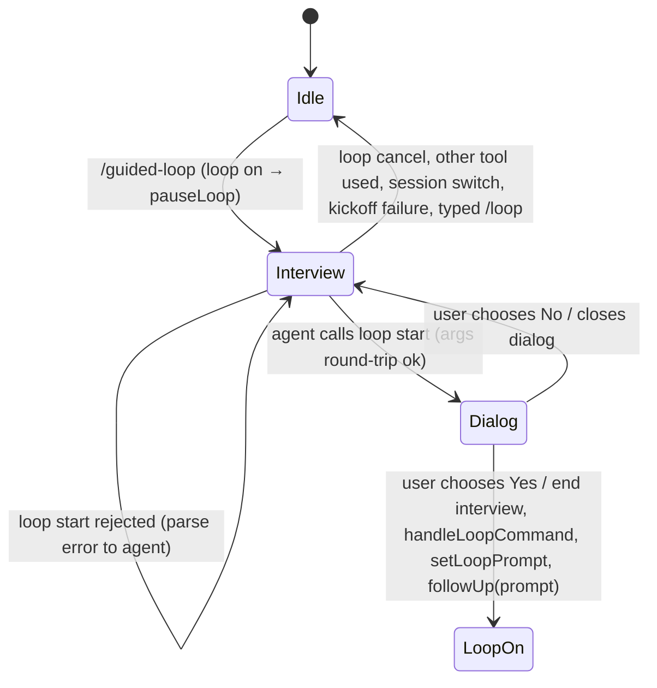

# Data Model: Guided Loop Setup

All state is in memory for the life of the session. Nothing is saved (spec Assumptions).

## Interview state (`InteractiveMode`, `src/modes/interactive-mode.ts`)

| Field | Type | Change | Rule |
|---|---|---|---|
| `#guidedLoopInterviewActive` | `boolean` | **new** | True from `#beginGuidedLoopInterview()` until `#endGuidedLoopInterview()` (research R6). |
| `interviewActive` | `boolean` | **renamed** from `goalInterviewActive` | True while a `/guided-goal` or `/guided-loop` interview waits for an answer. The IDE reads it as `needs-input` (FR-013). |
| `isGuidedLoopInterviewActive()` | `() => boolean` | **new**, on `InteractiveModeContext` | Returns `#guidedLoopInterviewActive`. The input controller reads it (FR-009). |

## Loop setup (tool input, `src/tools/loop.ts`)

| Field | Type | Rule |
|---|---|---|
| `op` | `"start" \| "cancel"` | Required. |
| `prompt` | `string?` | Required and not blank for `start`. May hold newlines. |
| `limit` | `string?` | A count (`10`) or a duration (`2h`, `90 minutes`), in the `/loop` grammar. |
| `every` | `string?` | A duration in the `/loop` grammar. |
| `while` / `until` | `string?` | A shell command. Not both. |

**Validation (research R3):** The tool builds `args` and requires that `parseLoopArgs(args)` round-trips: same prompt, and a limit, an interval, and a condition exactly when the input has them.

## Handler slot (`AgentSession`, `ToolSession`)

| Member | Type | Rule |
|---|---|---|
| `LoopStartHandler` | `(request: { op: "start"; args: string; signal?: AbortSignal } \| { op: "cancel" }) => Promise<"started" \| "declined" \| "cancelled">` | **new** type, beside `PlanProposalHandler` in `src/tools/resolve.ts`. |
| `peekLoopStartHandler()` | `() => LoopStartHandler \| undefined` | Defined only while a guided-loop interview runs. `isToolAllowed("loop")` reads it. |
| `setLoopStartHandler(handler \| null)` | | The setter wraps the handler in `waitForUser`. |

## State transitions

`Idle` keeps the state of the loop before the interview. A loop that the interview paused stays paused with its limit, interval, and condition. A paused loop has no prompt (`pauseLoop` clears it), so the next user prompt resumes it, as before this feature.
