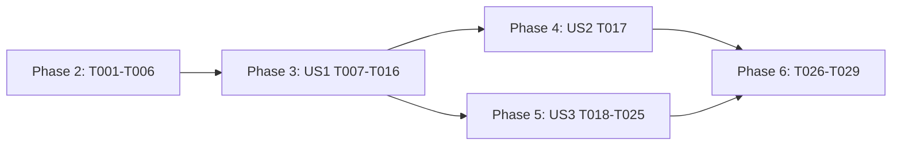

---

description: "Task list for /guided-loop"
---

# Tasks: Guided Loop Setup

**Input**: Design documents from `specs/013-guided-loop/`

**Prerequisites**: plan.md, spec.md, research.md, data-model.md, contracts/guided-loop.md, quickstart.md

**Tests**: The repo rules (`AGENTS.md`) require tests that prove properties. Test tasks are included. They use a seeded generator, print the seed on failure, and never copy the code under test.

**Organization**: Tasks are grouped by user story. All paths are relative to `packages/coding-agent/` unless they start with `packages/`, `specs/`, or `UPSTREAM_DIVERGENCES.md`. Line numbers are approximate. Search for the named symbol.

## Format: `[ID] [P?] [Story] Description`

- **[P]**: Can run in parallel (different files, no dependency on an unfinished task)
- **[Story]**: The user story that the task belongs to (US1, US2, US3)

---

## Phase 1: Setup

No setup is needed. The feature adds no dependency, setting, or package.

---

## Phase 2: Foundational (blocks all stories)

- [X] T001 [P] In `src/tools/loop.ts` (moved from `src/tools/resolve.ts`: the types belong with the tool), export `type LoopStartRequest = { op: "start"; args: string; signal?: AbortSignal } | { op: "cancel" }` and `type LoopStartHandler = (request: LoopStartRequest) => Promise<"started" | "declined" | "cancelled">`. Add a doc comment: InteractiveMode installs the handler only while a `/guided-loop` interview runs.
- [X] T002 In `src/session/agent-session.ts`, beside `peekPlanProposalHandler` / `setPlanProposalHandler` (about lines 3226-3237), add a `#loopStartHandler` field, `peekLoopStartHandler(): LoopStartHandler | undefined`, and `setLoopStartHandler(handler: LoopStartHandler | null): void`. The setter wraps the handler in `this.waitForUser(() => handler(request))`, in the same way as the plan setter, so that the dialog counts as a user wait (research R2).
- [X] T003 In `src/tools/index.ts`:
  1. Add `peekLoopStartHandler?(): LoopStartHandler | undefined` and `setLoopStartHandler?(handler: LoopStartHandler | null): void` to `ToolSession`, next to the plan-proposal members (about lines 505-507).
  2. In `isToolAllowed` (about line 741), add `if (name === "loop") return !restrictToolNames && session.peekLoopStartHandler?.() !== undefined;`.
  3. Add `loop: s => new LoopTool(s)` to `HIDDEN_TOOLS` (about line 591).
- [X] T004 [P] In `src/tools/builtin-names.ts` (about line 36), add `"loop"` to `HIDDEN_TOOL_NAMES`.
- [X] T005 In `src/sdk.ts`:
  1. Wire `peekLoopStartHandler: () => session.peekLoopStartHandler()` and `setLoopStartHandler: handler => session.setLoopStartHandler(handler)` next to the plan-proposal wiring (about lines 2509-2510).
  2. Pre-register the `loop` tool in the tool registry next to the eager `goal` registration (about lines 3594-3601), so that `setActiveToolsByName([... , "loop"])` finds it. Register it always, because the `isToolAllowed` gate controls it.
  3. Keep `loop` out of the first active tool set, as the `goal` filter does (about line 4211).
- [X] T006 Rename the public `goalInterviewActive` to `interviewActive` everywhere, with no alias (research R9). Change the field and its comment in `src/modes/interactive-mode.ts` (about line 1358) and every write (about lines 5605, 5781, 6281, 7409). Change the context member and its doc in `src/modes/types.ts` (about lines 652-653) to "True while a `/guided-goal` or `/guided-loop` interview waits for an answer". Change the readers in `src/modes/controllers/event-controller.ts` (about lines 1480 and 2976), `src/modes/controllers/extension-ui-controller.ts` (about line 1574), `src/modes/controllers/session-focus-controller.ts` (about line 254), and `#updateSpeckitAutoStatus` and the idle publish in `interactive-mode.ts` (about lines 3558 and 6490). Change every test that sets or reads the old name.

**Checkpoint**: `bun check:ts` passes. The `loop` tool name exists, but no handler is installed, so no session offers the tool.

---

## Phase 3: User Story 1 - Set up a loop through a short interview (Priority: P1) 🎯 MVP

**Goal**: `/guided-loop` interviews the user. The agent calls `loop`, the user chooses Yes in the dialog, and the loop starts with the confirmed setup.

**Independent Test**: Quickstart manual rows 1-5.

### Tests for User Story 1

- [X] T007 [P] [US1] Create `test/tools/loop-tool.test.ts`. Use `test/goals/goal-tool.test.ts` as the model for building the tool with a fake `ToolSession`.
  - **Round-trip property (seeded, print the seed):**
    1. Generate setups from these parts:
       - limit: none, a count 1..99, or a duration from a literal list (`30m`, `2h`, `90 minutes`).
       - every: none, or a duration from a literal list (`15m`, `1h30m`, `45s`).
       - condition: none, `while`, or `until`, with commands from a literal list that holds spaces, `'`, `"`, and `&&`.
       - prompt: a plain sentence, a sentence with a newline, or a hazard prompt that starts with `3 `, `-- `, or `every 5m `.
    2. Install a fake handler that records its `args` and returns `"started"`.
    3. When the handler was called, `parseLoopArgs(args)` gives the same prompt. It also has a limit, an interval, and a condition exactly when the setup has them, and the condition command equals the input command.
    4. When the handler was not called, the result text starts with `This setup does not parse as /loop`.
    5. A hazard prompt is never accepted when its matching field is absent. For example, prompt `3 checks` with no limit is rejected.
  - **Boundary rows:** check one assertion for each row of the tool table in `specs/013-guided-loop/contracts/guided-loop.md`, with its exact result text. These rows are a blank prompt, `while` with `until`, no handler, `declined`, `started`, and `cancel`.
- [X] T008 [P] [US1] Create `test/guided-loop.test.ts`. Use the harness of `test/goals/guided-goal.test.ts` (the kickoff delivery and the fake session). Cover:
  - **Kickoff:** `handleGuidedLoopCommand("check CI")` sends one synthetic prompt with `displayText: "/guided-loop check CI"` and `userInitiated: true`. While streaming, it uses `followUp`. The rendered kickoff contains the rough idea.
  - **Begin:** after the kickoff, `isGuidedLoopInterviewActive()` is true, `interviewActive` is true, `session.peekLoopStartHandler()` is defined, and `loop` is in the active tool names.
  - **Yes:** stub `showHookConfirm` to return true, and call the installed handler with `{ op: "start", args: "2 every 1m check CI" }`. It returns `"started"`. Loop mode is on with 2 iterations, a 60 000 ms interval, and `loopPrompt === "check CI"`. `session.followUp` got `"check CI"` once. `showStatus` got `/loop 2 every 1m check CI`. The interview has ended (all four Begin facts are false or absent).
  - **No:** stub `showHookConfirm` to return false. The handler returns `"declined"`. The loop state is unchanged, nothing was queued, and the interview is still active.
  - **Dialog options:** the stub records its arguments. The title is `Start this loop?`, the message starts with `/loop 2 every 1m check CI`, and the options have `initialIndex: 1` and the request `signal`. With a paused loop that has a limit of 5, the message also has a `This replaces the current loop (…)` line that names the limit.
  - **Speckit refusal:** under speckit-auto mode, the command returns false and sends nothing.

### Implementation for User Story 1

- [X] T009 [P] [US1] Create `src/prompts/tools/loop.md`, the tool description. Say that the tool exists only during a `/guided-loop` interview, and describe each field in `/loop` terms. Say that `op: "start"` shows the user a yes/no dialog, so the agent must not ask for a separate confirmation in the chat. Say that `op: "cancel"` ends the interview when the user declines or asks to stop. Use the style of `src/prompts/tools/goal.md`.
- [X] T010 [P] [US1] Create `src/prompts/loop/guided-loop-interview.md`, the kickoff. Use the style and the `{{#if initial}}` block of `src/prompts/goals/guided-goal-interview.md`. Rules:
  - Ask exactly one short question for each reply. Use no tools and do no other work while interviewing.
  - Settle the prompt to repeat, how often (after each turn, or `every <duration>`), and the stop rule (count, time limit, `--while` / `--until` command, or none). Aim for 6 questions or fewer.
  - Keep every constraint and stop rule that the user states. Suggest real project commands for conditions, but let the user decide. Never run the condition command.
  - If the user gives no stop rule, warn once that the loop runs until a bare `/loop` and uses tokens on each run. Then accept the answer (FR-003a).
  - Write the repeated prompt as a self-contained instruction. It says what to check, what to do, and what to report on each run, and it does not depend on this chat (FR-004a).
  - Finish with `loop` `op: "start"`. If the user chooses No, ask what to change. If the user declines or abandons the interview, call `loop` `op: "cancel"`.
- [X] T011 [US1] Create `src/tools/loop.ts` with `class LoopTool`. Use `src/goals/tools/goal-tool.ts` as the model for the class shape, the `strict` schema, the `approval`, and the description loading.
  1. The schema has `op: "start" | "cancel"` and the optional `prompt`, `limit`, `every`, `while`, and `until` (all strings).
  2. For `start`, check the fields in the order of the contract table. Then build `args` = `[limit] [every <every>] [--while|--until '<cmd>'] <prompt>`, and quote the command in POSIX single quotes (`'` → `'\''`).
  3. Run `parseLoopArgs(args)` from `src/modes/loop-limit.ts`, and require the round trip from research R3.
  4. Call `this.#session.peekLoopStartHandler?.()` with `{ op: "start", args, signal }`, where `signal` is the tool's abort signal. Map each result to the contract text.
  5. Add the `ponytail:` comment from research R4 at the `started` text.
- [X] T012 [US1] In `src/modes/interactive-mode.ts`, add the interview state beside `#guidedGoalInterviewActive` (about line 1733):
  1. `#guidedLoopInterviewActive = false`, and the public `isGuidedLoopInterviewActive()` beside `isGuidedGoalInterviewActive()` (about line 9739).
  2. `async #beginGuidedLoopInterview()`. It sets the flag and `interviewActive`, calls `this.session.setLoopStartHandler(request => this.#handleLoopStartRequest(request))`, and adds `"loop"` to the active tools with `setActiveToolsByName` when it is missing.
  3. `async #endGuidedLoopInterview()`. It returns when the flag is false. Otherwise it clears the flag and `interviewActive`, calls `setLoopStartHandler(null)`, and removes `"loop"` from the active tools.
  4. `async #handleLoopStartRequest(request)`. For `cancel`, end the interview and return `"cancelled"`. For `start`, follow research R4 steps 1-6 exactly: the dialog message with the replace line, `{ initialIndex: 1, signal: request.signal }`, then `handleLoopCommand(args)`. Never write loop fields directly.
- [X] T013 [US1] In `src/modes/interactive-mode.ts`, add `async handleGuidedLoopCommand(rest?, input?, displayText = rest?.trim() ? \`/guided-loop ${rest.trim()}\` : "/guided-loop"): Promise<boolean>` after `handleGuidedGoalCommand` (about line 7441). Import the kickoff prompt beside the guided-goal import (about line 132).
  1. Refuse with `#warnSpeckitAutoBlocks()` first.
  2. Refuse while `isGuidedGoalInterviewActive()`, with `showWarning("Finish the guided goal interview first.")`.
  3. If `loopModeEnabled && !loopModePaused`, call `pauseLoop()`.
  4. Call `#beginGuidedLoopInterview()`.
  5. Send the kickoff in the same way as `handleGuidedGoalCommand` (about lines 7416-7434).
  6. In the `catch` block, call `#endGuidedLoopInterview()`, show the error, and return false.
- [X] T014 [US1] In `src/modes/types.ts`, add `handleGuidedLoopCommand(rest?, input?, displayText?): Promise<boolean>` and `isGuidedLoopInterviewActive(): boolean` beside the guided-goal members (about lines 626-632).
- [X] T015 [US1] In `src/slash-commands/builtin-modes.ts`, add a `guided-loop` entry after `guided-goal` (about line 600). Copy that entry. Use icon `"loop"`, the description and hint from the contract, the autocomplete text `"Guided loop: blocked by speckit-auto mode"` under speckit-auto mode, and `handleTui` with `runWithDetachedModeDraft(...)` → `runtime.ctx.handleGuidedLoopCommand(command.args || undefined, runtime.input, command.text)`.
- [X] T016 [US1] In `src/modes/controllers/input-controller.ts`, add `"guided-loop"` to the `draftDetached` mode list (about lines 1146-1149). Also change the comment at about line 1200 to name it.

**Checkpoint**: T007 and T008 pass. `/guided-loop` runs end to end with Yes and No.

---

## Phase 4: User Story 2 - Learn the command for next time (Priority: P2)

**Goal**: The transcript keeps a valid `/loop` line that gives the same setup when the user types it later.

**Independent Test**: Quickstart manual row 4. Copy the `/loop` line, turn loop mode off, and run the line. The status line shows the same setup.

- [X] T017 [US2] In `test/tools/loop-tool.test.ts`, extend the T007 property. For each accepted setup, apply `"/loop " + args` with `parseSlashCommand` from `src/slash-commands/helpers/parse.ts`, then `parseLoopArgs(command.args)`. The result equals the result of `parseLoopArgs(args)`. This proves that the shown line survives the slash-command parser, including newlines in the prompt (SC-004).

US2 needs no new production code. T012 step 4 (`showStatus("/loop " + args)`) and T011 (the round trip) provide it.

**Checkpoint**: T017 passes.

---

## Phase 5: User Story 3 - Leave the interview (Priority: P3)

**Goal**: An interview that ends without Yes never starts a loop, never revives an old loop, and never leaves the `loop` tool active.

**Independent Test**: Quickstart manual rows 6-8.

### Tests for User Story 3

- [X] T018 [P] [US3] In `test/guided-loop.test.ts`, add `describe("leave")`. For each end point, check the "ended" facts: the flag is false, `interviewActive` is false, there is no handler, and `loop` is not in the active tools. The end points are:
  - **cancel:** the handler with `{ op: "cancel" }` returns `"cancelled"`, and no loop starts.
  - **Other tool:** emit an `agent_end` with an assistant tool call named `read`. The interview ends.
  - **Only `loop`:** an `agent_end` whose only tool call is `loop` keeps the interview active (FR-010).
  - **Session switch:** the session-switch path ends the interview.
  - **Kickoff failure:** make `session.prompt` throw a non-busy error. The command returns false, and the interview has ended.
  - **Typed `/loop`:** `handleLoopCommand("every 2m hi")` during the interview ends it and then turns the loop on.
- [X] T019 [P] [US3] In `test/guided-loop.test.ts`, add `describe("old loop")`:
  - Loop on with prompt `"tick"`, a limit of 5, and a 2-minute interval. `/guided-loop` pauses it.
  - `setLoopPrompt("an answer")` during the interview leaves `loopPrompt` undefined and the loop paused.
  - After `cancel`, the loop is still paused with the same `loopLimit`, `loopIntervalMs`, and `loopCondition`.
  - A second case: Yes with `args: "every 30s new"` replaces the setup, and `loopPrompt === "new"`.
  - A third case: with the loop paused by the interview, submit a bare `.` through the input controller. It reaches the agent as an answer, `loopPrompt` stays undefined, and no loop run starts (FR-009, FR-011a). Covered by the `setLoopPrompt` guard case above plus the `.` case in `test/input-controller-keybindings.test.ts`, and checked in the real TUI (quickstart row 6).
- [X] T020 [P] [US3] In `test/input-controller-keybindings.test.ts`, next to the bare-`c` interview case (about line 812), add the guided-loop case. With `isGuidedLoopInterviewActive` mocked to true, both `c` and `.` reach `onInputCallback` as text. With both interviews inactive, `.` and `c` keep their continue behavior. Add `isGuidedLoopInterviewActive` to the mocks at about lines 151 and 275.
- [X] T021 [P] [US3] In `test/interactive-mode-speckit-auto.test.ts` (about lines 1102-1105), add the guided-loop cases. Speckit-auto turn-on during a guided-loop interview shows `Finish the guided loop interview first.`. `/guided-loop` under speckit-auto mode is refused. Update the expected warning count.

### Implementation for User Story 3

- [X] T022 [US3] In `src/modes/interactive-mode.ts`, add the guards from research R5:
  1. Make `if (this.#guidedLoopInterviewActive) return;` the first line of `setLoopPrompt` (about line 3415).
  2. Make `await this.#endGuidedLoopInterview();` the first line of `handleLoopCommand` (about line 3455).
- [X] T023 [US3] In `src/modes/interactive-mode.ts`, add the end points from research R6:
  1. In the `agent_end` handling (about lines 5615-5617), end the guided-loop interview when an assistant tool call is not named `loop`.
  2. At the session switch (about line 5816), call `#endGuidedLoopInterview()`.
- [X] T024 [US3] In `src/modes/interactive-mode.ts`, add the blocks from research R7:
  1. In `handleGuidedGoalCommand` (about line 7378), refuse while `#guidedLoopInterviewActive` with `showWarning("Finish the guided loop interview first.")`.
  2. In `#speckitAutoBlocker` (about lines 3674-3680), return `"loop"` while `isGuidedLoopInterviewActive()`.
  3. In `#turnOnSpeckitAuto` (about lines 3683-3698), show `Finish the guided loop interview first.` for that case.
- [X] T025 [US3] In `src/modes/controllers/input-controller.ts` (about line 1110), change the shortcut guard as research R8 describes.

**Checkpoint**: T018-T021 pass. All three stories work.

---

## Phase 6: Polish & Cross-Cutting Concerns

- [X] T026 [P] In `CHANGELOG.md` under `## [Unreleased]` / `### Added`, describe `/guided-loop`: the chat interview, the yes/no dialog with the `/loop` line, and the replacement of a loop that is already on. In `### Changed`, note that `c` and `.` are answers during a guided-loop interview.
- [X] T027 [P] In `UPSTREAM_DIVERGENCES.md`, add the entry `### /guided-loop`. Use the existing fields: Decision, Behavior, Why, Key paths, Checks, Retire when. List the hidden `loop` tool, the `LoopStartHandler` slot, the `interviewActive` rename, and the `setLoopPrompt` guard.
- [X] T028 Run the automated checks in `specs/013-guided-loop/quickstart.md` (steps 1-4). Fix any regression at its cause.
  - `bun check:ts` exit 0. `omp --smoke-test` exit 0 (`smoke-test: ok`). Feature tests: 192 pass, 0 fail.
  - Full `coding-agent` suite: the failing files, run with the six changed test files, give the same 8 failures with and without this change (5 Cursor `No API key`, copilot baseUrl, parked subagent, npm min-release-age). The other full-suite failures pass in that run.
  - Fixed at the cause: a goal event or goal start during a loop interview cleared `interviewActive`. Test: `leave > a goal that starts during the interview keeps it` (fails without the fix).
- [X] T029 Run the 8 manual TUI checks in `specs/013-guided-loop/quickstart.md` against the real `omp` TUI with `xd://tui`. Record the result of each row.
  - Model: `anthropic/claude-haiku-4-5`, session `gl3`, current code.
  - Row 1: pass. One question ("How often should this run…"), no tool call.
  - Row 2: pass. One more question, then the dialog with `/loop 2 every 1m Check whether README.md has a title…`, No selected first.
  - Row 3: pass. Enter on No gave `The user declined this loop. Ask what to change.`. No loop started (no loop status), and the agent asked "What would you like to change?".
  - Row 4: pass. The `/loop 2 every 1m …` line and `Loop mode enabled. …` show as separate transcript lines. The first run started at once. The status line showed `every 1m next 07:43 AM 2/2`. An earlier run found that the enable message overwrote the `/loop` line. Fixed by `this.lastStatus = undefined`. The Yes test checks the rendered transcript.
  - Row 5: pass. Runs at 07:42:43 (first), 07:43:42, and 07:44:42, then `Loop limit reached. Loop mode disabled.`.
  - Row 6: pass. The status line showed `Loop paused every 2m`. `c` went to the agent as an answer, and no old-loop run started.
  - Row 7: pass. "never mind" led to `loop` `op: "cancel"` and `Guided loop interview ended. No loop started.`. The status line still showed `Loop paused every 2m`. A later typed prompt resumes the paused loop with that prompt, which is the existing `/loop` behavior.
  - Row 8: pass. `Warning: Finish the guided loop interview first.`.

---

## Dependencies & Execution Order

- T001 and T004 have no dependency. T002 needs T001. T003 needs T001 and T011 (for the `LoopTool` import). Write T011 before T003 step 3, or do them together. T005 needs T002 and T003. T006 has no dependency.
- In US1, T009, T010, T007, and T008 can start at once. T011 needs T009. T012 needs T002. T013 needs T010 and T012. T014 and T015 need T013.
- US2 (T017) extends T007.
- US3 needs T012 and T013.

## Parallel Examples

- **Phase 2:** T001, T004, and T006 at the same time.
- **US1:** T007, T008, T009, and T010 at the same time. Then T011 and T012.
- **US3:** T018, T019, T020, and T021 at the same time. Then T022-T025 in `interactive-mode.ts` and `input-controller.ts`, one after the other.
- **Polish:** T026 and T027 at the same time.

## Implementation Strategy

1. **MVP:** Phase 2 and US1 (T001-T016). `/guided-loop` then works with Yes and No.
2. **Next:** US2 (T017). This is one property test, with no production code.
3. **Next:** US3 (T018-T025). This adds the old-loop guard, the clean end points, and the blocks.
4. **Finish:** Phase 6, once.

## Phase 7: Convergence

- [X] T030 Keep the `loop` tool inactive while no loop-start handler is installed, also when a goal, plan, or impl-review tool snapshot taken during an interview is restored, per FR-006a (partial)
- [X] T031 Start the first run's interval clock when that run starts, not at the `loop` tool call, and remove the `ponytail:` ceiling in `src/tools/loop.ts`, per FR-007 (partial)
- [X] T032 Align spec wording with the code and plan: the edge case at spec.md:76 (only speckit-auto mode refuses), the `loop` tool name (T1), the typed `/loop` end point in FR-010 (U2), `/guided-loop` during an interview (U3), TUI-only availability (U4), SC-005 renames (C1), and hand-checked SC-001/FR-002 (A1), per Edge Cases (contradicts)
