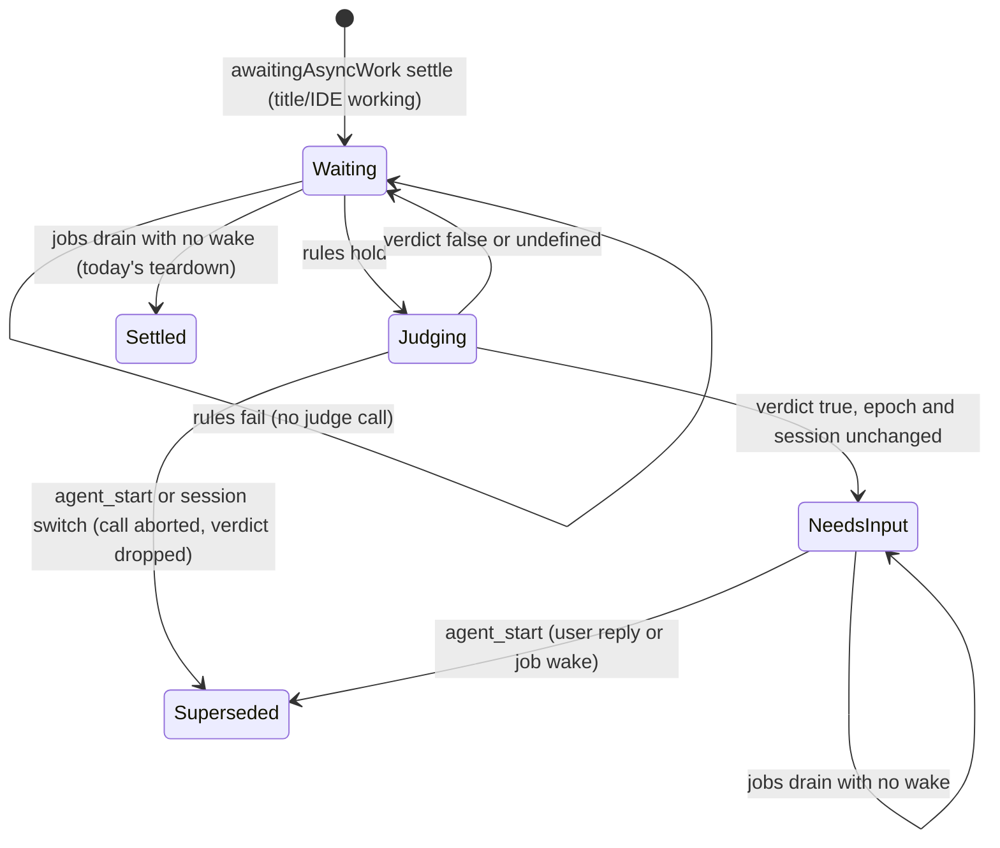

# Data Model: Judge Whether a Turn Needs the User While Background Jobs Run

All state is in memory in the TUI `EventController`. Nothing is saved to disk.

## Settle with running jobs

A non-terminal `agent_end` event that the TUI gets for the main session.

| Field | Source | Rule |
|---|---|---|
| `event.awaitingAsyncWork` | `AgentSession` | MUST be `true`. |
| Last assistant message | `event.messages` | `stopReason === "stop"`, with no tool call. |
| Running owned jobs | `session.hasRunningAsyncJobs()` | MUST be `true`. |
| Pending delivery | `session.hasPendingAsyncDelivery()` | MUST be `false`. |
| View | `ctx.viewSession === ctx.session` | Main session only. |
| Speckit-auto | `ctx.speckitAutoRunActive` | MUST be `false` (FR-008). |

If one rule fails, OMP makes no judge call (SC-004).

## Judge input

| Field | Value |
|---|---|
| `message` | The visible text of the last assistant message. |
| `request` | The newest operator request text (`operatorTitleText`), cut to 2000 characters. It is absent when no request exists. |

## Input verdict

`true` (needs input), `false` (does not need input), or `undefined` (no answer: no judge model, an error, an abort, or the 15-second timeout).

The controller keeps the verdict only as `#needsInputEpoch`: the run epoch of the settle that got a `true` verdict.

## State transitions

- **Waiting**: the behavior of today. The status is `working`, and `#finishWhenRunSettles` watches the jobs.
- **NeedsInput**: `#needsInputEpoch === #runEpoch`. The settled teardown ran once: the loader stopped, the run status is `done`, the IDE state is `needs-input`, and the notification fired. `ctx.jobWaitNeedsInput` is `true`.
- **Superseded**: a new run owns the status. `#needsInputEpoch` no longer matches, so `ctx.jobWaitNeedsInput` is `false`.

## Speckit-auto hold

No new state. `SpeckitRun.hold` with `kind: "user"` comes from the existing judge `waits` answer. While a hold exists, `#updateSpeckitAutoStatus` publishes the settled state even when async work is pending.
