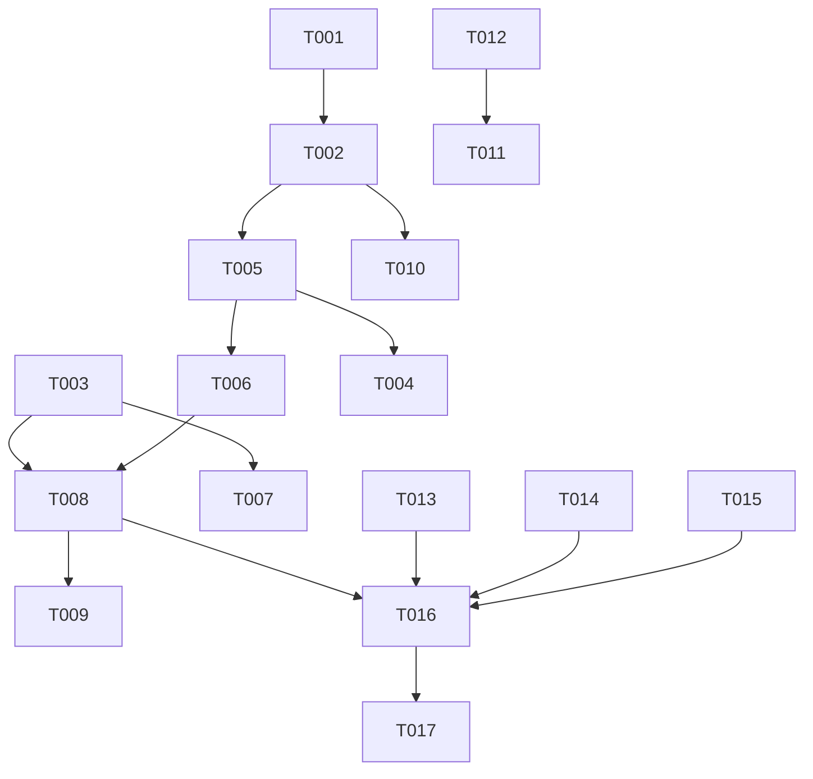

---

description: "Task list for the job settle judge"
---

# Tasks: Judge Whether a Turn Needs the User While Background Jobs Run

**Input**: Design documents from `specs/014-job-settle-judge/`

**Prerequisites**: plan.md, spec.md, research.md, data-model.md, contracts/job-settle-judge.md, quickstart.md

**Tests**: The repo rules (`AGENTS.md`) require tests that prove properties. Test tasks are included. They use tables of inputs, state the property, and never copy the code under test or check prompt text.

**Organization**: Tasks are grouped by user story. All paths are relative to `packages/coding-agent/` unless they start with `packages/`, `specs/`, or `UPSTREAM_DIVERGENCES.md`. Line numbers are approximate. Search for the named symbol.

## Format: `[ID] [P?] [Story] Description`

- **[P]**: Can run in parallel (different files, no dependency on an unfinished task)
- **[Story]**: The user story that the task belongs to (US1, US2, US3)

---

## Phase 1: Setup

No setup is needed. The feature adds no dependency, setting, or package.

---

## Phase 2: Foundational (blocks US1 and US2)

- [X] T001 [P] Create `src/prompts/judge/needs-user.json` in the format of `src/prompts/judge/unexpected-stop.json`, with one question `needsUser` (research R2, contract "Judge question").
  - `instructions`: the state holds the assistant's final `message` for this turn and, when known, the user's `request`. The agent's own background jobs still run. Answer yes when the message asks the user a question, asks for a decision or an approval, or asks the user to do something before the agent can go on, also when that request comes at the end of a long status report. Answer no when the message only reports status, promises to report later, or states the agent's own next step after the jobs end. A running job or watcher does not change the answer.
  - `criteria.true`: a bulleted list. It includes the status report from the spec clarifications that ends with "To start the E6 E7 pair, reply with approval of the two sha256 values above. I will then write approved_by into each frozen file, add a LEDGER line, and run launch.sh for each protocol.", and "The server is up. Must I run the migration now?".
  - `criteria.false`: a bulleted list. It includes "Next action: when the first E6 Runs finish, I will check their cost and their errors." and "Tests run in the background. I will report when they finish.".
- [X] T002 In `src/session/unexpected-stop-classifier.ts` (research R2, contract "Classifier"). Done with one change: `judgeYes` also takes the question id (`"stopped"`, `"needsUser"`), because the id goes on the wire to TypeSafe judges.
  1. Import the new file as `needsUserFile` and build `NEEDS_USER_QUESTIONS = judgeQuestions(needsUserFile)`.
  2. Move the body of `classifyUnexpectedStop` (about lines 83-112) into a private `async function judgeYes(purpose: string, question: NoulQuestion, turn: UnexpectedStopTurn, deps: ClassifyUnexpectedStopDeps): Promise<boolean | undefined>`. It keeps the `resolveJudge` setup, the 2000-character request cut, the 0.5 threshold, and the `undefined` on error. Log the failure with the purpose.
  3. `classifyUnexpectedStop` becomes `judgeYes("unexpected-stop", QUESTIONS.stopped, stop, deps)`.
  4. Export `classifyNeedsUser(turn, deps)` = `judgeYes("needs-user", NEEDS_USER_QUESTIONS.needsUser, turn, deps)`, with a doc comment: true when the final reply needs the user while the agent's background jobs run.
  5. Update the module doc comment (lines 1-5) to name both questions.
- [X] T003 [P] Dropped. `InteractiveModeContext` already exposes `eventController`, so callers read `ctx.eventController.jobWaitNeedsInput`. No new context member is needed.

**Checkpoint**: `bun check:ts` fails only because `InteractiveMode` does not implement `jobWaitNeedsInput` yet (T008 adds it).

---

## Phase 3: User Story 1 - Learn that the agent waits for me while a job runs (Priority: P1) 🎯 MVP

**Goal**: A reply that needs the user, while an owned job runs, stops the loader, shows `needs-input` in the IDE, and fires the completion notification once. The job continues to run.

**Independent Test**: Quickstart manual steps 1, 2, and 4. Automated: T004.

### Tests for User Story 1

- [X] T004 [P] [US1] In `test/modes/controllers/event-controller-ide-state.test.ts`, add `describe("EventController background-job settle judge")`. Stub the judge with `vi.spyOn` on `classifyNeedsUser`. Extend `makeTurnEndContext` so the session fake has `hasRunningAsyncJobs` and `hasPendingAsyncDelivery`. Drive each case as the existing "drained async turn outcome" test does: `agent_start`, then the `agent_end` with `isTerminal: false, awaitingAsyncWork: true`. Count notifications with `vi.spyOn(controller, "sendCompletionNotification")`. The session-switch row of the stale-verdict property has no own row, because the same epoch guard covers it.
  - **Property "yes ends the wait display once"**: the verdict is `true`. Then `fake.sent` ends with `"needs-input"`, the notification count is 1, and `controller.jobWaitNeedsInput` is `true`. Drain the jobs with no wake. Then `fake.sent` and the notification count do not change (spec edge case "keeps `needs-input`").
  - **Property "a stale verdict changes nothing" (FR-007)**: resolve the verdict `true` only after a second `agent_start`. Then `fake.sent` holds no `"needs-input"`, the notification count is 0, and `jobWaitNeedsInput` is `false`. Repeat with a session switch (`ctx.session` replaced) before the verdict.
  - **Property "a new run clears the verdict"**: after a yes verdict, an `agent_start` makes `jobWaitNeedsInput` `false` and publishes `"working"`.

### Implementation for User Story 1

- [X] T005 [US1] In `src/modes/controllers/event-controller.ts`, add the verdict state and the judge call (research R4-R6):
  1. Fields: `#needsInputEpoch: number | undefined` and `#jobWaitJudgeAbort: AbortController | undefined`. Add a getter `get jobWaitNeedsInput(): boolean { return this.#needsInputEpoch === this.#runEpoch; }`.
  2. In `#handleAgentStart` (about line 1061), after `this.#runEpoch += 1`, call `this.#jobWaitJudgeAbort?.abort()` and clear the field.
  3. Add `async #judgeJobWait(event)`. It returns at once unless all rules of data-model.md "Settle with running jobs" hold: `event.awaitingAsyncWork === true`; the last assistant message in `event.messages` has `stopReason === "stop"` and no `toolCall` content; `session.hasRunningAsyncJobs()` and `!session.hasPendingAsyncDelivery()`; `ctx.viewSession === ctx.session`; `!ctx.speckitAutoRunActive`. Add a `ponytail:` comment: a settle that arrives while a subagent view is focused keeps today's wait display.
  4. Capture `epoch = this.#runEpoch` and `session = this.ctx.session`. Create the abort controller with a 15-second timer (`JOB_WAIT_JUDGE_TIMEOUT_MS = 15_000`, beside the other constants). Call `classifyNeedsUser({ message, request }, deps)`. `message` is the text content of the last assistant message joined with newlines. `request` is the newest `operatorTitleText(m)` value over `session.messages`, from the end. `deps` follows `turn-recovery.ts` lines 1174-1183: `settings`, `modelRegistry`, `sessionId`, `model`, `metadataResolver`, `onUsage: journalJudgmentUsage(this.ctx.sessionManager)`, `telemetry`, `signal`. Clear the timer in `finally`.
  5. Return unless the verdict is `true`, `this.#runEpoch === epoch`, `this.ctx.session === session`, and `!session.isStreaming`.
  6. Under `this.#runSerialized(...)`, check the same guard again. Then set `this.#needsInputEpoch = epoch`, call `setRunStatus(this.#settledRunStatus(event))`, and call `await this.#finishAgentEnd({ ...event, isTerminal: true })`.
  7. In `#handleAgentEnd`, in the `isTerminal === false` branch, after the `awaitingAsyncWork` block (about line 2311), add `void this.#judgeJobWait(event);`. Catch and log errors with `logger.warn`, as `#finishWhenRunSettles` does.
- [X] T006 [US1] In `src/modes/controllers/event-controller.ts`, make the existing settled paths honor the verdict (research R5):
  1. `#publishIdeTurnState` (about line 2976): pass `this.ctx.interviewActive || this.jobWaitNeedsInput` to `ideTurnState`. It also returns when `ctx.speckitAutoRunActive` is true (not only `speckitAutoActing`), so a job drain does not replace a speckit-auto hold.
  2. `#handleTurnEnd`: not changed. A `turn_end` comes after `agent_start`, so the verdict is always false there.
  3. `#finishWhenRunSettles` (about line 2357): inside the serialized block, return before the teardown when `this.#needsInputEpoch === epoch`. The yes verdict already ran it.
- [X] T007 [P] [US1] Make the other `working` sites honor the verdict (research R7), through `ctx.eventController.jobWaitNeedsInput`:
  1. In `src/modes/controllers/extension-ui-controller.ts` `#publishDialogState` (about line 1572), use `session?.isStreaming || (session?.hasPendingAsyncWork() && !this.ctx.jobWaitNeedsInput)` for `working`, and pass `this.ctx.interviewActive || this.ctx.jobWaitNeedsInput` to `ideTurnState`.
  2. In `src/modes/controllers/session-focus-controller.ts` (about line 230), let `busy()` be false when `target === this.ctx.session && this.ctx.jobWaitNeedsInput`.
- [X] T008 [US1] In `src/modes/interactive-mode.ts`:
  1. Dropped with T003.
  2. In `#hidePlanReview` (about line 6518), use the same `working` and `ideTurnState` changes as T007 step 1.

**Checkpoint**: `bun check:ts` passes. T004 passes. Quickstart steps 1, 2, and 4 show `needs-input` with a configured judge.

---

## Phase 4: User Story 2 - Keep the wait for a job when the agent only waits (Priority: P1)

**Goal**: A no verdict, no answer, or a settle that does not qualify keeps the behavior of today, with no extra judge call.

**Independent Test**: Quickstart manual steps 3 and 5. Automated: T009.

### Tests for User Story 2

- [X] T009 [US2] In the `describe("EventController background-job settle judge")` block of `test/modes/controllers/event-controller-ide-state.test.ts`:
  - **Property "no or no answer is today's behavior" (FR-004, FR-005, SC-002, SC-003)**: for each verdict in `[false, undefined]`, `fake.sent` stays `["working"]` until the drain, and then it equals the existing expectation `["working", "done"]`. The notification count is 0 before the drain. `jobWaitNeedsInput` stays `false`.
  - **Property "no judge call outside the rules" (FR-002, SC-004)**: a table of settles, each of which breaks exactly one rule:
    - a non-terminal end without `awaitingAsyncWork`
    - an `error` stop with `awaitingAsyncWork`
    - a last message with a `toolCall`
    - `hasRunningAsyncJobs()` false with only a pending delivery
    - `hasPendingAsyncDelivery()` true
    - a focused subagent view
    - `speckitAutoRunActive` true
    - a terminal end with no jobs
  
    For each row, the `classifyNeedsUser` spy has 0 calls. Print the failing row label in the assertion message.
- [X] T010 [P] [US2] In `test/unexpected-stop-classifier.test.ts`, add one case in the style of the `completeSimple` cases (about lines 127-145): a judge reply of `YES` gives `classifyNeedsUser` `true`, `NO` gives `false`, and a rejected call gives `undefined`. The usage-purpose check is not included, because it only checks that a label reaches the usage record.

### Implementation for User Story 2

No new code. T005 step 3 holds the rules, and T005 step 5 keeps today's behavior for `false` and `undefined`. Fix T005 if T009 fails.

**Checkpoint**: T009 and T010 pass. The existing `event-controller-abort-guard.test.ts` and `agent-session-todo-reminder-async-jobs.test.ts` pass with no change (FR-010).

---

## Phase 5: User Story 3 - Speckit-auto uses its existing judgment (Priority: P2)

**Goal**: A speckit-auto hold for the user, made while a phase job runs, publishes `needs-input`. Speckit-auto makes no second judge call.

**Independent Test**: Quickstart manual step 6. Automated: T011.

### Tests for User Story 3

- [X] T011 [P] [US3] In `test/interactive-mode-speckit-auto.test.ts`, add one case with the file's existing harness: a phase reply whose judge verdict has `waits: true` settles while a phase job runs. Check:
  - the run holds with kind `user`
  - the IDE publish list ends with `"needs-input"`

  The `classifyNeedsUser` 0-call check is the `speckitAutoRunActive` row of T009, because this harness sends no `agent_end` with `awaitingAsyncWork`. The `needs-you` mirror row is the existing test "waits for the job wake instead of holding an unfinished phase while its job runs".

### Implementation for User Story 3

- [X] T012 [US3] In `src/modes/interactive-mode.ts` `#updateSpeckitAutoStatus` (about lines 3567-3578), change the gate `!this.session.hasPendingAsyncWork()` to `(!this.session.hasPendingAsyncWork() || run?.hold !== undefined)`. Update the comment above it: a hold waits for the user even while a job runs.
- [X] T013 [US3] In `src/modes/interactive-mode.ts` `#speckitTick` (about lines 3934-3945), keep the job-wait branch. Change its comment to say: only a `needs-you` hold waits for the job. A `user` hold comes from the judge `waits` answer and holds at once (FR-011a).

**Checkpoint**: T011 passes. The existing speckit-auto suites pass.

---

## Phase 6: Polish & Cross-Cutting Concerns

- [X] T014 [P] Add a `### Changed` entry under `## [Unreleased]` in `packages/coding-agent/CHANGELOG.md` (FR-012). Cover these points:
  - When a turn ends while the agent's own background job runs, a `judge` model call decides whether the reply needs the user.
  - On yes, the loader stops, the IDE shows `needs-input`, and the completion notification fires. The job continues to run.
  - Speckit-auto holds publish `needs-input` while a job runs.
- [X] T015 [P] In `UPSTREAM_DIVERGENCES.md`, amend "Working state during background-job waits" (about line 367):
  - Add a decision: a `needs-user` judge yes ends the wait display with the settled state and IDE `needs-input`. No or no answer keeps `working`.
  - Add `src/session/unexpected-stop-classifier.ts` and `src/prompts/judge/needs-user.json` to the key paths.
  - Add `test/unexpected-stop-classifier.test.ts` to the checks.
  
  In the "Speckit-auto mode" entry (about line 360), add: a hold publishes its settled state even while a phase job runs.
- [X] T016 Run `bun check:ts` and the quickstart automated commands (`specs/014-job-settle-judge/quickstart.md`). Run `bun fmt` on the changed files.
- [X] T017 Run `omp --smoke-test`. Run quickstart manual steps 1 and 3 in a real TUI with a configured `judge` role, and record the observed IDE state and notification. Done: `omp --smoke-test` passes. A live `classifyNeedsUser` run with the default judge chain (`claude-haiku-4-5`) gave true for the sha256 approval reply and a deploy question, and false for "Next action: when the first E6 Runs finish…" and "Tests run in the background…", each in less than 0.6 s, with `needs-user` usage recorded. The full TUI steps were not run by hand.

---

## Dependencies & Execution Order

- **Foundational (T001-T003)** blocks US1 and US2.
- **US1 (T004-T008)** holds all new controller code. US2 adds only tests on top of it.
- **US3 (T011-T013)** depends only on `interactive-mode.ts`. It can run in parallel with US1, except that T008 and T012 edit the same file, so finish them one after the other.
- **Polish (T014-T017)** comes last.

## Parallel Examples

- After T002: T004 (test), T007 (other controllers), and T010 (classifier test) touch different files.
- At any time: T003, T011 with T012, and T014 with T015.

## Implementation Strategy

1. **MVP**: Phase 2 plus US1 (T001-T008). This covers your approval example and the hidden-question problem.
2. **Safety net**: US2 (T009-T010). It proves that a reply that only waits, a judge failure, and settles that do not qualify keep today's behavior with no extra cost.
3. **Speckit-auto**: US3 (T011-T013).
4. **Polish**: T014-T017. The smoke run and the manual check need a real `judge` model.

## Phase 7: Convergence

- [X] T018 Tie the judge verdict to the main session: a session change (`/new`, `/resume`, `/fork`, session switch) aborts the in-flight `#jobWaitJudgeAbort` call and makes `jobWaitNeedsInput` false. Today the getter compares only `#runEpoch`, and no session-change path resets it (`resetTranscriptAnchors` does not). Add a test row that switches the session after a yes verdict and checks `jobWaitNeedsInput` is `false`, in `src/modes/controllers/event-controller.ts` and `test/modes/controllers/event-controller-ide-state.test.ts`, per FR-007 and data-model "Superseded: agent_start or session switch (call aborted)" (partial). Done: the verdict records the session and the judged reply's timestamp, and it holds only while that reply is still the session's last reply. `/new` keeps the same `AgentSession` object and sends no event to the controller, so the reply check is the session-change signal. An in-flight call is not aborted on a session change: it runs to its 15 s limit, and its answer is dropped (`ponytail:` comment). Tests: "ends the verdict when the session's last reply changes" and "drops a yes verdict that lands after the session changed".
- [X] T019 Keep a yes verdict while the user focuses a streaming subagent and comes back. The focus replay sends `agent_start` (`session-focus-controller.ts` about line 235), which bumps `#runEpoch` and clears the verdict, so the return shows `working`. Clear the verdict only on an `agent_start` of the main session, in `src/modes/controllers/event-controller.ts`, per spec Edge Case "keeps `needs-input` until the user replies" and US1/AC2 (partial). Done with `#mainRunEpoch`, which only an `agent_start` with `viewSession === session` changes. Test: "keeps the verdict while the user views a running subagent and comes back".
- [X] T020 Before the yes verdict applies, also require `session.queuedMessageCount === 0` and `!session.hasPostPromptWork`, as `#finishWhenRunSettles` does, so a queued user message does not get a short `needs-input` before its turn starts, in `src/modes/controllers/event-controller.ts` `#judgeJobWait`, per FR-007 (partial). Done with `queuedMessageCount === 0` only. `hasPostPromptWork` also counts slow post-prompt tasks, so it would drop correct yes answers. Test: "drops a yes verdict while a queued message waits for its turn".
- [X] T021 Run quickstart manual steps 1 and 3 in a real TUI with a running background job, and record the IDE state, the title, and the notification for each, per SC-001 and SC-002 (partial). Done in a headless PTY (`xd://tui`, Haiku 4.5, default judge). Step 1 (reply asks "Which branch should I deploy…?" while `bg_1` runs): the loader stopped, then `OSC 7501 state=done`, title `π > oh-my-pi` then `π !`, and one `OSC 9 "omp: Complete"` notification. Step 3 (reply "I will report when they finish." while `bg_1` and `bg_2` run): only `OSC 7501 state=working` and the working title `π :`, with no `done` and no notification. No IDE was attached, so the tests in `event-controller-ide-state.test.ts` cover the IDE `needs-input` state.
