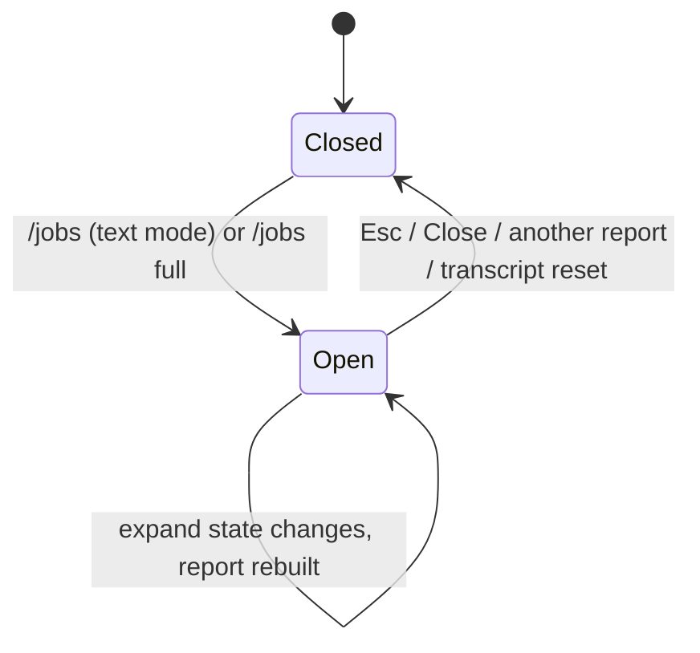

# Data Model: Expand Job Commands in the Background Jobs Report

This feature adds no stored data. It adds one view state, which reads an existing session flag.

## Tool output expansion state (existing)

- **Owner**: `InteractiveMode.toolOutputExpanded` (boolean, session lifetime, not persisted).
- **Writers**: `InputController.setToolsExpanded(expanded)` only. `toggleToolOutputExpansion()` and `/jobs full` call it.
- **Readers**: transcript blocks (existing), the Background Jobs report (new), and the jobs sheet (new).

## Background Jobs report state (new, `CommandController`)

| Field | Type | Meaning |
|---|---|---|
| `#jobsReportOpen` | boolean | The report on screen (above the editor, full-screen, or native sheet) is the jobs report. |

State changes:

The report form is not stored. It is `toolOutputExpanded` at build time.

## Jobs sheet source (extended, `JobsSheetSource`)

| Member | Type | Meaning |
|---|---|---|
| `expanded()` | `() => boolean` | Current expansion state. The sheet reads it on each frame. |
| `toggleExpanded()` | `() => void` | Switch the session state (the same toggle as the global key). |

## Validation rules

- Report full form: every job shows `job.command ?? job.label`, wrapped, with no `…` (FR-002).
- Report short form: one cut line for each job (FR-003). The output is the same as today.
- Sheet full form: the detail pane shows the full command of the selected job with no line cap. Rows stay one line (FR-009, FR-010).
