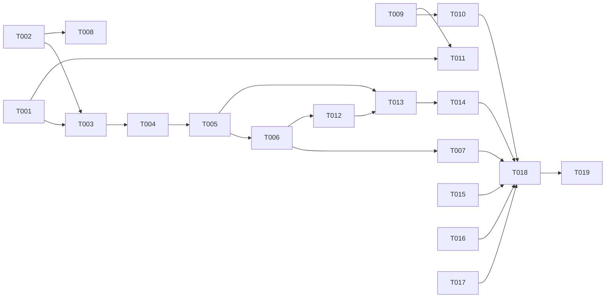

---

description: "Task list for the job command expansion feature"
---

# Tasks: Expand Job Commands in the Background Jobs Report

**Input**: Design documents from `specs/015-jobs-report-expand/`

**Prerequisites**: plan.md, spec.md, research.md, data-model.md, contracts/ui-keys.md, quickstart.md

**Tests**: The test plan in plan.md asks for property tests. Each story phase has one test task. Do not pin hint wording in a test.

**Organization**: Tasks are grouped by user story. US1 = report toggle (P1), US2 = jobs sheet (P2), US3 = state follows the session (P3).

## Format: `[ID] [P?] [Story] Description`

- **[P]**: Can run in parallel (different files, no dependency on an open task)
- **[Story]**: The user story of the task (US1, US2, US3)

## Phase 1: Setup

No setup. The feature changes existing files only, and the workspace already has its dependencies.

---

## Phase 2: Foundational (blocking prerequisites)

**Purpose**: The context members that the controllers in all stories call.

- [X] T001 Add `refreshJobsReport(): void` and `readonly jobsViewOpen: boolean` to `InteractiveModeContext`, with one-line doc comments, in packages/coding-agent/src/modes/types.ts

**Checkpoint**: The context interface compiles. Implementations come in US1 (T005) and US2 (T011).

---

## Phase 3: User Story 1 - See the full command of a job from the open report (Priority: P1) 🎯 MVP

**Goal**: The expand key switches the open Background Jobs report between cut and full commands in place. This works above the editor, as a full-screen view, and as a native sheet (FR-001, FR-002, FR-003, FR-008).

**Independent Test**: Quickstart scenarios A and B. Open `/jobs` with a long job command and press Ctrl+O. Expect the full command. Press Ctrl+O again and expect the cut form.

### Implementation for User Story 1

- [X] T002 [P] [US1] In packages/tui/src/overlays/report-panel.ts, add `expand?: { label: string; run(): void }` to `ReportPanelOptions`. Store it. In text mode, put `${appToolsExpandKey()} ${label} · ` before the close hint in the footer, also when the scroll hint shows. In `handleInput`, call `run()` when `matchesAppToolsExpand(data)`, before the cancel check. In `describe()`, add `actionButton(label, "expand", { keys: appToolsExpandKey() })` before Close when `expand` is set. In `handleNativeEvent`, map act `expand` to `run()`. Import both helpers from `../keybinding-matchers`. Reports without `expand` must stay the same.
- [X] T003 [US1] In packages/coding-agent/src/modes/controllers/command-controller.ts, extend `showCommandReport` options with the optional `expand` and pass it to `ReportPanel`. Add `#jobsReportOpen = false`. Set it to false in `#clearReport` (only when it removed a child) and in `#closeReportSheet` (only when a sheet was open).
- [X] T004 [US1] In packages/coding-agent/src/modes/controllers/command-controller.ts, move the body build of `handleJobsCommand` (from the `info` lines to `showCommandReport`) into `#showJobsReport()`. Use `const full = this.ctx.toolOutputExpanded`. Pass `expand: { label: full ? "short commands" : "full commands", run: () => this.ctx.toggleToolOutputExpansion() }`, and set `#jobsReportOpen = true` after `showCommandReport` (also for the "No async jobs yet." report). Add `refreshJobsReport(): void { if (this.#jobsReportOpen) this.#showJobsReport(); }` and `get jobsReportOpen(): boolean`. `handleJobsCommand` keeps the unavailable warning and the native sheet branch (`isNativeRendering() && !full`), then calls `#showJobsReport()`.
- [X] T005 [US1] In packages/coding-agent/src/modes/interactive-mode.ts, add `refreshJobsReport()` that delegates to `#commandController.refreshJobsReport()`. Add `get jobsViewOpen()` that returns `this.#jobsSheetHandle !== undefined || this.#commandController.jobsReportOpen`.
- [X] T006 [US1] In packages/coding-agent/src/modes/controllers/input-controller.ts, call `this.ctx.refreshJobsReport()` at the end of `setToolsExpanded`, after the chat loop and before `requestRender(true)`.
- [X] T007 [US1] In packages/coding-agent/test/modes/controllers/jobs-command.test.ts, add `toolOutputExpanded`, `setToolsExpanded`, and `toggleToolOutputExpansion` to the `renderFullJobs` mock ctx. `toggleToolOutputExpansion` must switch the flag and call `controller.refreshJobsReport()`. Add a property test. For commands of 0, 1, and 20 lines at widths 40, 60, and 120, check three things. In the full form, every non-whitespace command character is present. In the short form, each job has one detail line. Two toggles restore the same rows. Add a test that a full form taller than `commandReportRows()` mounts as an overlay (`ui.showOverlay` called, `reportContainer` empty), and that a toggle back mounts the report in `reportContainer`. Add an isolation test (FR-007, SC-004): open a jobs report, then open a different report through `showCommandReport`, then toggle the expand state. The other report must keep the same rendered rows, `jobsReportOpen` must be false, and the jobs report must not come back.
- [X] T008 [P] [US1] In packages/tui/test/report-panel.test.ts, add three tests. A panel with `expand` calls `run` on the bound expand key. A panel without `expand` ignores that key and its native description has only the Close button. A native `action`/`expand` event calls `run`.

**Checkpoint**: The `/jobs` report toggles with Ctrl+O in all three presentations (quickstart A, B).

---

## Phase 4: User Story 2 - See the full command of the selected job in the live jobs sheet (Priority: P2)

**Goal**: In the jobs sheet, the expand key switches the selected job's command in the detail pane between the 4-line preview and the full command. Rows stay one line (FR-009 to FR-012).

**Independent Test**: Quickstart scenario D.

### Implementation for User Story 2

- [X] T009 [P] [US2] In packages/tui/src/overlays/jobs-panel.ts, add `expanded(): boolean` and `toggleExpanded(): void` to `JobsSheetSource`. In `handleInput`, call `toggleExpanded()` when `matchesAppToolsExpand(data)`. In `describe()`, add `this.#source.expanded()` to the cache `key`. Pass it to `describeDetail`, which drops `preview: { lines: 4 }` from the `code` node when expanded. Add `actionButton(expanded ? "Short command" : "Full command", "expand", { keys: appToolsExpandKey() })` to the action bar before Close. Map act `expand` in `handleNativeEvent` to `toggleExpanded()`. In `render()`, when expanded and the selected job has a command (`detail.command`, or `job.label` for a non-task job), push the command wrapped to `width - 3` with a 3-space indent before the facts line. Do not add a scroll or a line cap: the overlay `maxHeight` cuts the rows at the bottom (facts and output tail) that do not fit (spec edge case). Leave the short form output the same. Update the class doc comment for the new key.
- [X] T010 [P] [US2] In packages/tui/test/jobs-panel.test.ts, add `expanded`/`toggleExpanded` to the source helpers. Add three tests. With `expanded()` true, the `omp.jobs.command` node has no `preview`, and with false it has one. The text fallback contains every line of a 10-line command when expanded and none when not. The job row count is the same in both forms. The bound expand key calls `toggleExpanded`.
- [X] T011 [US2] In packages/coding-agent/src/modes/interactive-mode.ts `showJobsSheet`, pass `expanded: () => this.toolOutputExpanded` and `toggleExpanded: () => this.toggleToolOutputExpansion()` to the `JobsSheet` source.

**Checkpoint**: The jobs sheet toggles its detail command with Ctrl+O, natively and in a plain terminal.

---

## Phase 5: User Story 3 - Job views follow the session expansion state (Priority: P3)

**Goal**: New job views open in the current session form. `/jobs full` always opens full. A toggle in a job view also switches the transcript, also with hidden tool activity (FR-004, FR-005, research R2, R5).

**Independent Test**: Quickstart scenarios A step 5, C, and E.

### Implementation for User Story 3

- [X] T012 [US3] In packages/coding-agent/src/modes/controllers/command-controller.ts `handleJobsCommand`, when `full` is true, call `this.ctx.setToolsExpanded(true)` before the report opens, after the unavailable check.
- [X] T013 [US3] In packages/coding-agent/src/modes/controllers/input-controller.ts `toggleToolOutputExpansion`, change the guard to `if (this.ctx.hideToolActivity && !this.ctx.jobsViewOpen)`.
- [X] T014 [US3] In packages/coding-agent/test/modes/controllers/jobs-command.test.ts, add three tests. `/jobs full` with the state off leaves the state on, and one toggle gives the short form. `/jobs` with the state on opens the full form. With `hideToolActivity` true and a jobs report open, `toggleToolOutputExpansion` switches the state. Use the `InteractiveMode` fixture that the file already has.

**Checkpoint**: All stories work. The session state is the single source.

---

## Phase 6: Polish & Cross-Cutting Concerns

- [X] T015 [P] Add an Unreleased entry to packages/coding-agent/CHANGELOG.md: the expand key shows full job commands in `/jobs` and in the jobs sheet, and `/jobs full` turns tool output expansion on.
- [X] T016 [P] Add the fork divergence note to UPSTREAM_DIVERGENCES.md (files: report-panel.ts, jobs-panel.ts, command-controller.ts, input-controller.ts, interactive-mode.ts, types.ts).
- [X] T017 [P] Change the `app.tools.expand` description in docs/keybindings.md to say that it also expands job commands in `/jobs` and the jobs sheet.
- [X] T018 Run `bun test packages/coding-agent/test/modes/controllers/jobs-command.test.ts packages/tui/test/jobs-panel.test.ts packages/tui/test/report-panel.test.ts packages/coding-agent/test/input-controller-focused-commands.test.ts`, then oxfmt --check, oxlint, and tsgo through `bun check`.
- [X] T019 Run the quickstart.md scenarios A to E in a real terminal with `bun packages/coding-agent/src/cli.ts`, and confirm the expected results.

---

## Dependencies & Execution Order

- **Foundational (T001)** blocks the coding-agent tasks in all stories.
- **US1** has no dependency on another story.
- **US2** shares `interactive-mode.ts` with US1 (T005, T011), so T011 runs after T005. The tui-side tasks (T009, T010) have no dependency on US1.
- **US3** depends on US1: it changes `handleJobsCommand` and reads `jobsViewOpen`.

## Parallel Examples

- **US1**: T002 (report-panel.ts) and T008 (report-panel.test.ts, after T002) run beside T003 to T006 in coding-agent.
- **US2**: T009 and T010 (tui package) run beside all of US1.
- **Polish**: T015, T016, and T017 run in parallel.

## Implementation Strategy

1. **MVP**: Do T001 to T008 (US1). This fixes the screenshot case, so you can stop and run quickstart A and B.
2. Add US2 (T009 to T011) for the native jobs sheet.
3. Add US3 (T012 to T014) for `/jobs full` sync and the hidden tool activity case.
4. Do the polish tasks, then commit with the smart-commit skill.
