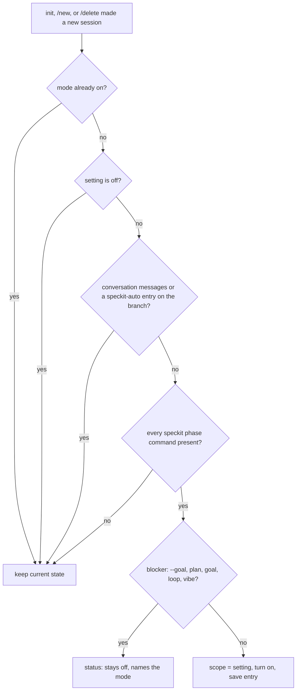

# Data Model: Speckit-Auto Startup Default

## Setting `speckitAuto.defaultOnStartup`

| Field | Value |
|---|---|
| Type | enum `"off" \| "full" \| "tasks"` |
| Default | `"off"` |
| Layers | global `~/.omp/agent/config.yml`, project `<cwd>/.omp/config.yml`, runtime override. The project layer wins over the global layer. |
| Bad value | Reads as `"off"`, with one debug-log warning (registry rule, research R2). |
| Read when | `init`, `/new`, `/delete`. A change in the middle of a session takes effect at the next brand-new session. |

The value maps directly to the mode: `"off"` means the mode stays off, and `"full"` or `"tasks"` is the `SpeckitAutoScope`.

## Saved session state `speckit-auto` (existing, unchanged)

`{ enabled: boolean, scope: SpeckitAutoScope, run?: SpeckitRun }`, a `custom` entry on the branch. Resume reads it in `restoreSpeckitAuto()`. The startup default never reads or replaces an existing entry. When the default turns the mode on, it appends a new entry, as a manual toggle does.

## Decision: should the default apply?

## Mode transitions from `setSpeckitAutoMode(target)`

| Current | Target | Effect |
|---|---|---|
| off | full / tasks | Set the scope, then turn on (blocker and command checks, save, adopt a running phase turn). Returns false if refused. |
| full | tasks | The existing cycle step. A parked start past tasks ends the run. |
| tasks | full | Set the scope, save, update the status. The run continues. |
| on | off | The existing cycle step. A run ends as "stopped". |
| same | same | Show the current state. No change. Returns true. |

`toggleSpeckitAutoMode()` = `setSpeckitAutoMode(next)`, with off→full, full→tasks, tasks→off.
