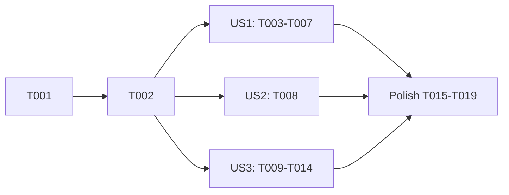

---

description: "Task list for the speckit-auto startup default"
---

# Tasks: Speckit-Auto Startup Default

**Input**: Design documents from `specs/016-speckit-auto-default/`

**Prerequisites**: plan.md, spec.md, research.md, data-model.md, contracts/speckit-auto-default.md, quickstart.md

**Tests**: Included. The repository rules require a regression check for each non-trivial branch. Each test states the property it proves. No test checks wiring or message text alone.

**Organization**: Tasks are grouped by user story. Line numbers are from plan time. Find each target by its symbol name before you edit.

## Format: `[ID] [P?] [Story] Description`

- **[P]**: Can run in parallel (different files, no dependency on an open task)
- **[Story]**: US1, US2, US3 from spec.md

## Phase 1: Setup

- [X] T001 Record a baseline: run `cd packages/coding-agent && bun test test/interactive-mode-speckit-auto.test.ts test/settings-manager.test.ts test/settings-reload-cwd.test.ts` and note any failure that exists before the change (memory lists known host-state failures)

## Phase 2: Foundational

- [X] T002 In `packages/coding-agent/src/modes/settings.ts`, after `cfgSpeckitAutoConvergeRounds` (about line 978), register `cfgSpeckitAutoDefaultOnStartup = register({ id: "speckitAuto.defaultOnStartup", type: "enum", values: ["off", "full", "tasks"] as const, default: "off", ui: { tab: "interaction", group: "Input", label: "Speckit auto on startup", description: "Turn speckit-auto mode on in new sessions; a project .omp/config.yml value overrides the global one", options: [{ value: "off", label: "Off" }, { value: "full", label: "Full", description: "Run every phase" }, { value: "tasks", label: "Tasks", description: "Stop after /speckit.tasks" }] } })` (research R1, contract "Config")

**Checkpoint**: The setting exists, and `cfgSpeckitAutoDefaultOnStartup.get(settings)` returns `"off"` by default.

---

## Phase 3: User Story 1 - New sessions start with speckit-auto mode on (Priority: P1) 🎯 MVP

**Goal**: A brand-new interactive session (startup, `/new`, `/delete`) turns the mode on at the setting's scope. A resumed session never changes.

**Independent Test**: With the global value `full`, start `omp` in a project that has the speckit commands. The status bar shows the mode on, waiting (quickstart rows 1, 2, 5–10).

### Tests for User Story 1

- [X] T003 [US1] In `packages/coding-agent/test/interactive-mode-speckit-auto.test.ts`, add `describe("startup default")`. Use a helper that calls `cfgSpeckitAutoDefaultOnStartup.override(settings, value)`, makes the phase commands visible to `init`, and then calls `mode.init({ suppressWelcomeIntro: true })`. `init` reads `session.slashCommands` at `interactive-mode.ts:2515`, so call `session.setSlashCommands(...)` with entries named `PHASE_COMMANDS` first. The existing `start()` sets `fileSlashCommands` only after init. Cases, each a property of the rule in data-model.md:
  - `full` and `tasks` in an empty session → `speckitAutoEnabled` is true, `getSpeckitAutoDescription()` shows the right scope, and one `SPECKIT_AUTO_ENTRY` is appended.
  - `off` → the mode is off and no entry is appended.
  - The session has a message before init (a resumed conversation) → the mode is off for both `full` and `tasks`.
  - The session has a saved `{ enabled: false, scope: "full" }` entry and no messages → the mode stays off.
  - A phase command is missing → the mode is off, and `showWarning` is not called.
  - `init({ ..., startsGoal: true })` → the mode is off, and one `showStatus` call contains "goal mode".
  - `plan.defaultOnStartup` and `plan.enabled` are on → plan mode is on, speckit is off, and the status names "plan mode".
  - `/new` (`handleNewCommand`) while off with the default `tasks` → the new session has the mode on to tasks. `handleClearCommand` alone (an internal reset) → stays off. `handleDeleteCommand` while off → on.
  - `/new` while on at `tasks` with the default `full` → the new session keeps `tasks` (the carried mode wins).

### Implementation for User Story 1

- [X] T004 [US1] In `packages/coding-agent/src/modes/types.ts`, add `/** A --goal objective starts after init; the speckit-auto default gives way to it. */ startsGoal?: boolean;` to `InteractiveModeInitOptions` (about line 90)
- [X] T005 [US1] In `packages/coding-agent/src/modes/interactive-mode.ts`, add `#applySpeckitAutoDefault(startupBlocker?: "goal"): void` next to `#turnOnSpeckitAuto` (about 3838). Steps, in order (research R3–R7):
  1. Return if `this.speckitAutoEnabled`.
  2. Read `cfgSpeckitAutoDefaultOnStartup.get(this.settings)`, and return on `"off"`.
  3. Return if `this.sessionManager.buildSessionContext().messages.length > 0`, or if `this.sessionManager.getBranch()` has a `custom` entry with `customType === SPECKIT_AUTO_ENTRY`.
  4. Return without a message if any `speckit.${phase}` from `SPECKIT_PHASE_COMMANDS` is missing in `this.fileSlashCommands`.
  5. Set `const blocker = startupBlocker ?? this.#speckitAutoBlocker()`. If it is set, call `this.showStatus(\`Speckit-auto mode stays off: ${blocker} mode is on.\`)` and return.
  6. Set `this.#speckitScope = scope`. If `!this.#turnOnSpeckitAuto()`, set `this.#speckitScope = "full"`.

  Import `cfgSpeckitAutoDefaultOnStartup` from `./settings`.
- [X] T006 [US1] In `packages/coding-agent/src/modes/interactive-mode.ts`, call the method in three places:
  - In `init`, right after `await this.#applyPlanModeDefault()` (about 2812): `this.#applySpeckitAutoDefault(options?.startsGoal ? "goal" : undefined)`. Check the name of `init`'s options parameter.
  - In `handleNewCommand` (about 9573), after `await this.#applyPlanModeDefault()`.
  - In `handleDeleteCommand` (about 9588): save `this.sessionManager.getSessionId()` before the call, and after it, call `this.#applySpeckitAutoDefault()` only if the session id changed.

  Update the comments above the init call and `handleNewCommand` to name both defaults.
- [X] T007 [US1] In `packages/coding-agent/src/main.ts` `runInteractiveMode` (about line 729), pass `startsGoal: startupGoal !== undefined` in the `mode.init({...})` options

**Checkpoint**: T003 passes. Quickstart rows 1, 2, 5–10 behave as written.

---

## Phase 4: User Story 2 - A project config overrides the global default (Priority: P1)

**Goal**: The project `.omp/config.yml` value wins over the global value.

**Independent Test**: Quickstart rows 3 and 4.

### Tests for User Story 2

- [X] T008 [US2] In `packages/coding-agent/test/settings-reload-cwd.test.ts`, next to the `modelProfile` project test (about line 345), add a case. Write the global `speckitAuto.defaultOnStartup: full` and the project `speckitAuto: { defaultOnStartup: off }` to temp config files, load `Settings` for that cwd, and check that `cfgSpeckitAutoDefaultOnStartup.get(settings)` is `"off"`. Then swap the values (global `off`, project `tasks`) and check `"tasks"`. Then remove the project key and check that the global value applies. Use the file's existing temp-dir and load helpers.

### Implementation for User Story 2

No code. The settings layers already merge the project config over the global config (research R1). If T008 fails, stop and report the layer that loses. Do not add a special case.

**Checkpoint**: T008 passes.

---

## Phase 5: User Story 3 - Save the default from the command (Priority: P2)

**Goal**: `/speckit-auto-mode [off|full|tasks] [global|project]` sets the mode and saves the startup default. With no arguments, the command cycles as before.

**Independent Test**: Quickstart rows 11–13.

### Tests for User Story 3

- [X] T009 [P] [US3] In `packages/coding-agent/test/interactive-mode-speckit-auto.test.ts`, add `describe("setSpeckitAutoMode")`. Prove that:
  - from off, `setSpeckitAutoMode("tasks")` turns the mode on with the tasks scope and returns true;
  - from `tasks`, `setSpeckitAutoMode("full")` keeps an active run (the run object and its phase are unchanged) and changes the scope;
  - `setSpeckitAutoMode("off")` with an active run ends it as "stopped";
  - setting the current state again changes nothing (the entry count is unchanged) and returns true;
  - with plan mode on, `setSpeckitAutoMode("full")` returns false;
  - three `toggleSpeckitAutoMode()` calls still go off → full → tasks → off. The existing cycle tests must keep passing unchanged.
- [X] T010 [P] [US3] In `packages/coding-agent/test/settings-manager.test.ts` (about line 433), change `settings.setProjectCyberMode(true)` to `settings.setProjectValue(cfgCyberMode, true)`. In `settings-reload-cwd.test.ts` (about line 345), change `settings.setProjectModelProfile("work")` to `settings.setProjectValue(cfgModelProfile, "work")`. In `settings-manager.test.ts`, add one case: `setProjectValue(cfgSpeckitAutoDefaultOnStartup, "tasks")` plus `flush()` writes `speckitAuto.defaultOnStartup: tasks` to the project `config.yml`, and leaves the global file without that key. Add a second case: `setProjectValue(cfgSpeckitAutoDefaultOnStartup, "bogus")` throws.

### Implementation for User Story 3

- [X] T011 [US3] In `packages/coding-agent/src/config/settings.ts`, replace `setProjectCyberMode`, `setProjectReviewUsesPlan`, and `setProjectModelProfile` (about 1866–1896) and the booleans `#modifiedProjectModelProfile`, `#modifiedProjectCyberMode`, and `#modifiedProjectReviewUsesPlan` (about 648–653) with:
  - the field `#modifiedProjectSettings = new Set<AnySetting>()`;
  - `/** Persist one setting in <cwd>/.omp/config.yml (project layer). */ setProjectValue(setting: AnySetting, value: unknown): void`, which calls `setting.assertWritable(value)`, sets `prev = setting.get(this)`, calls `setByPath(this.#project, [...setting.segments], value)`, adds the setting to the set, increments `#persistedMutationGeneration`, calls `#rebuildMerged()`, and calls `#fireIfChanged(setting, prev)`. Copy any save-queue call that the old setters made.

  In `#saveProjectNow` (about 4110), change the early return to check `this.#modifiedProjectSettings.size === 0`. Snapshot and clear the set. Write `getByPath(this.#project, segments)` for each setting into `projectSettings`. In the `catch`, add every setting back to the set. Remove the now-unused imports.
- [X] T012 [US3] In `packages/coding-agent/src/slash-commands/builtin-modes.ts`, change the three callers to `settings.setProjectValue(cfgModelProfile, name)` (about 224), `settings.setProjectValue(cfgCyberMode, true)` (about 259), and `settings.setProjectValue(cfgReviewUsesPlan, enabled)` (about 297). Check the imports.
- [X] T013 [US3] In `packages/coding-agent/src/modes/interactive-mode.ts`, add the public `setSpeckitAutoMode(target: "off" | SpeckitAutoScope): boolean`, using the transition table in data-model.md:
  - **Off → on:** set the scope, then `#turnOnSpeckitAuto()`. On success, call `#adoptSpeckitTurn()`. On failure, reset the scope to "full".
  - **`full` → `tasks`:** move the current branch, including the parked-start end.
  - **`tasks` → `full`:** set the scope, show "Speckit-auto mode on.", then save and update the status.
  - **On → off:** move the current off branch.
  - **Same state:** show the state and return true.

  Rewrite `toggleSpeckitAutoMode()` as `this.setSpeckitAutoMode(next)`, with off → full, full → tasks, tasks → off. Add `setSpeckitAutoMode(target: "off" | "full" | "tasks"): boolean;` to `InteractiveModeContext` in `packages/coding-agent/src/modes/types.ts` (near `restoreSpeckitAuto`, about 657).
- [X] T014 [US3] In `packages/coding-agent/src/slash-commands/builtin-modes.ts`:
  - Add `resolveSpeckitAutoModeArg(args)` next to `resolveCyberArg` (about 235). It returns `{ kind: "cycle" }`, `{ kind: "set"; value: "off" | "full" | "tasks"; scope?: "global" | "project" }`, or `undefined`, per contracts/speckit-auto-default.md.
  - Add `persistSpeckitAutoDefault(settings, value, scope)` with the return lines "saved as the startup default (global config)" and "saved as the startup default (.omp/config.yml)". It uses `cfgSpeckitAutoDefaultOnStartup.set` for global and `settings.setProjectValue` for project.
  - Give `/speckit-auto-mode` `allowArgs: true` and `inlineHint: "[off|full|tasks] [global|project]"`. Change its description to "Cycle speckit-auto mode, or set it and save it as the startup default".
  - In `handleTui`:
    1. On `undefined`, show the usage `Usage: /speckit-auto-mode [off|full|tasks] [global|project]`.
    2. On `cycle`, call `toggleSpeckitAutoMode()`.
    3. On `set`, call `ok = ctx.setSpeckitAutoMode(value)`.
    4. If `ok` and a scope is given, save the value and show `Speckit-auto default: ${value} — ${saved}`.

    Keep `clearSubmittedText(runtime)`.

**Checkpoint**: T009 and T010 pass. Quickstart rows 11–13 behave as written.

---

## Phase 6: Polish & Cross-Cutting Concerns

- [X] T015 [P] In `packages/coding-agent/CHANGELOG.md` under `## [Unreleased]` → `### Added`, add one entry for `speckitAuto.defaultOnStartup` (`off`, `full`, `tasks`; default `off`). It turns speckit-auto mode on in new sessions (startup, `/new`, `/delete`), and the project `.omp/config.yml` overrides the global config. Resumed sessions keep their state. Projects without the speckit commands stay off. Plan or goal mode wins. Also add `/speckit-auto-mode [off|full|tasks] [global|project]`. Mention under `### Changed` that the `/cyber`, `/review-plan`, and `/model-profile` project saves now share one path, with no visible change.
- [X] T016 [P] In `UPSTREAM_DIVERGENCES.md`, in the speckit-auto entry (about line 365), add one **Decision** line for the startup default and the command arguments, and add `packages/coding-agent/src/config/settings.ts` (`setProjectValue`) to its key paths
- [X] T017 [P] Append `defaultOnStartup: off` under the existing `speckitAuto:` block in `~/.omp/agent/config.yml`. Do not change other keys. Leave a value that is already there.
- [X] T018 Run `cd packages/coding-agent && bun run check:types`, the three test files from T001, and `bunx oxfmt --check` at the root. Fix every error in the touched files. Compare the results with the T001 baseline.
- [X] T019 Run the quickstart.md section 3 scenarios with the real `omp`, record each row's result, then do the section 4 cleanup

---

## Dependencies & Execution Order



- US1, US2, and US3 depend only on T002. They do not depend on each other.
- In US1: T004 before T005–T007, because the option type must exist. T003 can be written first and fail.
- In US3: T011 before T012 (the callers use the new method). T013 before T014 (the handler calls the new setter). T009 and T010 are in different files and can be written in parallel.
- Same-file conflicts: T005, T006, and T013 all edit `interactive-mode.ts`, and T003 and T009 both edit the speckit test file. Run these in sequence, or give each file to one owner.

## Parallel Example

```text
After T002:
  agent A → US1 (T003–T007): interactive-mode.ts init/new/delete, types.ts, main.ts
  agent B → US2 (T008): settings-reload-cwd.test.ts
  agent C → US3 settings slice (T010, T011, T012): config/settings.ts, the two settings tests, builtin-modes.ts callers
Then one owner for T009, T013, and T014: interactive-mode.ts and the speckit test file, after US1 lands.
Polish T015, T016, T017 in parallel, then T018, then T019.
```

## Implementation Strategy

1. **MVP**: T001, T002, then US1 (T003–T007). A global default works at once, and the project override works without extra code (US2 only proves it).
2. **Then** US2 (T008), so the "like model profile" promise has a test.
3. **Then** US3 (T009–T014): the command arguments, the setter refactor, and the generic project setter.
4. **Last**: polish and the real-`omp` smoke.
