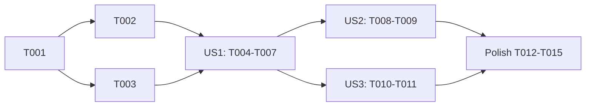

---

description: "Task list for speckit-auto following a phase the agent starts itself"
---

# Tasks: Speckit-Auto Follows a Phase the Agent Starts Itself

**Input**: Design documents from `specs/017-speckit-auto-self-advance/`

**Prerequisites**: plan.md, spec.md, research.md, data-model.md, contracts/phase-load.md, quickstart.md

**Tests**: Included. The repository rules require a regression check for each non-trivial branch, and property tests with a fixed, printed seed where inputs can be generated. No test checks wiring or message text alone.

**Organization**: Tasks are grouped by user story. Line numbers are from plan time. Find each target by its symbol name before you edit.

## Format: `[ID] [P?] [Story] Description`

- **[P]**: Can run in parallel (different files, no dependency on an open task)
- **[Story]**: US1, US2, US3 from spec.md

## Phase 1: Setup

- [X] T001 Record a baseline: run `cd packages/coding-agent && bun test test/speckit-auto.test.ts test/interactive-mode-speckit-auto.test.ts` and note any failure that exists before the change (result: 195 pass, 0 fail)

## Phase 2: Foundational

- [X] T002 In `packages/coding-agent/src/modes/speckit-auto.ts`, next to `parseSpeckitPhaseCommand` (about line 153), add and export `speckitPhaseLoad(toolName: string, args: unknown): SpeckitPhase | undefined` per contracts/phase-load.md:
  - Return `undefined` unless `args` is an object with a string `command` (for `bash`) or a string `path` (for `read`). Every other tool returns `undefined`. A `bash` call with `args.async === true` returns `undefined` (research R2 (c)).
  - `bash`: split `command` at `/;|&&|\|\||\||\n/`. For each segment, split on whitespace and strip one layer of `'` or `"` from each word. The segment counts when the basename of word 0 (text after the last `/`) is `specify` and a later word matches `^speckit[.-](<phase>)$`, with `<phase>` from `SPECKIT_PHASE_COMMANDS`. Return the phase of the last matching segment.
  - `read`: drop every trailing selector with `path.replace(/(?::(?:raw|conflicts|img|-?\d[\d+,-]*))+$/, "")`, so `:raw:2-4` and `:2-4:raw` both go. Then match `(?:^|\/)speckit\.(<phase>)\.md$`, `(?:^|\/)speckit-(<phase>)\/SKILL\.md$`, or `^skill:\/\/speckit-(<phase>)(?:\/SKILL\.md)?$`.
  - Add a one-line doc comment that names the two load forms (research R2).
- [X] T003 In `packages/coding-agent/src/modes/interactive-mode.ts`, extract `#startSpeckitRun(phase: SpeckitPhase): SpeckitRun` from the typed-command branch of `#handleSpeckitSessionEvent` (about 4288–4291): finish the current run as `"stopped"` (if any), then set and return `this.#speckitRun = newSpeckitRun(phase, normalizeConvergeRounds(cfgSpeckitAutoConvergeRounds.get(this.settings)))`. Call it from that branch. Leave the own-turn branch and the typed move branch unchanged (research R3). The existing `interactive-mode-speckit-auto.test.ts` cases must pass without changes.

**Checkpoint**: T001's baseline tests still pass, and `speckitPhaseLoad` compiles.

---

## Phase 3: User Story 1 - The run follows the phase that the agent started (Priority: P1) 🎯 MVP

**Goal**: A successful load by the agent moves the run (or starts one), so the settle check reads the right phase and no phase runs twice.

**Independent Test**: quickstart.md section 1, rows 1–5 and 8–10.

### Tests for User Story 1

- [X] T004 [P] [US1] In `packages/coding-agent/test/speckit-auto.test.ts`, add `describe("speckitPhaseLoad")`:
  - Every row of the two tables in contracts/phase-load.md as `it.each`, including the async, `uvx`, assignment, and `:raw:2-4` rows.
  - A seeded property test (fixed seed, printed in the test name, 500 cases). Generate a phase from `SPECKIT_PHASE_COMMANDS`, a separator `[".", "-"]`, optional quotes, optional directory prefix for `specify`, random flags (`--json`, `-v`), and 0–2 unrelated segments (`echo x`, `cd repo`) before and after, joined by a random separator from `;`, `&&`, `||`, `|`, newline. Property: the result is the phase. A second property on the same generator with word 0 replaced by a random non-`specify` word (`grep`, `echo`, `cat`, `rg`) and no other `specify` segment: the result is `undefined`.
  - `write`, `edit`, `grep`, and `glob` with a `speckit.tasks` argument return `undefined`. Non-string `command` or `path` returns `undefined`.
- [X] T005 [US1] In `packages/coding-agent/test/interactive-mode-speckit-auto.test.ts`, add `describe("phase loads by the agent")`. Add a helper `toolRuns(toolName, args, isError = false)` that calls `session.agent.emitExternalEvent` with `tool_execution_start` and then `tool_execution_end` (same `toolCallId`), then `await flush()`. Cases (data-model.md rows 3–5):
  - Run in plan, `bash` `specify project command speckit.tasks --json` → the run phase is `tasks`, the history ends `plan → tasks`, and `getSpeckitAutoDescription()` names `tasks` right after the call (SC-002). After the reply settles, `classify` gets `"tasks"` and the parked start is `/speckit.analyze`.
  - The same call with `isError: true` → the phase stays `plan`.
  - `bash` `grep -rn speckit.tasks .specify/` → the phase stays `plan`.
  - `read` `.omp/commands/speckit.plan.md` in plan → the run object and history are unchanged.
  - Run in converge, `read` `.omp/commands/speckit.implement.md` → `convergeRounds` grows by 1 and the phase is `implement`.
  - A paused run in plan, a tasks load → the phase is `tasks`, `paused` stays true, and `tick(3)` parks no start.
  - A paused run in plan, a specify load → the new run is at `specify` and paused.
  - Run in analyze, an analyze load → `remediationRounds` is unchanged (FR-004).
  - Mode on, no run, `turnStarts("write the plan")`, a plan load → a run exists in `plan`. At settle, `classify` gets the request `"write the plan"`.
  - Run in tasks, a specify load → the previous run ended `stopped` (one summary status), and the new run is at `specify` with history `[specify]`.
  - Resume: after a move, `reload()` the session file. The restored run holds the moved phase and history (SC-005).
  - Two moves in one turn (plan → tasks → analyze) → the history ends `plan → tasks → analyze` (US1 scenario 5).

### Implementation for User Story 1

- [X] T006 [US1] In `packages/coding-agent/src/modes/interactive-mode.ts`, add the field `#speckitPendingLoads = new Map<string, SpeckitPhase>()`. In `#handleSpeckitSessionEvent`:
  - Before the `speckitAutoEnabled` guard, on `tool_execution_end`: take and delete the entry for `event.toolCallId`. If it exists, the mode is on, and `event.isError !== true`, call `#applySpeckitPhaseLoad(phase)`. Then return. The end event always deletes, so the map needs no other clear point (data-model.md).
  - After the guard, on `tool_execution_start`: `const phase = speckitPhaseLoad(event.toolName, event.args)`. If set, store it under `event.toolCallId`.

  Import `speckitPhaseLoad`.
- [X] T007 [US1] In `packages/coding-agent/src/modes/interactive-mode.ts`, add `#applySpeckitPhaseLoad(phase: SpeckitPhase): void` per data-model.md rows 3–5:
  - Row 3: `phase === "specify"` or no run → `const paused = run?.paused ?? false`, `run = this.#startSpeckitRun(phase)`, `run.paused = paused`.
  - Row 4: `phase === run.phase` → return.
  - Row 5: if `phase === "implement" && run.phase === "converge"`, add 1 to `convergeRounds`. Then set `run.phase`, push to `history`, and set `autoAnswered = false`. Do not touch `paused` or `editing`.

  After rows 3 and 5: call `#bumpSpeckitGeneration()`, set `run.turnOpen = true` and `run.hold = undefined`, then call `#saveSpeckitAutoState()` and `#updateSpeckitAutoStatus()` (FR-003, FR-005, FR-009, FR-010, FR-010a).

**Checkpoint**: T004 and T005 pass. Quickstart rows 1–5 and 8–10 behave as written.

---

## Phase 4: User Story 2 - The user can see that the agent moved the phase (Priority: P2)

**Goal**: One notice for each move, and the summary lists agent-started phases.

**Independent Test**: quickstart.md section 2, step 3.

### Tests for User Story 2

- [X] T008 [US2] In the `describe("phase loads by the agent")` block of `packages/coding-agent/test/interactive-mode-speckit-auto.test.ts`, add:
  - A move shows exactly one `showStatus` call that contains the phase name. A same-phase load shows none.
  - Two moves (plan → tasks → analyze in one turn), then `/speckit-auto-mode` off → the summary's `Phases:` list is `plan → tasks → analyze` (FR-011).

### Implementation for User Story 2

- [X] T009 [US2] In `#applySpeckitPhaseLoad` in `packages/coding-agent/src/modes/interactive-mode.ts`, after rows 3 and 5, call `this.showStatus(\`Speckit auto: the agent started ${phase}.\`)` before the save. For row 3 with an old run, pass the notice as the `note` of `#startSpeckitRun` and `#finishSpeckitRun`, so it joins the summary line instead of replacing it (FR-007, research R5).

**Checkpoint**: T008 passes.

---

## Phase 5: User Story 3 - A tasks-scope run stays out of code edits (Priority: P2)

**Goal**: In a tasks-scope run that existed before the load, an implement or converge load ends the run and aborts the turn.

**Independent Test**: quickstart.md section 1, rows 6–7, and section 2, step 5.

### Tests for User Story 3

- [X] T010 [US3] In the `describe("phase loads by the agent")` block of `packages/coding-agent/test/interactive-mode-speckit-auto.test.ts`, add (spy on `session.abort`, and set `session.isStreaming` through the existing pattern in the file):
  - Tasks scope, run in analyze, implement load → `abort` is called once before the end-event handler returns (check right after the synchronous emit, before `flush()`), the run is gone, the summary contains "stopped before implement", and `tick(3)` parks nothing (SC-004).
  - The same for a converge load.
  - Tasks scope, run with `editing = true` (started by a typed `/speckit.implement`), converge load → no abort, phase `converge`.
  - Tasks scope, paused run, implement load → no abort, phase `implement`, still paused.
  - Tasks scope, no run, free-text turn, implement load → no abort, a run exists at `implement`, and `editing` is true (FR-010, the same as a typed `/speckit.implement` with no run).
  - Full scope, run in analyze, implement load → no abort, phase `implement`, `editing` false.

### Implementation for User Story 3

- [X] T011 [US3] At the top of `#applySpeckitPhaseLoad` in `packages/coding-agent/src/modes/interactive-mode.ts`: when `run = this.#speckitRun` exists, `!run.paused`, `speckitRunScope(run, this.#speckitScope) === "tasks"`, and `!speckitScopeAllows("tasks", phase)`, then:
  1. Call `#bumpSpeckitGeneration()`.
  2. Call `#finishSpeckitRun(run, "planned", \`The agent started /speckit.${phase}, so the turn stopped.\`)`. The note joins the summary line.
  3. If `this.session.isStreaming`, call `void this.session.abort({ reason: USER_INTERRUPT_LABEL })`, the same reason as `/speckit-auto next`. It stops any automatic resume of the turn.
  4. Return.

  This follows data-model.md row 2 and research R4.

**Checkpoint**: T010 passes.

---

## Phase 6: Polish & Cross-Cutting Concerns

- [X] T012 [P] In `packages/coding-agent/CHANGELOG.md` under `## [Unreleased]` → `### Changed`, add one entry. Speckit-auto mode now follows a phase that the agent loads itself, through a `specify … speckit.<phase>` command or a read of the phase's command or skill file. The run moves (or starts) at that phase, no phase runs twice, and a "stop before implement" run aborts the turn when the agent loads implement or converge.
- [X] T013 [P] In `UPSTREAM_DIVERGENCES.md`, in the "Speckit-auto mode" entry, add one **Decision** line for agent phase loads (the two forms, the run rules, and the tasks-scope abort). Add `speckitPhaseLoad` to its key paths.
- [X] T014 Run `bun check` at the root, then the two test files from T001. Fix every error in the touched files. Compare the results with the T001 baseline. (Result: `bun check` exits 0. The two files: 242 pass, 0 fail.)
- [X] T015 Run quickstart.md section 2 with the real `omp` (`bun run setup` first so the launcher has the change). Record the result of each step. (Result, run from source through the headless TUI: with no run, a `read` of `speckit.tasks.md` started a run at tasks, showed "Speckit auto: the agent started tasks.", and the settle check read the reply as tasks. In the "stop before implement" scope, a `read` of `speckit.implement.md` ended the run as "stopped before implement … The agent started /speckit.implement, so the turn stopped." The next sequential `read` never started, and the agent sent no reply.)

---

## Dependencies & Execution Order



- T002 and T003 are in different files and can run in parallel.
- US2 and US3 extend `#applySpeckitPhaseLoad` from US1, so both need US1.
- Same-file conflicts: T003, T006, T007, T009, and T011 all edit `interactive-mode.ts`. T005, T008, and T010 all edit the speckit interactive test. Give each file to one owner.

## Parallel Example

```text
After T001:
  agent A → T002, then T004 (speckit-auto.ts, speckit-auto.test.ts)
  agent B → T003, then T005–T011 in order (interactive-mode.ts and its test)
Polish: T012 and T013 in parallel, then T014, then T015.
```

## Implementation Strategy

1. **MVP**: T001–T007. The run follows agent loads, which fixes the reported repeated phase.
2. **Then** US2 (T008–T009): the notice.
3. **Then** US3 (T010–T011): the tasks-scope abort.
4. **Last**: polish and the real-`omp` smoke.
