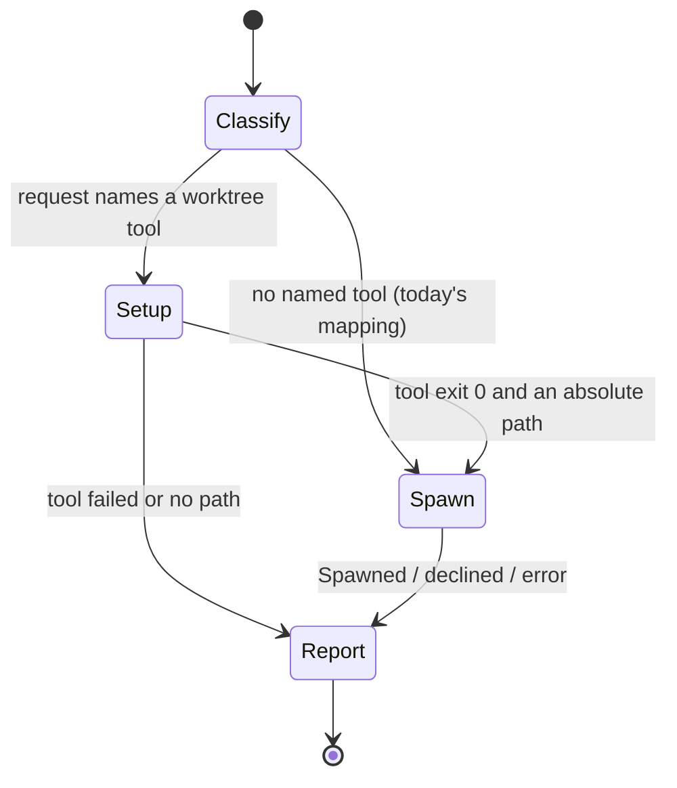

# Data Model: Spawn Into a Prepared Worktree

The feature stores no data. It only changes the order of the parent's steps during one `/spawn` run.

## Entities

| Entity | Fields | Source |
|---|---|---|
| Spawn request | free text | the text after `/spawn` |
| Worktree setup | tool name, branch name (from the request, or picked from it), worktree path (tool stdout) | named in the request |
| `spawn_session` call | `mode`, `text`, `cwd` = worktree path, `model` | the existing tool schema. `new_worktree` and `branch` stay unset when a setup ran. |

## Parent flow in one `/spawn` run

## Rules

- At most one setup for each `/spawn` run (FR-008).
- `cwd` is the absolute path that the tool printed, never a guessed path (FR-002, FR-005).
- The report after a setup always names the worktree path when the result is a decline or an error (FR-009).
