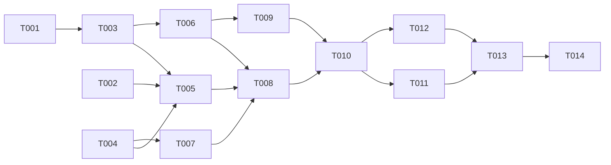

---

description: "Task list for spawning into a prepared worktree"
---

# Tasks: Spawn Into a Prepared Worktree

**Input**: Design documents from `specs/018-spawn-worktree-first/`

**Prerequisites**: plan.md, spec.md, research.md, data-model.md, contracts/spawn-prompts.md, quickstart.md

**Tests**: No new unit tests. A test that matches prompt text pins wording, which the repository rules forbid (research R7). Real-model smoke runs prove the behavior. The existing `/spawn` tests must still pass.

**Organization**: Tasks are grouped by user story. US1 and US2 edit the same two prompt files, so their edits run one after the other. Line numbers are from plan time. Find each target by its text before you edit.

## Format: `[ID] [P?] [Story] Description`

- **[P]**: Can run in parallel (different files, no dependency on an open task)
- **[Story]**: US1, US2, US3 from spec.md

## Phase 1: Setup

- [X] T001 Record a baseline: run `cd packages/coding-agent && bun test test/spawn-command.test.ts test/session/sibling-spawn.test.ts` and note any failure that exists before the change
- [X] T002 [P] Create the smoke repository from quickstart.md "Setup" steps 1–2: `/tmp/spawn-smoke` with one commit on `main`, and branch `taken` checked out in `/tmp/spawn-smoke-taken`. Run `ww --help-agent` once to confirm that `ww` works there

## Phase 2: Foundational

No foundational tasks. The `/spawn` window, the shell tool, and `spawn_session.cwd` already exist (research R1).

---

## Phase 3: User Story 1 - The new session starts in the worktree that the request names (Priority: P1) 🎯 MVP

**Goal**: A request that names a worktree tool makes the parent run that tool once, then call `spawn_session` with `cwd` set to the printed path.

**Independent Test**: quickstart rows 1–3. Each parent transcript shows the tool call before `spawn_session`, and `cwd` equals the printed path. The parent runs only the worktree tool.

### Implementation for User Story 1

- [X] T003 [US1] In `packages/coding-agent/src/prompts/spawn/spawn-kickoff.md`, after the line "Turn it into exactly one `spawn_session` call. NEVER do the requested work yourself." (line 7), add the worktree-setup exception from contracts/spawn-prompts.md "Kickoff":
  - One exception: when the request names a tool or command that makes a worktree (for example `ww`), run that tool once yourself BEFORE `spawn_session`. Follow the tool's own skill or help first (for example `skill://ww`, which requires `ww --help-agent`).
  - Branch: use the branch name in the request. Else pick a short name that describes the request (for example `feat/deploy-llm`). Never ask for it (spec FR-001a).
  - Then call `spawn_session` with `cwd` = the absolute path that the tool printed. Do not set `new_worktree` or `branch`.
  - `text` must not ask the new session to make a worktree. It may say that the session already runs in the new worktree on that branch (research R6).
  - Run nothing else from the request: installs, speckit commands, edits, and tests are the new session's work (research R2).
  - When the request names a worktree tool and also a directory, the tool wins: run it in the current checkout, and use its printed path as `cwd`, not the named directory (spec edge case, contract row "a worktree tool and an existing directory").
- [X] T004 [P] [US1] In `packages/coding-agent/src/prompts/tools/spawn-session.md`, extend the `cwd` bullet (line 10): `cwd` is also the path of a worktree that you made with the tool that the request names. Extend the `new_worktree` bullet (line 11): use it only when the request asks for a new worktree and names no tool
- [X] T005 [US1] Run quickstart rows 1–3 with the real `omp` from this checkout inside zmx, using a new parent session for each run. For each run, read the parent session `.jsonl` and record: the `ww create` call and its stdout path, the `spawn_session` arguments, the result line, and every shell call the parent made. Pass: all 3 runs have `cwd` equal to the printed path, no handoff `text` asks for a worktree (SC-002), the parent's shell calls are only `ww` calls (`--help-agent`, `list`, `create`), and `/tmp/spawn-smoke` has no `NOTES.md` (FR-003). If a run fails, fix T003/T004 and run all 3 again

**Checkpoint**: A `/spawn … using ww` request starts the child in the worktree with no `/wtcd`.

---

## Phase 4: User Story 2 - A failed worktree setup starts no session (Priority: P1)

**Goal**: A failed setup starts no session and reports the reason in one line. A decline or a spawn error after a setup reports the worktree path and keeps the worktree.

**Independent Test**: quickstart rows 4, 5, and 8.

### Implementation for User Story 2

- [X] T006 [US2] In `packages/coding-agent/src/prompts/spawn/spawn-kickoff.md`, in the block from T003, add the failure rule: when the tool exits non-zero, or prints no absolute path, do NOT call `spawn_session`. Report the reason in one short line and end your turn (spec FR-005, research R4)
- [X] T007 [P] [US2] In `packages/coding-agent/src/prompts/tools/spawn-session.md`, change the "Results" lines (lines 18–19): after a worktree setup, an error or "Spawn declined" report also names the worktree path and says that it was kept. Never remove that worktree (spec FR-009, contract "Tool description results")
- [X] T008 [US2] Run quickstart rows 4, 5, and 8. Row 4 (decline): the confirm `Directory:` shows the `ww` path, the parent's line names the path, and `ww list` still shows `smoke-decline`. Row 5 (`branch taken`): `ww create` fails, the transcript has no `spawn_session` call, and the parent reports one line (SC-003). Row 8 (`wwx`, not installed): the transcript has no `spawn_session` call, and the parent's one line says that the tool is missing (FR-005, US2 scenario 2)

**Checkpoint**: No failure path starts a session in the wrong directory, and no worktree is lost silently.

---

## Phase 5: User Story 3 - Requests without a named tool keep today's behavior (Priority: P2)

**Goal**: "New worktree" with no tool still maps to `new_worktree: true`. A named directory still maps to `cwd`. No setup runs.

**Independent Test**: quickstart rows 6 and 7.

### Implementation for User Story 3

- [X] T009 [US3] In `packages/coding-agent/src/prompts/spawn/spawn-kickoff.md`, check that the line "`cwd`, `new_worktree`, `branch`, `model`: set only what the request asks for." (line 10) still reads correctly next to the T003 block. If needed, scope the T003 exception so that it applies only when a tool is named, and leave this line for all other requests (research R5)
- [X] T010 [US3] Run quickstart rows 6 and 7. Row 6 (`/spawn in a new worktree, list the files`): no shell call before `spawn_session`, and `new_worktree: true`. Row 7 (`/spawn in /tmp/spawn-smoke-taken, list the files`): no shell call before `spawn_session`, `cwd` is `/tmp/spawn-smoke-taken`, and `new_worktree` is unset (SC-004, FR-007, US3 scenario 3)

**Checkpoint**: All three stories work.

---

## Phase 6: Polish & Cross-Cutting Concerns

- [X] T011 [P] In `packages/coding-agent/CHANGELOG.md` `[Unreleased]`, add a "Changed" bullet: a `/spawn` request that names a worktree tool (for example `ww`) now makes the worktree first and starts the new session in it. A decline or an error after that setup names the kept worktree
- [X] T012 [P] In `UPSTREAM_DIVERGENCES.md`, in "/spawn and /despawn sibling sessions", add a Decision bullet for the worktree-setup exception and the kept worktree. `/despawn` does not clean up a tool-made worktree, because it has no `cci-wt-*` labels. Add `packages/coding-agent/src/prompts/tools/spawn-session.md` to Key paths
- [X] T013 Run `cd packages/coding-agent && bun test test/spawn-command.test.ts test/session/sibling-spawn.test.ts` and compare with T001. Then run `bun check` from the repository root
- [X] T014 Clean up per quickstart "Cleanup": end every spawned zmx session, `ww remove` each smoke branch from `/tmp/spawn-smoke`, remove the row-6 worktree through `/despawn`, and delete `/tmp/spawn-smoke` and `/tmp/spawn-smoke-taken`

---

## Dependencies & Execution Order

- US1 comes first. US2 extends the same prompt block. US3 checks the block's scope.
- The smoke runs (T005, T008, T010) run one at a time. They share one zmx parent and one smoke repository.

## Parallel Opportunities

- T002 (smoke repository) runs during T001.
- T004 runs with T003, and T007 runs with T006, because each pair edits different files.
- T011 and T012 edit different files.

## Implementation Strategy

1. **MVP**: Phases 1 and 3 (T001–T005). This fixes the reported case.
2. **Safety**: Phase 4 makes the failure paths explicit.
3. **No regression**: Phase 5 confirms that other requests keep today's behavior.
4. **Last**: the changelog, the divergence notes, the checks, and the cleanup.
