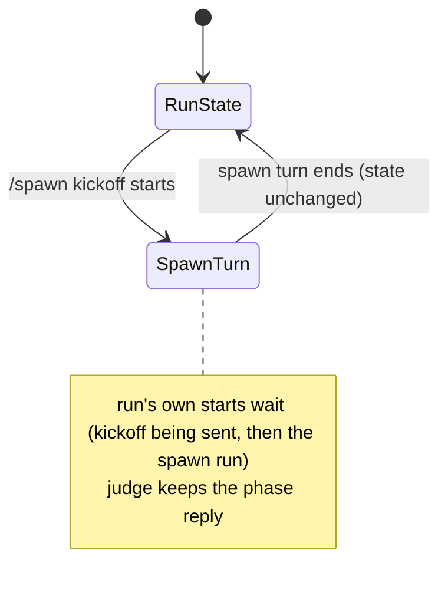

# Data Model: Spawn During Speckit-Auto Mode

No new stored data. The change adds one derived test, and it fixes how the run handles that test.

## Spawn kickoff (derived)

- **What it is**: The hidden prompt that `/spawn` sends into the current session.
- **Shape**: a `developer` message with:
  - `synthetic: true`
  - `userInitiated: true`
  - `displayText`, which starts with `/spawn`
- **Rule**: `isSpawnKickoff(message)` is true for this shape only. The session file keeps `displayText`, so the test gives the same result after a reload.

## Speckit run (unchanged shape)

The saved entry (`SPECKIT_AUTO_ENTRY`) keeps its fields. A spawn turn changes none of these:

| Field | Meaning | After a spawn turn |
|---|---|---|
| `phase` | The current phase | Same |
| `hold` | Why the run waits, and for whom | Same, and its reason is the same |
| `paused` | The run waits for `/speckit-auto-mode` | Same |
| `answering` | Typed text answers the phase question | Same |
| `remediationRounds`, `convergeRounds` | Round counts | Same |
| `turnOpen` | A run turn started and has not settled | Same |

In-memory state that a spawn turn also keeps:

| State | After a spawn turn |
|---|---|
| `#speckitPhaseReply` | The phase's last reply from before the kickoff |
| `#speckitDecidedKey` | Same. A decided reply is not checked again. |
| `#speckitJudgeAbort` | Same. A judge in flight goes on. |
| `#speckitRequest` | Same |
| `#speckitGeneration` | Same. Parked and own-turn starts stay valid. |

## State transitions

