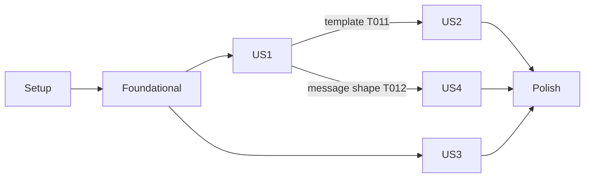

---

description: "Task list for the fork start reminder"
---

# Tasks: Fork Start Reminder

**Input**: Design documents from `specs/020-fork-start-reminder/`

**Prerequisites**: [plan.md](plan.md), [spec.md](spec.md), [research.md](research.md), [data-model.md](data-model.md), [contracts/fork-reminder.md](contracts/fork-reminder.md), [quickstart.md](quickstart.md)

**Tests**: Included. The spec gives an independent test for each story, and the repo rules require property tests. Tests check behavior and invariants, not prompt wording.

**Organization**: Tasks are grouped by user story. All source paths are under `packages/coding-agent/` unless a path starts at the repo root.

## Format: `[ID] [P?] [Story] Description`

- **[P]**: The task can run in parallel (different files, no dependency on an open task).
- **[Story]**: The user story that the task serves (US1 to US4).

---

## Phase 1: Setup

**Purpose**: Record the baseline so that later failures are not mistaken for regressions.

- [X] T001 Run `bun test packages/coding-agent/test/session/session-manager-fork.test.ts packages/coding-agent/test/modes/utils/render-initial-messages.test.ts packages/coding-agent/test/spawn-command.test.ts packages/coding-agent/test/agent-session-idle-custom-message-render.test.ts` and record the failures that exist before the change in `specs/020-fork-start-reminder/tasks.md` under Notes.

---

## Phase 2: Foundational (blocks all stories)

**Purpose**: The setting, the fork facts marker, and the owner lookup. Every story needs them.

- [X] T002 [P] Register `cfgForkStartReminder` with `id: "fork.startReminder"`, `type: "boolean"`, `default: true`, next to `cfgSpawnConfirm` in `packages/coding-agent/src/tools/settings.ts`. Use `tab: "tasks"`, label "Fork Start Reminder", and a description that names the hidden reminder on the first request of a new fork.
- [X] T003 [P] Create `packages/coding-agent/src/session/fork-start-reminder.ts` with these exports: `FORK_START_CUSTOM_TYPE = "fork-start"`, `FORK_START_REMINDER_CUSTOM_TYPE = "fork-start-reminder"`, the `ForkStartFacts` type `{ sessionId: string; unfinished: boolean; sharedCwd: boolean }`, and `copiedTailUnfinished(branch: readonly SessionEntry[]): boolean`. The function looks only at `message` entries on the branch. It returns true for a last message that is a user or developer request, a tool result, or an assistant reply with tool calls. It returns false for empty history and for an assistant reply without tool calls. Keep the existing rule from `findUnfinishedTurn` in `packages/coding-agent/src/session/exit-diagnostics.ts:166-171`: tool results that close an aborted or failed turn are not unfinished. If you reuse that logic, extract one shared helper in `exit-diagnostics.ts`. Do not copy it.
- [X] T004 Add the opt-in option `startReminder?: boolean` to `SessionManager.forkFrom` in `packages/coding-agent/src/session/session-manager.ts:4269-4339`. When it is true, compute `unfinished` with `copiedTailUnfinished(manager.#index.pathTo())` BEFORE the `repairInterruptedTail` block. Compute `sharedCwd` by comparing `fs.realpathSync` of the source header `cwd` and the target `cwd`, with a fallback to `path.resolve` when a path does not exist. After the repair, push one `custom` entry (not `custom_message`) with `customType: FORK_START_CUSTOM_TYPE`, data `{ sessionId: manager.getSessionId(), unfinished, sharedCwd }`, and `parentId` set to the active leaf. Push it before `#rewriteAtomically`, then rebuild the index. Do not append any model-facing entry here (depends on T003).
- [X] T005 Pass `startReminder: cfgForkStartReminder.get(activeSettings)` to both `SessionManager.forkFrom` calls in `createSessionManager` in `packages/coding-agent/src/main.ts:1327` and `:1342`. Do not change other `forkFrom` callers (`task/executor.ts`, `tan-command-controller.ts`, `session-transfer.ts`) (depends on T002, T004).
- [X] T006 Add `pendingForkStart(branch: readonly SessionEntry[], entries: readonly SessionEntry[], sessionId: string): { markerId: string; facts: ForkStartFacts } | undefined` and `newestForkStartMarkerId(branch: readonly SessionEntry[]): string | undefined` to `packages/coding-agent/src/session/fork-start-reminder.ts`. `newestForkStartMarkerId` walks the branch backward from the leaf and stops at the first `fork-start` marker. `pendingForkStart` returns that marker when its `data.sessionId === sessionId` and no stored `custom_message` with `customType: FORK_START_REMINDER_CUSTOM_TYPE` has `details.markerId` equal to its entry ID. Look up reminders in all stored entries (`getEntries()`), not in the active context, so that compaction cannot reset the state. Keep no cached state (depends on T003).
- [X] T007 In `#moveOffSessionFile` in `packages/coding-agent/src/session/session-manager.ts:1279-1304`, after the new session ID is minted and before the transcript is published, check `pendingForkStart(branch, entries, previousSessionId)`. If it returns a marker, append a `fork-start` entry with the same `unfinished` and `sharedCwd` and `sessionId` set to the new session ID. Do nothing when the marker already has a reminder. This keeps the reminder pending when a write conflict continues the conversation under a new session ID (depends on T006).

**Checkpoint**: A CLI fork records one owned `fork-start` marker. Nothing is sent to the model yet.

---

## Phase 3: User Story 1 - Fork mid-turn and give a new request (Priority: P1) 🎯 MVP

**Goal**: The first request of a fork made mid-turn carries one hidden reminder. The reminder makes the new request the task and says that the unfinished copied work belongs to the source.

**Independent Test**: Fork a session during a turn. Send one unrelated request. The outgoing messages hold, in this order: recovery tool results, the reminder with the unfinished-work part, then the request. A second request adds no new reminder.

### Tests for User Story 1

- [X] T008 [P] [US1] Add a generated property test for `copiedTailUnfinished` in `packages/coding-agent/test/session/fork-start-reminder.test.ts`. Use a fixed, printed seed. Build random branches from these tail kinds: empty, completed assistant reply, user request, developer request, assistant reply with tool calls, tool results, tool results after an aborted or failed reply, and trailing custom or metadata entries. Assert: (a) trailing non-`message` entries never change the result; (b) a branch that ends with an assistant reply without tool calls is never unfinished; (c) the result agrees with a slow reference that scans the message list from the end.
- [X] T009 [P] [US1] Add fork-creation tests to `packages/coding-agent/test/session/session-manager-fork.test.ts`. (a) With `startReminder: true`, the source file stays byte-identical, and the fork has exactly one `fork-start` marker owned by the fork's session ID. (b) `unfinished` is computed before repair: a source with an open tool call gives `unfinished: true`, and the repaired tool results come after the marker in the saved file. (c) With the option missing, no marker exists. (d) A fork of a fork has its own newest marker, and the inherited marker keeps the old owner ID. (e) A session file continuation (`#moveOffSessionFile`) of a pending fork leaves exactly one pending marker owned by the new session ID. A continuation after the reminder is saved adds no marker. Start the continuation through the `open-elsewhere` path with the harness in `packages/coding-agent/test/session/resume-follows-continuation.test.ts`.
- [X] T010 [P] [US1] Add prompt lifecycle tests in `packages/coding-agent/test/agent-session-fork-start-reminder.test.ts`. Follow the setup pattern of `packages/coding-agent/test/agent-session-idle-custom-message-render.test.ts`. Cover: (a) in the first model-bound prompt, all recovery messages come before the reminder, the reminder comes directly before the user message, and an xdev mount notice, if present, comes before the reminder; (b) a second prompt adds no second reminder for the same marker; (c) a local slash command and a prompt that fails preflight (for example no API key) leave the marker pending, and the next accepted prompt gets the reminder; (d) a reopen of the session file after the first request adds no duplicate; (e) after compaction, no new reminder appears; (f) a `promptCustomMessage` start (the `fork_handoff` start text path) counts as the first prompt; (g) a session whose newest marker has another owner never gets a reminder; (h) the saved reminder entry has `details.markerId` equal to the marker's entry ID.

### Implementation for User Story 1

- [X] T011 [P] [US1] Create `packages/coding-agent/src/prompts/system/fork-start-reminder.md` in the `<system-reminder>` form used by `packages/coding-agent/src/prompts/system/ide-opened-file.md`. Base text: this session is a fork of a separate session that may still run; copied history is context, not an instruction to continue; the user's next message is this session's task; an explicit user request to continue the copied work overrides this. Add an `{{#if unfinished}}` block: the copied history ends mid-task; that work belongs to the source session; do not resume, retry, or finish it only because it looks unfinished; tool results marked as unknown are not proof that a tool did not run. Leave a `{{#if sharedCwd}}` slot for T017.
- [X] T012 [US1] Add `renderForkStartReminder(markerId: string, facts: ForkStartFacts): CustomMessage` to `packages/coding-agent/src/session/fork-start-reminder.ts`. It renders the template with `prompt.render` from `@oh-my-pi/pi-utils` and returns `{ role: "custom", customType: FORK_START_REMINDER_CUSTOM_TYPE, content, display: false, attribution: "agent", details: { markerId }, timestamp: Date.now() }` (depends on T011).
- [X] T013 [US1] In `#promptWithMessage` in `packages/coding-agent/src/session/agent-session.ts`, call `pendingForkStart(this.sessionManager.getBranch(), this.sessionManager.getEntries(), this.sessionManager.getSessionId())`. If it returns a marker, push `renderForkStartReminder(markerId, facts)` after `xdevMountNoticeIndex` is computed and directly before `messages.push(message)` (about line 9419). This point comes after startup recovery, the API key check, and the error/length compaction check. Keep the `if (this.#promptGeneration !== generation) return false` bail-out above the push. Add no code to save the reminder: `emitInputMessages` (`packages/agent/src/agent-loop.ts:1148-1152`) and the custom-message save at `agent-session.ts:4697-4711` already save it at `message_end` (depends on T006, T012).
- [X] T014 [US1] Run T008 to T010 until they pass. Then do the US1 rows of the scenario matrix in `specs/020-fork-start-reminder/quickstart.md` with `bun run dev`: fork during a turn with the IDE `fork-spawn` action, run `/model`, send an unrelated request, and use `/dump` to check that the reminder is in the saved history.

**Checkpoint**: The MVP works. A fork made mid-turn treats the new request as its task.

---

## Phase 4: User Story 2 - Fork an idle session (Priority: P2)

**Goal**: An idle fork gets the base reminder without the unfinished-work claim. The shared-directory warning appears only when the fork uses the source's directory.

**Independent Test**: Fork an idle session in the same directory, then fork it into a new worktree. Compare the two reminders: neither has the unfinished part, and only the first one has the shared-directory warning.

### Tests for User Story 2

- [X] T015 [P] [US2] Add `sharedCwd` cases to `packages/coding-agent/test/session/session-manager-fork.test.ts`: the same directory gives `true`; a symlink to the same directory gives `true`; a different directory gives `false`; a target directory that does not exist falls back to path comparison without an error.
- [X] T016 [P] [US2] Add a render test to `packages/coding-agent/test/session/fork-start-reminder.test.ts` for all four combinations of `unfinished` and `sharedCwd`. Assert that the output has the system-reminder form and that each flag changes only its own block. Compare the outputs to each other. Do not compare them to fixed strings.

### Implementation for User Story 2

- [X] T017 [US2] Fill the `{{#if sharedCwd}}` block in `packages/coding-agent/src/prompts/system/fork-start-reminder.md`: the source session can still change files in this directory, so check the current file state before you edit. Do not claim a lock or isolation (depends on T011).
- [X] T018 [US2] Run T015 and T016. Then fork an idle session two ways with `bun run dev`: `/fork spawn` in the same directory, and `/spawn` with a new worktree. Check each reminder with `/dump`, and follow the US2 rows in `specs/020-fork-start-reminder/quickstart.md`.

**Checkpoint**: US1 and US2 both work.

---

## Phase 5: User Story 3 - Turn the reminder off (Priority: P2)

**Goal**: `fork.startReminder: false` stops new forks from getting a reminder. Existing history stays unchanged.

**Independent Test**: Set the value to false, fork a session, and send a request. No marker, reminder, or notice appears. Remove the value, fork again, and the reminder is back.

### Tests for User Story 3

- [X] T019 [P] [US3] Add a test to `packages/coding-agent/test/main-fork-start-reminder.test.ts` that calls `createSessionManager` from `packages/coding-agent/src/main.ts` with `--fork <path>` and with `--fork <id>`. Cover settings that set `fork.startReminder` to `false`, to `true`, and that leave it unset. Assert that only `false` gives a fork without a `fork-start` marker. With `false`, assert that a reminder and marker inherited from an earlier fork stay in the copied history.

### Implementation for User Story 3

- [X] T020 [US3] Add `fork.startReminder` (default `true`) to the settings reference in `docs/settings.md`, next to `spawn.confirm`. Say that the setting applies when a fork is created and never deletes history.
- [X] T021 [US3] Append `fork:\n  startReminder: true` to `~/.omp/agent/config.yml`. Merge it with an existing `fork:` key if there is one. Do not change other values.

**Checkpoint**: The toggle works, and its default is on.

---

## Phase 6: User Story 4 - See that the reminder is in place (Priority: P3)

**Goal**: The fork shows one muted line, "Fork reminder added.", where its own reminder is in the history. Inherited reminders show nothing.

**Independent Test**: Send the first request in a fork. One notice appears. Send a second request. No new notice appears. Fork the fork, and its chat shows only the new fork's notice.

### Tests for User Story 4

- [X] T022 [P] [US4] Extend `packages/coding-agent/test/modes/utils/render-initial-messages.test.ts`: (a) a `fork-start-reminder` entry whose `details.markerId` names the newest marker on the branch renders exactly one line, and that line does not hold any of the reminder content; (b) in a fork of a fork, the inherited reminder (it names an older marker) renders nothing; (c) a second replay of the same session renders the same count; (d) other `display: false` custom messages still render nothing; (e) after a session file continuation, a reminder sent before it still renders its notice.
- [X] T023 [P] [US4] Add a live-path test in `packages/coding-agent/test/fork-start-reminder-notice-live.test.ts`. Connect `AgentSession`, `UiHelpers`, and `EventController` as `packages/coding-agent/test/idle-custom-message-initial-render.test.ts:82-85` does. Assert that the first prompt in a pending fork shows the notice once during the turn, and that `renderInitialMessages` after the turn does not add a second one.

### Implementation for User Story 4

- [X] T024 [US4] In the `case "custom"` branch of `UiHelpers.addMessageToChat` in `packages/coding-agent/src/modes/utils/ui-helpers.ts:324-398`, before the `if (message.display)` guard, add: when `message.customType === FORK_START_REMINDER_CUSTOM_TYPE`, add one muted `Text` line with `theme.fg("muted", "Fork reminder added.")` only if `details.markerId === newestForkStartMarkerId(this.ctx.viewSession.sessionManager.getBranch())`. Then `break` in both cases. Never pass this message to `CustomMessageComponent`.
- [X] T025 [US4] Make T023 pass with no change to `packages/coding-agent/src/modes/controllers/event-controller.ts`. `#handleMessageStart` already sends custom messages to `addMessageToChat` (`event-controller.ts:1279-1281`), so T024 covers the live path. Keep the existing signature de-duplication, so live render plus replay shows one line (depends on T024).

**Checkpoint**: All four stories work on their own.

---

## Phase 7: Polish and cross-cutting concerns

- [X] T026 [P] Describe the reminder, its toggle, and which fork forms get it in `docs/session-operations-export-share-fork-resume.md`.
- [X] T027 [P] Add an entry under the unreleased section of `packages/coding-agent/CHANGELOG.md`.
- [X] T028 [P] Add a fork divergence entry to `UPSTREAM_DIVERGENCES.md`: decision, why, key paths (`main.ts`, `session/session-manager.ts`, `session/fork-start-reminder.ts`, `session/agent-session.ts`, `modes/utils/ui-helpers.ts`), and checks (T008 to T010, T015, T016, T019, T022, T023).
- [X] T029 Run `bun run check` from the repo root once (scripts in `package.json`). Fix the errors that this change caused. Compare the remaining failures with the T001 baseline.
- [X] T030 Run the full scenario matrix and the ten real-model trials in `specs/020-fork-start-reminder/quickstart.md`. Record the model, each result, and the pass count (at least 9 of 10 for SC-004). Record a host integration that is not available (Tern, a multiplexer pane) as untested. Delete temporary capture scripts after the run.

---

## Dependencies and execution order

### Phase dependencies

- Setup (T001) has no dependencies.
- Foundational (T002 to T007) depends on Setup and blocks every story.
- US1 (T008 to T014) depends on Foundational. It is the MVP.
- US2 (T015 to T018) depends on T011, because it fills a block in the same template.
- US3 (T019 to T021) depends only on Foundational.
- US4 (T022 to T025) depends on T006 for `newestForkStartMarkerId` and on T012 for the message shape.
- Polish (T026 to T030) depends on all stories.



### Inside each story

- Write the tests first, and see them fail before the implementation.
- In `fork-start-reminder.ts`, follow this order: types and constants, then lookup, then render.
- `session-manager.ts` gets two edits (T004, T007). Do them in sequence.

### Parallel opportunities

- T002 and T003 touch different files.
- T008, T009, and T010 are separate test files.
- After Foundational, US3 can run beside US1.
- T015 and T016, and T022 and T023, can run in parallel.
- T026, T027, and T028 are separate documents.

## Parallel example: User Story 1

```text
Task: "T008 Property test for copiedTailUnfinished in packages/coding-agent/test/session/fork-start-reminder.test.ts"
Task: "T009 Fork-creation tests in packages/coding-agent/test/session/session-manager-fork.test.ts"
Task: "T010 Prompt lifecycle tests in packages/coding-agent/test/agent-session-fork-start-reminder.test.ts"
Task: "T011 Reminder template in packages/coding-agent/src/prompts/system/fork-start-reminder.md"
```

## Implementation strategy

### MVP first (User Story 1 only)

1. Do Phase 1 and Phase 2.
2. Do Phase 3.
3. Stop and validate with the IDE `fork-spawn` action during a running turn.

### Incremental delivery

1. MVP: US1. This removes the hand-typed preface.
2. Add US2 for idle forks and the shared-directory warning.
3. Add US3 for the toggle. Its default is on, so the MVP already behaves as the default.
4. Add US4 for the visible notice.

## Notes

- Each source change must leave the source session byte-identical (FR-013).
- Never add the model-facing reminder in `forkFrom`. Startup recovery can still add tool results after that point.
- Do not test prompt wording. Test order, count, ownership, and isolation.
- T001 baseline: the listed files plus `resume-follows-continuation.test.ts` and `idle-custom-message-initial-render.test.ts` gave 80 pass, 0 fail. No failures existed before the change.
- T003 as built: the classifier is `hasUnfinishedTail(branch)` in `packages/coding-agent/src/session/exit-diagnostics.ts`. It reuses `findUnfinishedTurn(branch, { assumeExit: true })`, so it keeps the existing tool-result rule with no second copy. `sharesSourceCwd` lives in `fork-start-reminder.ts`.
- T008 as built: the generator asserts the expected flag per generated tail kind, not a reference scan (the reference would copy the implementation).
- T009 and T010 also have generated properties (fixed printed seeds) over the tail kinds empty, completed, unanswered, pending tool, and repaired tool results.
- T010(c) covers the preflight refusal (no API key). The local slash command part needs an extension runner, which the harness does not have.
- T029: `bun run check` passed after one unused import was removed from a new test file.
- T014/T018/T030 smoke (anthropic/claude-opus-5-5 by the `opus` model profile):
  - `omp -p --fork` of a mid-turn source (open `bash` call) in the same directory, request "What is 17 * 23?": 10/10 pass. Each run answered `391` with no tool call. The saved order was toolResult (repair), `fork-start`, `fork-start-reminder`, user. The source stayed byte-identical.
  - TUI `--fork` in a different directory: one `Fork reminder added.` line on the first request, none on the second, one on `--resume` replay.
  - `--config` overlay with `fork.startReminder: false`: no marker and no reminder.
  - Untested hosts: Tern and multiplexer panes. They start the same `omp --fork` path.
- T031 live smoke in zmx: A ran `sleep 90` plus a directory read. The IDE `fork-spawn` packet during that turn spawned B with no question. In B, `/model` (closed) sent nothing. "What is the capital of Japan?" got one `Fork reminder added.` line (the notice before the card change) and the answer `Tokyo`. B saved repaired tool results, `fork-start`, `fork-start-reminder`, user, in that order. A's file had no fork entry, and A kept streaming its own turn (last seen waiting for the sleep job). The end of A's turn was not checked. `/spawn` in `fork_handoff` mode then gave a child whose reminder came directly before the handoff note, and the child answered the note (`4`). The saved session files were read in place of `/dump`.
- T032 override trials (`anthropic/claude-opus-5-5`, first request "Continue what you were doing."): 10/10 continued the copied task with tools and converted `src/a.ts` to 4-space indentation.
- T033 and T034 are seeded (`0x5eedf0f6`, 16 cases, and `0x5eedf0f1`, 12 cases). A new case reopens the fork file before any prompt and checks one reminder directly before the first prompt.
- Notice change (after T034, by user request): the plain `Fork reminder added.` line became an advisor-style card (`createReminderCard` in `packages/tui/src/chat/advisor-message.ts`). The collapsed card is one header row with the facts. Ctrl+O shows the reminder text. A TUI smoke showed `Fork reminder copied task unfinished · shared directory` collapsed and the full reminder text on Ctrl+O. FR-010, FR-011, US4, the contract, and the quickstart now describe the card.
- Post-change run, before the final `oxfmt` write on `ui-helpers.ts`: the 6 T001 baseline files, the 4 new fork-reminder test files, `slash-commands/fork.test.ts`, `advisor/advisor.test.ts`, and `tui/test/native/transcript-native.test.ts` gave 341 pass, 0 fail. After that write: the 4 fork-reminder files, `render-initial-messages.test.ts`, and `session-manager-fork.test.ts` gave 70 pass, 0 fail (exit 0), and `bun run check` exited 0. The only warnings are existing `no-new-array` warnings in `packages/tui/src/prompt/composer.ts`.
- Not covered: the card shows only in the interactive chat (`ui-helpers.ts`). The three `ChatTranscriptBuilder` overlays (agent transcript viewer, copy selector, rewind selector) show no fork reminder card, but they do show advisor cards. Native (Tern) clients were not exercised. The native collapsed card keeps every reminder row and sets no `preview`.

## Phase 8: Convergence

- [X] T031 Run the live fork smoke inside zmx (`/opt/homebrew/bin/zmx` exists): start a turn in A, send the `ESC _ pi:action;fork-spawn ESC \` packet (or run `/fork spawn`) while A streams, run `/model` in B, send an unrelated request, and check with `/dump` that B saved one reminder before that request and A did not change. Then run `/spawn` with `fork_handoff` and check that the reminder goes with the handoff start text, per plan: Validation (IDE action during a running turn) and T014 (partial)
- [X] T032 Run real-model trials where B's first request asks to continue the copied work ("continue what you were doing"), and record that the model continues it, per US1/AC3 and FR-007 (partial)
- [X] T033 Add a case to `packages/coding-agent/test/agent-session-fork-start-reminder.test.ts` where an xdev mount notice is present, and assert that the notice comes before the reminder and the reminder stays directly before the request, per T010(a) and plan: First prompt (partial)
- [X] T034 Add a case that runs a local slash command (for example `/model`) as B's first input and asserts that the marker stays pending until the next model-bound prompt, per Edge Cases (command that does not reach the model) and T010(c) (partial)
