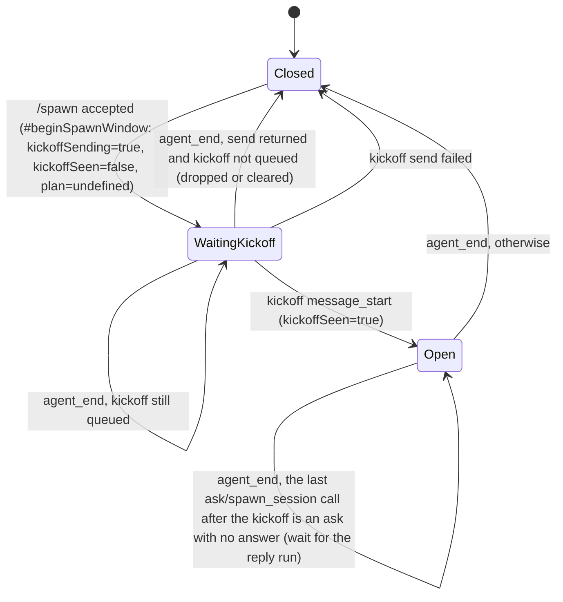

# Data Model: Spawn More Than One Session From One Request

All state is in memory in `InteractiveMode`, for the life of one spawn window. No state is saved.

## Spawn window

| Field | Type | Meaning |
|---|---|---|
| `#spawnPreviousTools` | `string[] \| undefined` | Exists today. The tool set before the window opened. It is defined only while the window is open. |
| `#spawnKickoffSending` | `boolean` | New. It is `true` from `#beginSpawnWindow` until the kickoff `followUp`/`prompt` call in `handleSpawnCommand` returns or fails. While it is `true`, `agent_end` keeps the window open. |
| `#spawnKickoffSeen` | `boolean` | New. It is set when the kickoff of this window starts (`message_start`). Before it is set, and when `#spawnKickoffSending` is `false`, `agent_end` keeps the window open only while the kickoff is still in the steering or follow-up queue. |
| `#spawnPlan` | `{ approved: boolean; remaining: number } \| undefined` | New. It records the overview answer. It is `undefined` when no overview has shown. |
| `#spawnBranches` | `Set<string>` | New. The default `wt/<yyyymmdd-hhmmss>` branches that spawns in this window used. `#beginSpawnWindow` clears it. |
| `#spawnRunUsed` | — | Removed. |

### Transitions

`agent_end` checks only the messages after the last kickoff in `event.messages`. In a reply run that has no kickoff, it checks the whole run.

## Overview plan

| Event | `#spawnPlan` before | Result | `#spawnPlan` after |
|---|---|---|---|
| `plan` call, `spawn.confirm` off | any | "spawn.confirm is off: no overview. Spawn each task." | unchanged |
| `plan` call, already set | set | error "The overview already showed for this /spawn." | unchanged |
| `plan` call, user approves | `undefined` | "Approved: spawn the <N> tasks." | `{ approved: true, remaining: tasks.length }` |
| `plan` call, user declines | `undefined` | "Overview declined: spawn nothing." | `{ approved: false, remaining: 0 }` |
| spawn call | `{ approved: false }` | error "The user declined this /spawn." | unchanged |
| spawn call | `{ approved: true, remaining > 0 }` | spawn with no dialog | `remaining - 1` |
| spawn call | `undefined` or `remaining = 0` | spawn, dialog when `spawn.confirm` is on | unchanged |

The count goes down on each spawn attempt that skips the dialog, also when that spawn then fails. A failed task still counts as one of the approved tasks.

## Validation (`SpawnSessionTool.execute`)

- `mode: "plan"` needs `tasks` with 2 or more non-empty lines. It allows no other field.
- `tasks` is allowed only with `mode: "plan"`.
- Other modes keep today's rules.

## Branch

- `new_worktree` with no `branch` gives today's `wt/<yyyymmdd-hhmmss>`. When that name is already in `#spawnBranches`, it gives `wt/<yyyymmdd-hhmmss>-<suffix>`. `<suffix>` is the 6-character suffix of the zmx session name for that spawn. Each default branch that a spawn uses goes into `#spawnBranches`.
