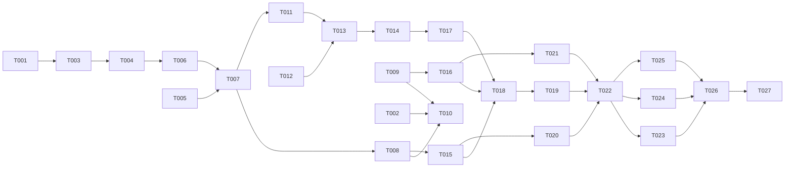

---

description: "Task list for spawning more than one session from one /spawn request"
---

# Tasks: Spawn More Than One Session From One Request

**Input**: Design documents from `specs/021-spawn-multi-sessions/`

**Prerequisites**: plan.md, spec.md, research.md, data-model.md, contracts/spawn-tools.md, quickstart.md

**Tests**: research R8 asks for test changes in `packages/coding-agent/test/spawn-command.test.ts`. Remove the tests that pin the one-call limit. Add tests for the window state across runs, the overview plan, and branch uniqueness. No test pins prompt text. Real-model smoke runs prove the prompt behavior (quickstart).

**Organization**: Grouped by user story. The kickoff prompt and the tool description are shared by all stories, so their edits run one after the other. Line numbers are from plan time. Find each target by its text before you edit it.

## Format: `[ID] [P?] [Story] Description`

- **[P]**: Can run in parallel (a different file, and no dependency on an open task)
- **[Story]**: US1, US2, US3 from spec.md

## Phase 1: Setup

- [X] T001 Record a baseline: run `cd packages/coding-agent && bun test test/spawn-command.test.ts test/session/sibling-spawn.test.ts`, and note each failure that exists before the change
- [X] T002 [P] Create the smoke repository from quickstart.md "Setup" steps 1–2: `/tmp/spawn-multi` with one commit on `main`, and branch `taken` checked out in `/tmp/spawn-multi-taken`. Run `ww --help-agent` once to make sure that `ww` works there

---

## Phase 2: Foundational (the window allows more than one spawn)

**Purpose**: The spawn window stays open for the whole spawn run and closes only at `agent_end`, after the kickoff (research R1–R3, data-model "Spawn window"). Every story needs this.

- [X] T003 In `packages/coding-agent/src/modes/interactive-mode.ts`, remove the one-call limit:
  - Delete the field `#spawnRunUsed` and its comment (line 2002–2003).
  - Delete `if (event.type === "agent_start") this.#spawnRunUsed = false;` (line 3103).
  - Delete the `tool_execution_end` close and its `FR-002` comment (lines 3105–3106).
  - In `#beginSpawnWindow`, delete `this.#spawnRunUsed = false;` and its comment (lines 8695–8696).
  - In `#handleSpawnRequest`, delete the `#spawnRunUsed` check and set, and the `await this.#endSpawnWindow();` call (lines 8739–8743).
  - Update its doc comment: "one spawn per run, and the window closes at every call" becomes "the window stays open until the spawn run ends".
- [X] T004 In `packages/coding-agent/src/modes/interactive-mode.ts`, add the kickoff flags, the queue check, and the sliced close (research R2):
  - Add a field `#spawnKickoffSeen = false`, with the comment "the kickoff of the open /spawn window started, so its agent_end may close it".
  - Add a field `#spawnKickoffSending = false`, with the comment "the /spawn kickoff is on its way to the queue, so agent_end must not close the window".
  - In `#beginSpawnWindow`, set `#spawnKickoffSeen = false` and `#spawnKickoffSending = true`.
  - In `handleSpawnCommand`, set `#spawnKickoffSending = false` in a `finally` around the kickoff `followUp`/`prompt` sends. This covers the `AgentBusyError` fallback and the failure path that calls `#endSpawnWindow`.
  - In the `this.session.subscribe` block (near line 3104), add: `if (event.type === "message_start" && this.#spawnPreviousTools && isSpawnKickoff(event.message)) this.#spawnKickoffSeen = true;`.
  - At line 6662, replace the check with this logic:
    - When `#spawnPreviousTools` is unset, do nothing.
    - When `!#spawnKickoffSeen` and `#spawnKickoffSending`, do nothing. The kickoff is still on its way to the queue.
    - When `!#spawnKickoffSeen`, close the window unless `[...this.session.agent.peekSteeringQueue(), ...this.session.agent.peekFollowUpQueue()].some(isSpawnKickoff)`. The kickoff is still queued in that case. If it was dropped, the window must not stay open.
    - Else close the window when `spawnWindowShouldClose(event.messages.slice(event.messages.findLastIndex(isSpawnKickoff) + 1))`.
  - In `src/session/sibling-spawn.ts`, change `spawnWindowShouldClose` so that only a last `ask`/`spawn_session` call that is an `ask` with no answer (no result, an error result, or a `chatRedirect` result) keeps the window open. Found at implement time: the old rule kept the window open after any `spawn_session` or `ask` call, so with no close per call the window would never close, and an answered ask left it open.
- [X] T005 [P] In `packages/coding-agent/src/tools/spawn-session.ts`, add `readonly concurrency = "exclusive" as const;` to `SpawnSessionTool`, so that parallel calls run one after another in request order (research R3)
- [X] T006 In `packages/coding-agent/test/spawn-command.test.ts`, replace the one-call tests with tests for the new window:
  - Rename the `describe` to "spawn: sessions per /spawn (FR-001) and the --api-key refusal (FR-020)".
  - Replace "parallel calls in one run create one session and refuse the rest" (lines 114–127). The new test: two parallel `handler` calls both fulfill, and `create` runs 2 times with both start texts. Direct `handler` calls skip the agent loop, so the request order comes from `concurrency: "exclusive"` and smoke row 1 shows it.
  - Replace "a /spawn queued into a run that already spawned still creates its one session" (lines 157–170). The new test: after `handleSpawnCommand`, a delivered kickoff `message_start`, and one spawn, `isSpawnWindowOpen()` is still `true`. A second `handleSpawnCommand` returns `false`. After an `agent_end` whose messages hold the kickoff and the `spawn_session` call, the window is closed, and a new `handleSpawnCommand` returns `true` (SC-006, FR-015).
  - Update "a /spawn while another /spawn window is open is refused…" (lines 172–189): after the spawn, the window stays open until `agent_end`.
  - Add: an `agent_end` whose messages have an `ask` call BEFORE the kickoff, and no call after it, closes the window.
  - Add: an `agent_end` that comes before the kickoff `message_start` leaves the window open while the kickoff is still queued. Queue it with a real `session.followUp` (do not spy it) while the session reports `isStreaming`.
  - Add: after `h.session.agent.clearFollowUpQueue()` drops the queued kickoff, an `agent_end` closes the window, `spawn_session` is no longer active, and a new `handleSpawnCommand` returns `true`.
  - Add: an `agent_end` that comes while the kickoff `followUp` has not returned yet leaves the window open. Make `followUp` wait on a promise that the test resolves, and emit `agent_end` before you resolve it. After you resolve it, the kickoff still has `spawn_session` active.
  - Emit the events with `h.session.agent.emitExternalEvent`, as `startRun` does. Build the kickoff message with `role: "developer"`, `userInitiated: true`, and a display text that starts with `/spawn `, so that `isSpawnKickoff` matches it.
- [X] T007 Run `cd packages/coding-agent && bun test test/spawn-command.test.ts test/session/sibling-spawn.test.ts`, and fix the failures that T003–T006 caused

**Checkpoint**: One `/spawn` window accepts many `spawn_session` calls, closes when its run ends, and frees the next `/spawn`.

---

## Phase 3: User Story 1 - One request starts one session for each named task (Priority: P1) 🎯 MVP

**Goal**: The model splits the request into tasks and calls `spawn_session` once for each task, each with its own mode and opening text.

**Independent Test**: quickstart row 6, plus a three-task fresh request. `/despawn` lists every session.

- [X] T008 [US1] In `packages/coding-agent/src/prompts/spawn/spawn-kickoff.md`, replace "Turn it into exactly one `spawn_session` call." (line 7) with the task rules from contracts/spawn-tools.md "Kickoff prompt", rules 1, 2, 7, and 9:
  - Split the request into tasks, one for each session that it asks for. Most requests are one task. A count gives that many tasks.
  - Call `spawn_session` once for each task. NEVER do the requested work yourself.
  - Each task has its own `mode`, `text`, `cwd`/`new_worktree`/`branch`, and `model`. `text` holds only that task, written to stand alone.
  - `handoff_summary`: `text` is that task's focus, so each task gets its own summary.
  - Change the `askEnabled` lines (12–14) to cover an unclear mode or an unclear split.
  - Change line 24 into rule 8: after all tasks, report one short line for each task.
- [X] T009 [P] [US1] In `packages/coding-agent/src/prompts/tools/spawn-session.md`:
  - Change line 1 so that it says the tool creates one session for each call.
  - Replace line 15 ("Call exactly once: …") with: call once for each task in the request, in request order. NEVER do the requested work yourself.
  - Change the "Spawned →" result line (line 21): note the name for the final report, then go on with the next task.
- [X] T010 [US1] Run quickstart row 6 and a request "`/spawn three fresh sessions: A lists the files, B prints the date, C shows git status`" with the real `omp` from this checkout inside zmx. Pass when:
  - The parent `.jsonl` has 3 `spawn_session` calls, each with only its own task in `text`.
  - The report has 3 lines.
  - `/despawn` lists 3 sessions (US1-1, US1-2, US1-4, US1-6).
  - A one-task `/spawn list the files` makes exactly 1 call (FR-002).

**Checkpoint**: Many fresh sessions from one command (SC-001).

---

## Phase 4: User Story 2 - Each task gets the directory that the request gives it (Priority: P1)

**Goal**: Each task gets its own directory setup: a tool worktree made per task, the built-in worktree with a unique branch, a named directory, or the current directory. With `spawn.confirm` on, one overview shows before any setup.

**Independent Test**: quickstart rows 1–4 and 7–10.

- [X] T011 [US2] In `packages/coding-agent/src/modes/interactive-mode.ts`, make the default branch unique within one window, and keep today's name for its first use (research R5, SC-005):
  - Add a field `#spawnBranches = new Set<string>()`, and clear it in `#beginSpawnWindow`.
  - In `#spawnSibling`, compute `const suffix = randomSiblingSuffix();` once, and use it in `siblingName(parent, dir, suffix)` (line 8833).
  - At line 8809, when `request.new_worktree` is set and `request.branch` is not, let `name = defaultSessionWorktreeBranch()`. Use `name` if it is not in `#spawnBranches`, else `${name}-${suffix}`. Add the chosen default branch to `#spawnBranches`.
- [X] T012 [US2] In `packages/coding-agent/src/tools/spawn-session.ts`, add the `plan` mode (contracts/spawn-tools.md "spawn_session input"):
  - Add `'plan'` to the `mode` union.
  - Add `"tasks?": type("string[]").describe("plan only: one line for each task")`.
  - In `execute`, for `plan`: require `tasks` with 2 or more non-empty lines, and allow no other field. `text` must be empty.
  - For every other mode, refuse `tasks`.
  - Skip the `text` rules for `plan`.
- [X] T013 [US2] In `packages/coding-agent/src/modes/interactive-mode.ts`, add the overview (data-model "Overview plan"):
  - Add a field `#spawnPlan: { approved: boolean; remaining: number } | undefined`, and reset it to `undefined` in `#beginSpawnWindow`.
  - In `#handleSpawnRequest`, handle `mode === "plan"` before `#spawnSibling`:
    - With `spawn.confirm` off, return `spawn.confirm is off: no overview. Spawn each task.`
    - With `#spawnPlan` already set, throw `The overview already showed for this /spawn.`
    - Else call `showHookConfirm(\`Spawn these ${tasks.length} sessions?\`, tasks.join("\n"), { initialIndex: 1, signal })`. Set `#spawnPlan`, and return `Approved: spawn the ${n} tasks.` or `Overview declined: spawn nothing.`.
  - For a spawn call:
    - With `#spawnPlan?.approved === false`, throw `The user declined this /spawn.`
    - With `approved` and `remaining > 0`, subtract 1 and pass `confirm = false`.
    - Else pass `cfgSpawnConfirm.get(this.settings)`.
  - In `handleSpawnCommand`, pass `confirm: cfgSpawnConfirm.get(this.settings)` to `prompt.render(spawnKickoffPrompt, …)` (line 8666).
- [X] T014 [US2] In `packages/coding-agent/test/spawn-command.test.ts`, add tests:
  - With `cfgSpawnConfirm` on and `showHookConfirm` resolving `true`, a `plan` call with 2 tasks and then 3 spawn calls give 1 overview, 0 dialogs for calls 1–2, and 1 dialog for call 3.
  - With the overview declined, the `plan` call returns `Overview declined: spawn nothing.`, a later spawn call rejects with "declined", and `create` never runs.
  - With `cfgSpawnConfirm` off, a `plan` call shows no dialog.
  - Two `new_worktree` spawns with no branch in one window pass two different branches to `createSessionWorktree`. The first one is exactly `defaultSessionWorktreeBranch()` with no suffix. Fix the clock with `vi.setSystemTime`, so that both calls fall in the same second. Spy `createSessionWorktree` from `@oh-my-pi/pi-coding-agent/…/session-worktree`, and resolve a fake worktree.
  - A `plan` call with 1 task, or with `text`, is refused by `SpawnSessionTool.execute`.
- [X] T015 [US2] In `packages/coding-agent/src/prompts/spawn/spawn-kickoff.md`, make the worktree block (lines 17–22) work for each task (contracts/spawn-tools.md rules 2–4, 6):
  - Handle tasks one at a time, in request order. For each task, run its worktree tool, then spawn that task.
  - A setup that the request gives to all tasks applies to each task separately. "Each in its own worktree" makes one worktree for each task. Make no worktree that the request did not ask for.
  - Branch names that you pick are different for each task.
  - Add a `{{#if confirm}}` block: with two or more tasks, first call `spawn_session` with `mode: "plan"`, before any worktree tool runs. Write one `tasks` line for each task: label, mode, directory setup, branch, and model. On `Overview declined: spawn nothing.`, run nothing more and report one line. `{{/if}}`
- [X] T016 [P] [US2] In `packages/coding-agent/src/prompts/tools/spawn-session.md`, add the `plan` mode to the mode list. It is only for two or more tasks with `spawn.confirm` on, and only before any worktree tool. `tasks` has one line for each task, and it creates nothing. `Approved: spawn the <N> tasks.` skips the dialog for each task. `Overview declined: spawn nothing.` means stop: no setup and no spawn. Add `tasks` to the optional fields
- [X] T017 [US2] Run `cd packages/coding-agent && bun test test/spawn-command.test.ts`, and fix the failures
- [X] T018 [US2] Run quickstart rows 1–3 with a new parent session each time. For each run, read the parent `.jsonl`. Pass when all 3 runs meet these checks:
  - Two `ww create` calls on two different branches, each before its matching spawn.
  - A and B have `cwd` set to their printed paths, and C has no `cwd`.
  - The report has 3 lines (SC-002).
  - If one run fails, fix T015/T016 and run all 3 again.
- [X] T019 [US2] Run quickstart row 4 (mixed setups, SC-003), rows 7–9 (overview approve, decline, and single task with `spawn.confirm` on, FR-011), and row 10 (two summaries with different focus, FR-004a)

**Checkpoint**: Mixed per-task directories work, with and without `spawn.confirm`.

---

## Phase 5: User Story 3 - A failure in one task does not hide or stop the others (Priority: P2)

**Goal**: A failed setup or spawn skips only its task. The final report has one line for each task, and a kept worktree is named in its task's line.

**Independent Test**: quickstart row 5.

- [X] T020 [US3] In `packages/coding-agent/src/prompts/spawn/spawn-kickoff.md`, change the failure rule (line 20) to cover one task at a time:
  - When a tool is missing, fails, or prints no absolute path, do not spawn that task, and go on with the next task.
  - NEVER try another tool, probe the shell for it, or hide its stderr.
  - In the final report, the line for that task quotes the tool's error.
- [X] T021 [P] [US3] In `packages/coding-agent/src/prompts/tools/spawn-session.md`, change the "Error →" and "Spawn declined →" result lines (lines 18–19). `Spawn declined` is the dialog for one task only:
  - Note that task's reason, with the worktree path if you made one. The worktree stays.
  - Go on with the next task.
  - Keep "NEVER remove a worktree you made for this call".
  - Add: "The user declined this /spawn." → stop and report one line.
- [X] T022 [US3] Run quickstart row 5. Pass when:
  - The `ww` call for A fails, and A has no `spawn_session` call.
  - B spawns in its worktree.
  - The report names A with the tool's error, and B with its session name (SC-004, FR-009, FR-010).

**Checkpoint**: All three stories work.

---

## Phase 6: Polish & Cross-Cutting Concerns

- [X] T023 [P] In `packages/coding-agent/CHANGELOG.md` `[Unreleased]`, add:
  - A "Changed" bullet: one `/spawn` can start one session for each task it names, each with its own mode and directory setup. With `spawn.confirm` on, two or more tasks show one overview first. A failed task does not stop the others.
  - A "Fixed" bullet: a `/spawn` whose run already had a spawn or an `ask` no longer leaves the spawn tool on, and the next `/spawn` is no longer refused as "already running".
- [X] T024 [P] In `UPSTREAM_DIVERGENCES.md`, in "/spawn and /despawn sibling sessions", replace the one-session decision with these facts:
  - There is one session for each task.
  - The window closes at `agent_end`, after the kickoff.
  - `plan` is the overview.
  - The default branch for a built-in worktree keeps today's name. Only a second default branch with the same name in one window gets the zmx suffix.
- [X] T025 Run quickstart row 11 (a `/spawn` as a follow-up during a long turn, then a second `/spawn` after `agent_end`). Pass when the second `/spawn` is accepted and spawns (SC-006)
- [X] T026 Run `cd packages/coding-agent && bun test test/spawn-command.test.ts test/session/sibling-spawn.test.ts`, and compare the result with T001. Then run `bun check` from the repository root
- [X] T027 Clean up as quickstart "Cleanup" describes:
  - End each spawned zmx session.
  - Run `ww remove` for each smoke branch, from `/tmp/spawn-multi`.
  - Delete `/tmp/spawn-multi` and `/tmp/spawn-multi-taken`.

---

## Dependencies & Execution Order

- Phase 2 blocks all stories, because it removes the one-call limit.
- `spawn-kickoff.md` edits run in this order: T008 → T015 → T020. `spawn-session.md` edits run in this order: T009 → T016 → T021.
- `interactive-mode.ts` edits run in this order: T003 → T004 → T011 → T013.
- The smoke runs (T010, T018, T019, T022, T025) run one at a time. They share one zmx parent and one smoke repository.

## Parallel Opportunities

- T002 runs during T001.
- T005 (`spawn-session.ts`) runs with T003/T004 (`interactive-mode.ts`).
- T009 runs with T008. T016 runs with T015. T021 runs with T020. Each pair edits different prompt files.
- T012 (`spawn-session.ts`) runs with T011 (`interactive-mode.ts`).
- T023 and T024 edit different files.

## Implementation Strategy

1. **MVP**: Phases 1–3 (T001–T010). Many sessions from one `/spawn`, with the stale-window fix.
2. **Directories**: Phase 4 adds the setup for each task, unique branches, and the overview.
3. **Failures**: Phase 5 makes a failure in one task local, and adds the report for each task.
4. **Last**: the changelog, the divergence notes, the follow-up smoke run, the checks, and the cleanup.

## Phase 7: Convergence

- [X] T028 Make FR-015 in spec.md name the exception that plan R2 and data-model "Spawn window" chose: a kickoff run whose last `ask`/`spawn_session` call is an `ask` with no answer (no result, an error result, or a `chatRedirect` result) keeps the window open for the user's reply run. Keep the code in `spawnWindowShouldClose` as it is, because a strict close would take the spawn tool away from the reply to a cancelled question. Also align the edge case at spec.md line 91 with FR-014 per FR-015 (contradicts)
