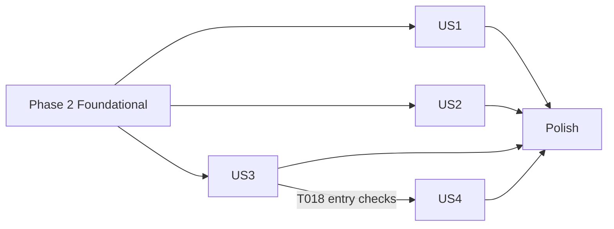

# Tasks: Master Mode

**Input**: Design documents from `specs/022-master-mode/`
**Prerequisites**: plan.md, spec.md, research.md, data-model.md, contracts/master-mode.md, quickstart.md

**Tests**: Included. research.md R11 plans them. They must prove properties against the real code (table + seeded property, state checks). No mirror tests.

**Organization**: Tasks are grouped by user story. Line numbers come from plan.md and can move. Open the file before each edit.

## Format: `[ID] [P?] [Story] Description`

- **[P]**: Can run in parallel (different files, no dependency on an open task)
- **[Story]**: The user story of the task (US1–US4)

## Path Conventions

- Agent package: `packages/coding-agent/src/`, tests in `packages/coding-agent/test/`
- TUI package: `packages/tui/src/`, tests in `packages/tui/test/`

---

## Phase 1: Setup

No setup. The work happens on `main`, and the design adds no dependency, setting, or tool.

---

## Phase 2: Foundational (Blocking Prerequisites)

**Purpose**: The state, its wiring, and a bare `/master` toggle. Every story needs them.

- [X] T001 Create `packages/coding-agent/src/session/master-mode.ts` with `MasterModeState { enabled: boolean }`, `MASTER_MODE_ENTRY = "master-mode"`, and `MASTER_MODE_CONTEXT_MESSAGE_TYPE = "master-mode-context"` (data-model.md)
- [X] T002 Add `#masterModeState`, `getMasterModeState()`, and `setMasterModeState(state)` to `packages/coding-agent/src/session/agent-session.ts`, modeled on `getVibeModeState`/`setVibeModeState` (:8082-8110). A missing or disabled state removes `master-mode-context` messages from agent messages, the steering and follow-up queues, and `#pendingNextTurnMessages`
- [X] T003 [P] Add `getMasterModeState?: () => MasterModeState | undefined` to `ToolSession` in `packages/coding-agent/src/tools/index.ts` (beside `getPlanModeState?`, :464)
- [X] T004 Wire `getMasterModeState: () => session?.getMasterModeState()` in `packages/coding-agent/src/sdk.ts` (beside `getPlanModeState`, :2721)
- [X] T005 Add `masterModeEnabled` and `handleMasterModeCommand()` to `InteractiveModeContext` in `packages/coding-agent/src/modes/types.ts` (beside vibe, :711)
- [X] T006 Implement a bare toggle in `packages/coding-agent/src/modes/interactive-mode.ts`: `masterModeEnabled`, `handleMasterModeCommand()`, `#enterMasterMode()` (calls `session.setMasterModeState({ enabled: true })`, shows the one-sentence `Master mode on: …` text from the contract), and `#exitMasterMode()` (calls `setMasterModeState(undefined)`, shows `Master mode off.`). Exit does not abort the running turn. Entry checks come in US3
- [X] T007 Register `/master` in `packages/coding-agent/src/slash-commands/builtin-modes.ts` (beside the `/vibe` entry, :531) with a TUI handler that calls `handleMasterModeCommand()` and a `getTuiAutocompleteDescription` of `Master: on` / `Master: off`

**Checkpoint**: `/master` turns the state on and off. Nothing is enforced yet.

---

## Phase 3: User Story 1 - The main agent does no direct or foreground work (Priority: P1) 🎯 MVP

**Goal**: With the state on, omp refuses file-change tools, foreground `bash`, named `bash` services, `wait`, foreground `task`, and every tool not on the allowlist. Subagents keep their normal tools.

**Independent Test**: Turn master mode on. Ask the agent to edit a file itself. The `edit` call is refused, the file does not change, and the refusal names `task` and background `bash`. A `bash` call with `async: true` runs.

### Tests for User Story 1

- [X] T008 [P] [US1] Write `packages/coding-agent/test/master-mode-guard.test.ts`: a table over `(tool, args) → allow | refuse` that calls the real `masterRefusal` with every row of contracts/master-mode.md "Guard" (including `bash` with blank and non-blank `name`, `write` to `agent://`, `out://`, `local://`, `proc://bg_1/kill`, `proc://bg_1/stdin`, `xd://edit`, a plain path, a malformed selector, no `path`, an `mcp__*` name, an unknown name); a seeded property (printed seed) that random names off the allowlist always refuse; refusal-text properties (starts with `Master mode is on.`, names an allowed way, ends with `Do not retry or route around this block.`); a session wiring check that `beforeToolCall` blocks `edit` and allows `read` with the state on, allows `edit` with it off, and a refused `write` leaves the file unchanged
- [X] T009 [P] [US1] Write `packages/coding-agent/test/task/master-task-refusal.test.ts`: with the state on, a `task` call whose agent sets `blocking: true` and a call with `async.enabled` off both return the `foreground-task` refusal with zero runs started; with the state off both run; `#startSpeculative` starts no run for a foreground item; FR-009: a subagent session created by `TaskTool` has no master state, so its `edit`, foreground `bash`, and foreground `task` are not refused

### Implementation for User Story 1

- [X] T010 [US1] Add `masterRefusal(toolName, args): string | undefined` and the six refusal texts (contracts/master-mode.md "Refusal texts"; export the `foreground-task` text as `MASTER_TASK_REFUSAL` for T012) to `packages/coding-agent/src/session/master-mode.ts`. Allow `task`, `read`, `grep`, `glob`, `find`, `todo`, `ask`, `goal`, `loop`; `bash` only when `args.async === true` and `name` is blank; `write` only when the target resolves (research.md R2 steps 1–4: `unwrapHashlineHeaderPath`, `peelWriteSelector`, `recoverConflictUriPrefix`, `InternalUrlRouter.instance().writeTarget`) to write scope `coordination`, `reply`, or `sandbox`, or `spec.write.cancels?.(url)` is true; refuse everything else; a throw means refuse
- [X] T011 [US1] Call the guard first in `AgentSession.#beforeToolCall` in `packages/coding-agent/src/session/agent-session.ts` (:6068): `if (this.#masterModeState?.enabled) { const reason = masterRefusal(ctx.tool.name, ctx.args); if (reason) return { block: true, reason }; }`, before the TTSR and extension logic
- [X] T012 [US1] Refuse a foreground task in `TaskTool.#dispatch` in `packages/coding-agent/src/task/index.ts` (after `itemBlocking` and `manager`, :1160-1167): when `this.session.getMasterModeState?.()?.enabled && (!manager || itemBlocking.some(Boolean))`, return `createTaskModeError(MASTER_TASK_REFUSAL)` with no run started. In `#startSpeculative` (:1003), return `undefined` when `!detached` and the state is on

**Checkpoint**: The guard and the task refusal work. T008 and T009 pass.

---

## Phase 4: User Story 2 - The user can talk to the main agent while work runs (Priority: P1)

**Goal**: The main agent dispatches work, ends its turn, answers the user at once, and reacts to each result. The async job sink already delivers results (SC-003, SC-004). This story adds the per-turn instructions that make the model use it.

**Independent Test**: In master mode, ask for two independent changes. The first turn ends while the subagents run. A message sent meanwhile gets an answer. Each result starts a turn with no user input.

### Tests for User Story 2

- [X] T013 [US2] Add to `packages/coding-agent/test/master-mode-guard.test.ts` (after T008, same file): with the state on, a prompt turn holds exactly one hidden `master-mode-context` message (`display: false`); it is not written to the session transcript; after `setMasterModeState(undefined)` no copy stays in agent messages or the queues

### Implementation for User Story 2

- [X] T014 [P] [US2] Create `packages/coding-agent/src/prompts/system/master-mode-active.md` (about 150 words) from `orchestrate-notice.md` and `vibe-mode-active.md`, with the six points of contracts/master-mode.md "Per-turn message". Drop the "trivial inline edit" exemption. State that "give every change to a subagent" is a rule that omp does not enforce
- [X] T015 [US2] Add `#buildMasterModeMessage()` beside `#buildVibeModeMessage` (:8433) in `packages/coding-agent/src/session/agent-session.ts`, push it right after the vibe push (:9403-9406), and add `MASTER_MODE_CONTEXT_MESSAGE_TYPE` to the transcript skip condition (:4702)

**Checkpoint**: A master turn carries the rules, and the transcript stays clean. T013 passes.

---

## Phase 5: User Story 3 - The mode is visible, persistent, and easy to leave (Priority: P2)

**Goal**: Entry checks, mutual exclusion, the status label, save and resume.

**Independent Test**: Turn master mode on. The status line shows `Master`. Resume the session: the first turn refuses a direct edit. `/vibe` shows `Exit master mode first.` Turn master off: the tool set is the same as before.

### Tests for User Story 3

- [X] T016 [P] [US3] Write `packages/coding-agent/test/interactive-mode-master.test.ts` (modeled on `test/interactive-mode-vibe-toggle.test.ts`): enter and exit leave the active tool names unchanged (SC-005) and remove the hidden message; resume of a branch whose latest `master-mode` entry is `enabled: true` turns the mode on before the first turn, `/new` turns it off, a later `enabled: false` entry wins; each of vibe, plan (on and paused), and speckit-auto blocks entry, and master blocks each of them, in both orders; goal and loop do not block; entry with `async.enabled` off is refused and names the setting; a reset loop under master is refused
- [X] T017 [P] [US3] Write `packages/tui/test/status-line-master.test.ts`: `Master` shows alone, shows after the goal label and after the loop label, and does not show when the state is off

### Implementation for User Story 3

- [X] T018 [US3] Add the entry checks to `handleMasterModeCommand` in `packages/coding-agent/src/modes/interactive-mode.ts` in the order of research.md R7: `#warnSpeckitAutoBlocks()`, `#warnPlanModeBlocks()` for plan on or paused, `Exit vibe mode first.` for vibe on or `#vibeModeEntry`, and `Master mode needs background work. Enable async.enabled.` when `cfgAsyncEnabled` is off or `session.asyncJobManager` is missing. Goal and loop do not block
- [X] T019 [US3] Add `Exit master mode first.` to the other modes in `packages/coding-agent/src/modes/interactive-mode.ts`: `handlePlanModeCommand` (:8260) and `#enterPlanMode` guards (:7185-7197), `handleVibeModeCommand` (:8342) and `#enterVibeMode` (:8460), `"master"` in the `#speckitAutoBlocker` return union (:4151) and in the `#applySpeckitAutoDefault` `startupBlocker` type (:4165), `conflict("master")` for plan or vibe `enter` in `#planSessionModeTransition` (:4984), and `Exit master mode before using reset loops. Loop mode disabled.` in both `#loopIteration` reset guards (:3735, :3767)
- [X] T020 [P] [US3] Add the `blocked by master mode` hints to `/vibe` and `/plan` and the full `/master` hint order (`on`, `blocked by speckit-auto mode`, `blocked by plan mode`, `blocked by vibe mode`, `off`) in `packages/coding-agent/src/slash-commands/builtin-modes.ts`
- [X] T021 [US3] Add `#saveMasterModeState()` (appends `MASTER_MODE_ENTRY` with `{ enabled }` through `sessionManager.appendCustomEntry`, as `#saveSpeckitAutoState` at :3991) on each enter and exit, `restoreMasterMode()` (latest branch entry, as `restoreSpeckitAuto` at :4064; missing or malformed data means off) called in `#reconcileModeFromSession` next to `restoreSpeckitAuto()` (:7054), and the memory reset in `#clearTransientModeState` (:6934), all in `packages/coding-agent/src/modes/interactive-mode.ts`
- [X] T022 [P] [US3] Add `masterMode: { enabled: boolean } | null` to `SegmentContext` in `packages/tui/src/status-line/types.ts` (beside `prewalk`, :111)
- [X] T023 [US3] Add `#masterModeStatus`, `setMasterModeStatus(status)` (as `setVibeModeStatus`, :1205), and `masterMode: this.#masterModeStatus` in the segment context (beside :2646) to `packages/tui/src/status-line/component.ts`
- [X] T024 [US3] Make `modeSegment.render` and `describe` in `packages/tui/src/status-line/segments.ts` (:707-721) append `Master` after the main mode, or show it alone, with `theme.icon.agents`
- [X] T025 [US3] Add `#updateMasterModeStatus()` (as `#updateVibeModeStatus`, :6631: `statusLine.setMasterModeStatus`, `ui.requestRender()`, `#notifyModeChanged()`) to `packages/coding-agent/src/modes/interactive-mode.ts` and call it from enter, exit, restore, and reset

**Checkpoint**: T016 and T017 pass. All three P1/P2 in-session stories work.

---

## Phase 6: User Story 4 - A session can start in master mode (Priority: P2)

**Goal**: `omp --master` starts the interactive session in master mode before the first prompt. Non-interactive modes reject the flag.

**Independent Test**: `omp --master "edit README.md to add a line"`. The first turn delegates the edit, and no direct edit succeeds. `omp --master -p "x"` exits with code 2.

### Tests for User Story 4

- [X] T026 [P] [US4] Write `packages/coding-agent/test/cli-master-flag.test.ts` (in `test/cli-goal-flag.test.ts` style): `--master` parses to `master: true`; `--master -p`, `--master --mode rpc`, and `--master --mode acp` throw the usage error with exit code 2
- [X] T027 [US4] Add to `packages/coding-agent/test/interactive-mode-master.test.ts` (after T016, same file): `startMasterAtStartup` turns the mode on before the first prompt; it is a no-op on a resumed master session; with `async.enabled` off, plan mode on, or `--plan-yolo` it shows the contract message and leaves the mode off; with a speckit-auto startup default, master wins and speckit-auto stays off

### Implementation for User Story 4

- [X] T028 [P] [US4] Add `Args.master?: boolean`, the parse branch beside `--wait-async` (:370), and `validateMasterLaunch(args, interactive)` beside `validateGoalLaunch` (:137) throwing `CliUsageError("--master requires an interactive terminal (not --print or --mode).")` in `packages/coding-agent/src/cli/args.ts`
- [X] T029 [P] [US4] Add `"--master"` to `VALUELESS_FLAGS` in `packages/coding-agent/src/cli/flag-tables.ts` (:327)
- [X] T030 [P] [US4] Add the `master` flag help (`Start in master mode: the main agent delegates work to subagents and background jobs and never waits on them (interactive only)`) beside `wait-async` (:99) in `packages/coding-agent/src/commands/launch-help.ts`
- [X] T031 [US4] Add `startMasterAtStartup(planYolo)` to `packages/coding-agent/src/modes/interactive-mode.ts`: no-op when on; else run the T018 entry checks; `--plan-yolo` shows `Master mode stays off: --plan-yolo starts plan mode.`
- [X] T032 [US4] In `packages/coding-agent/src/main.ts`: call `validateMasterLaunch` beside `validateGoalLaunch` (:1990); pass `startupMaster` to `runInteractiveMode` (:683); set `startupBlocker` to `"goal"`, else `"plan"`, else `"master"` (:762); call `await mode.startMasterAtStartup(startsPlanYolo)` after `init` and before `startGoalAtStartup` (:845), the restore (:853), the `/spawn` start text (:871), and the initial messages (:886-906)

**Checkpoint**: T026 and T027 pass. `omp --master` works.

---

## Phase 7: Polish & Cross-Cutting Concerns

- [X] T033 [P] Write `docs/master-mode.md` (beside `docs/vibe-mode.md`): goal (never waits on delegated work), the enforced rules and the prompt-only limit (research.md R10), the allowlist, entry and exit, exclusion, resume, `--master`
- [X] T034 [P] Add a `--master` row near `--goal` (:164) in `docs/cli-reference.md`
- [X] T035 [P] Add an `Added` entry for `/master` and `--master` to `packages/coding-agent/CHANGELOG.md`
- [X] T036 [P] Add a fork-only entry (decision, key paths, checks) to `UPSTREAM_DIVERGENCES.md`
- [X] T037 Run the quickstart.md automated checks 1–5: the new test files, the touched-mode tests, the TUI status line tests, `bun check:ts` from the repo root, and `omp --smoke-test`
- [X] T038 Run the quickstart.md manual smoke (steps 1–16) in a real `omp` TUI session and record the observed results, including the time to the first turn end (SC-002) and to each result turn (SC-004)

---

## Dependencies & Execution Order

### Phase Dependencies

- **Foundational (Phase 2)**: No dependencies. Blocks all stories.
- **US1 (Phase 3)** and **US2 (Phase 4)**: Depend on Phase 2. In US2, only T013 depends on US1 (T008 creates its test file). T014 and T015 do not.
- **US3 (Phase 5)**: Depends on Phase 2. T018's entry checks are reused by T031.
- **US4 (Phase 6)**: Depends on Phase 2 and T018.
- **Polish (Phase 7)**: After the stories in scope.



### Within Each Story

- Write the tests first and see them fail.
- `master-mode.ts` before `agent-session.ts`. `agent-session.ts` before `interactive-mode.ts`.
- `interactive-mode.ts` is one file: T006, T018, T019, T021, T025, and T031 run in sequence.
- `agent-session.ts` is one file: T002, T011, and T015 run in sequence.

### Parallel Opportunities

- Phase 2: T003 with T002.
- US1: T008 and T009 together. T012 (`task/index.ts`) runs after T010, because it uses `MASTER_TASK_REFUSAL`. It can run beside T011.
- US2: T014 beside T013. T013 waits for T008 (same test file).
- US3: T016, T017, T020, and T022 together. The TUI chain T022 → T023 → T024 runs beside the `interactive-mode.ts` chain.
- US4: T026, T028, T029, and T030 together. T027 waits for T016 (same test file).
- Polish: T033–T036 together.

## Parallel Example: User Story 1

```text
Task: "T008 master-mode-guard.test.ts (table + seeded property + wiring)"
Task: "T009 task/master-task-refusal.test.ts (foreground task, speculation, FR-009)"
Then: T010, then T011 and T012 side by side
```

## Implementation Strategy

### MVP First (User Story 1)

1. Complete Phase 2.
2. Complete US1. Validate with T008, T009, and the US1 independent test.
3. Stop and review.

### Incremental Delivery

1. Phase 2 + US1: the guard (MVP).
2. US2: the per-turn rules, so the model ends turns and reacts to results.
3. US3: exclusion, status, resume.
4. US4: `--master` for the cc-ide Master Session.
5. Polish: docs, full checks, the TUI smoke.

## Notes

- [P] tasks touch different files and have no open dependency.
- Do not change the active tool set on enter or exit (research.md R4).
- The guard is not a security boundary. A background `bash` job can change files (research.md R10). Do not describe the mode as forced delegation in code, docs, or messages.
- Commit with smart-commit after each story checkpoint.
