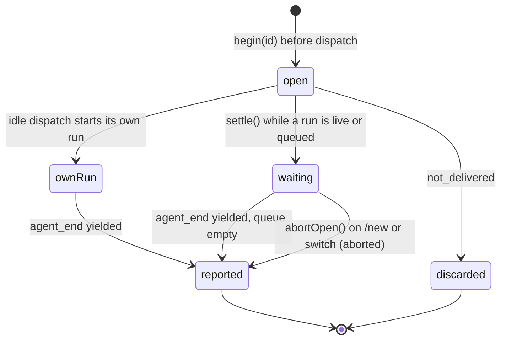

# Data Model: Session Inbox

Everything here is in memory or in a 0600 file under `getSessionInboxDir()`. Nothing goes in the session transcript, except the delivered messages and the replies, which the conversation shows.

## Inbox entry (discovery file `<dir>/<entryId>.json`)

| Field | Type | Rule |
|---|---|---|
| `version` | `1` | Another version is hidden. It is pruned only when its PID is dead. |
| `entryId` | 16 hex chars | Random for each process. It is also the endpoint stem. |
| `pid` | number | `process.pid` |
| `endpoint` | string | `ipcEndpoint(dir, entryId)` |
| `token` | 64 hex chars | Random for each process. Every request must carry it. |
| `address` | string | `ZMX_SESSION`, or else `omp-<pid>` (research R2) |
| `parent` | string \| null | `OMP_SPAWN_PARENT` at start |
| `createdAt` | number (ms) | Used to sort entries and to break ties |

**Lifecycle**
1. The host writes the entry when it starts. That happens at interactive start, or when the setting turns on.
2. The host removes the entry when it stops. That happens on dispose, on process exit, or when the setting turns off.
3. After a crash, the entry stays until the next list prunes it. A list prunes an entry when its endpoint answers `ENOENT` or `ECONNREFUSED`.

## Reachable session (the `snapshot` answer, also the `list` row)

| Field | Source |
|---|---|
| `address`, `parent`, `pid`, `createdAt` | the entry |
| `name` | `session.sessionName ?? address` |
| `cwd` | `sessionManager.getCwd()` |
| `branch` | `vcs.git(cwd)?.currentBranch()` at query time. It is null outside git and on a detached HEAD. |
| `busy` | `session.isStreaming` |
| `conversationId` | `sessionManager.getSessionId()` |
| `startedByCaller` | `parent === callerAddress` (the sender computes it) |
| `startedCaller` | `address === callerParent` (the sender computes it) |

Each string field is capped at 1024 chars.

## Inbox message (the `send` request)

| Field | Type | Rule |
|---|---|---|
| `id` | string | Random. The sender stores it in its pending-request map when `kind = request`. |
| `from` | `{ address, name, entryId }` | The sender's identity. The target shows `name` and `address` and puts them in the content. The target sends the reply to the entry with this `entryId`, so an address that two live sessions share does not change where the reply goes. |
| `kind` | `"request" \| "notification"` | The default is `request`. |
| `text` | string | 1 byte to 256 KiB (UTF-8). A larger text is refused with `too_large`. |
| `delivery` | `"steer" \| "after_turn"` | Only for a request. The default is `steer`. |
| `level` | `"nit" \| "concern" \| "blocker"` | Only for a notification. The default is `nit`. |

**Validation**
- `delivery` with a notification is rejected as `invalid`.
- `level` with a request is rejected as `invalid`.
- A message to the caller's own address is rejected as `self`. The tool checks this, so the message never reaches IPC.

## Delivery result (the `send` answer)

| Field | Values |
|---|---|
| `status` | `delivered` · `queued` · `not_delivered` |
| `reason` | only for `not_delivered`: `cost_cap`, `aborted`, `error: <text>`, `inbox_off`, `too_large`, `invalid` |
| `conversationId` | the target conversation that got the message |
| `shown` | `true` when a notification was only shown, with no turn and no queue (advisor `preserve`) |

**Mapping**
- **Request**
  - `onPromptQueued` gives `queued`.
  - `onPromptAdmitted` with no queue gives `delivered`.
  - A `false` return or a throw gives `not_delivered`.
- **Notification**
  - Advisor channel `steer` gives `delivered`.
  - `aside` gives `queued`.
  - `preserve` gives `delivered` with `shown: true`.

## Pending request (sender-side, in memory)

`Map<messageId, { target: address, sentAt }>`

- **Added:** before the sender sends a message with `kind = request`. This makes sure that a reply that comes back very fast finds the ID.
- **Removed:** when a reply arrives for that ID, when the send result is `not_delivered`, when the send call fails (connect error, timeout or error response), or when the sender's conversation changes (`/new` or resume). A reply for an unknown ID is refused with `unknown_id`.

## Reply ticket (target-side, in `RpcPromptResults`)

There is one ticket for each received request. The ticket ID is the message ID. A side map stores, for each ticket, the sender's `from.entryId` that the reply goes to.

The ticket state machine is the one `RpcPromptResults` already has:

## Reply (the `reply` request to the sender)

| Field | Rule |
|---|---|
| `id` | the request message ID |
| `from` | `{ address, name }` of the target |
| `outcome` | `completed` · `aborted` · `error` |
| `error` | the text, when `outcome = error` |
| `text` | the last visible assistant text of the turn, 16 KiB at most |
| `truncated` | `true` when the text was cut |

**Sender handling**
- The sender gets the reply as a YieldQueue `"inbox-reply"` entry, and that entry starts a turn when the sender is idle.
- A reply never creates a ticket, so it cannot cause another reply.
