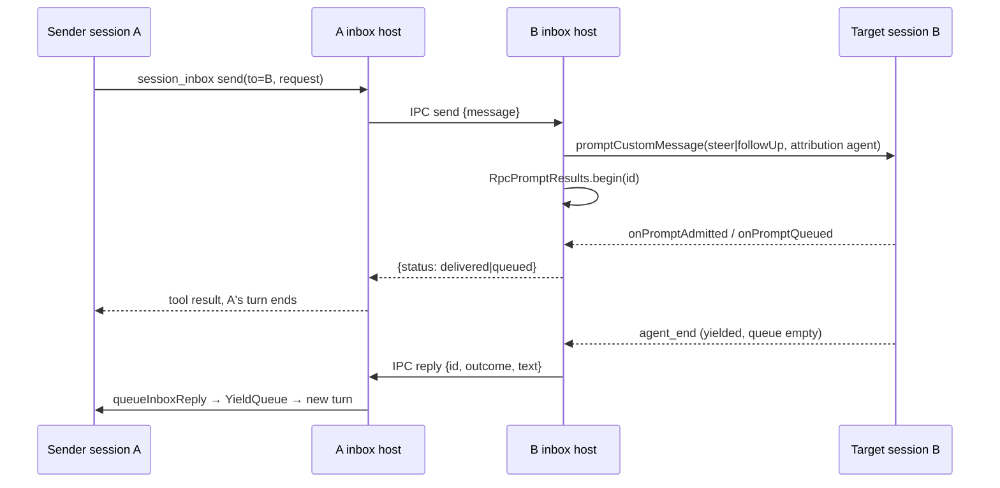

# Implementation Plan: Session Inbox

**Branch**: `023-session-inbox`. The work happens on `main`. | **Date**: 2026-11-20 | **Spec**: [spec.md](spec.md)

**Input**: Feature specification from `specs/023-session-inbox/spec.md`

## Summary

Every top-level interactive omp session gets a private local inbox. Other sessions of the same user use it to list sessions, to send a **request** or a **notification**, and to **interrupt** a turn. A request acts like user input in the target. When the turn ends, the target's last answer comes back to the sender like a background job result. A notification is advice, routed with the advisor-note rules, and gets no reply.

Almost every part reuses code that exists today:

| Need | Reused part (research) |
|---|---|
| Same-user socket, bind lock, stale replacement, Windows pipes | `IpcServer` / `IpcConnection` / `ipcEndpoint` (R1) |
| Discovery files, token, prune, bounded listing | collab registry helpers, moved to `ipc/private-registry.ts` (R1) |
| Address and parent link | `ZMX_SESSION`, `OMP_SPAWN_PARENT` (R2) |
| Request into a live or idle turn, sender card, editor untouched | `promptCustomMessage` + `collab-prompt` type (R3) |
| "Which turn did my request enter, and how did it end" | `RpcPromptResults`, extended with answer text (R4) |
| Reply that starts a turn in the sender | YieldQueue kind, like `async-result` (R5) |
| Notification levels and wake rules | `resolveAdvisorDeliveryChannel` via a new `routeExternalNote` seam (R6) |
| Interrupt | `session.abort` + `emitNotice`, as in collab (R7) |
| Tool gating to the top-level TUI, master mode allowlist | `tuiTranscript` gate, `ALLOWED_TOOLS` (R8) |

The new code is the inbox host (handler + session glue), the registry wire format, one tool, one setting, and two small seams in `AgentSession` and `SessionAdvisors`.

## Technical Context

**Language/Version**: TypeScript on Bun 1.4.x

**Primary Dependencies**:
- Workspace packages `@oh-my-pi/pi-coding-agent`, `@oh-my-pi/pi-natives` (IPC, `vcs`), `@oh-my-pi/pi-utils` (`dirs`, `logger`, `postmortem`), `@oh-my-pi/omptype` (tool schema) and `@oh-my-pi/pi-tui` (`USER_INTERRUPT_LABEL`).
- No new external dependency.

**Storage**: one 0600 JSON discovery file for each live session in `~/.omp/run/session-inbox/` (XDG state override honored). Nothing persists across restarts.

**Testing**: `bun test` in `packages/coding-agent/test/`. The real `IpcServer` runs on temp dirs, as in `test/collab/registry.test.ts`. Agent sessions are stubbed through the existing advisor and RPC test helpers. Then `bun check` and `omp --smoke-test`.

**Target Platform**: macOS and Linux (Unix sockets) and Windows (named pipes, through the same native API).

**Project Type**: CLI/TUI application (monorepo package).

**Performance Goals**:
- A message shows in an idle target within 1 s (SC-001).
- A reply reaches the sender within 2 s after the target's turn ends (SC-006).
- `list` takes at most 1.5 s for each dead or slow entry, with 8 entries checked in parallel (SC-003).

**Constraints**:
- The send never waits for the target's run (SC-005).
- The request text is 256 KiB at most, the reply text 16 KiB at most, and a frame 2 MiB at most (research.md R10).
- Same OS user only (FR-012).
- The RPC wire format does not change.

**Scale/Scope**: a few to a few dozen sessions on one machine.

## Constitution Check

*GATE: Must pass before Phase 0 research. Re-check after Phase 1 design.*

`.specify/memory/constitution.md` is the unfilled template, so it sets no project gates. The plan checks itself against the repo's standing rules instead:

| Rule | Status |
|---|---|
| Reuse before new code (ponytail ladder) | PASS. Nine of the ten needs reuse existing parts (table above). The only extraction, `ipc/private-registry.ts`, removes duplication instead of adding a layer. |
| No backward-compatibility shims | PASS. There is no protocol versioning beyond `v: 1`, and no migration. |
| No hashing or retained-evidence ceremony | PASS. The token is a random bearer token compared in constant time. Nothing is logged or kept as evidence. |
| Tests prove properties, not copies | PASS (planned). The tests target invariants: one reply for each request for each turn, a reply never makes a reply, foreign files are never pruned, an unknown reply ID is refused, and the size and level rules hold. |
| New `config.yml` setting → append default to `~/.omp/agent/config.yml` | PLANNED (`inbox.enabled: true`). |
| Fork feature → `UPSTREAM_DIVERGENCES.md` + `CHANGELOG.md` | PLANNED. |

**Post-design re-check:** PASS. The design adds no layer with only one implementation, beyond the host class that owns the listener's lifetime.

## Project Structure

### Documentation (this feature)

```text
specs/023-session-inbox/
├── plan.md
├── research.md
├── data-model.md
├── quickstart.md
├── contracts/
│   ├── inbox-ipc.md
│   └── session-inbox-tool.md
└── tasks.md             # /speckit.tasks
```

### Source Code (repository root)

```text
packages/utils/src/dirs.ts                     # + getSessionInboxDir()

packages/coding-agent/src/
├── ipc/private-registry.ts                    # NEW: helpers moved out of collab/registry.ts
├── collab/registry.ts                         # import the moved helpers
├── inbox/
│   ├── registry.ts                            # NEW: entry schema, publish, list, lookup, one-shot call
│   ├── host.ts                                # NEW: InboxHost — handler, delivery, reply tickets, pending map
│   └── settings.ts                            # NEW: inbox.enabled
├── tools/
│   ├── session-inbox.ts                       # NEW: session_inbox tool
│   ├── builtin-names.ts                       # + "session_inbox"
│   └── index.ts                               # + HIDDEN_TOOLS entry, isToolAllowed gate, ToolSession.getSessionInbox
├── prompts/tools/session-inbox.md             # NEW: tool description
├── prompts/system/master-mode-active.md       # toolset line + reply rule
├── session/master-mode.ts                     # ALLOWED_TOOLS + session_inbox
├── session/session-advisors.ts                # #routeNote split, routeExternalNote, dispatcher always on, idle aside → preserve
├── session/agent-session.ts                   # routeInboxNote, queueInboxReply, "inbox-reply" YieldQueue kind, epoch clear
├── modes/rpc/rpc-prompt-results.ts            # RunOutcome.text, passed as the 2nd output arg
├── modes/interactive-mode.ts                  # start/stop InboxHost, live setting toggle
├── config/all-settings.ts                     # import inbox/settings
└── sdk.ts                                     # register the hidden tool

packages/coding-agent/test/
├── ipc/private-registry.test.ts
└── inbox/{registry,host,tool}.test.ts

docs/session-inbox.md, docs/settings.md, docs/master-mode.md
packages/coding-agent/CHANGELOG.md, UPSTREAM_DIVERGENCES.md
```

**Structure Decision**:
- The new code goes in one new domain folder, `inbox/`, with three files. That follows `collab/` and `advisor/`.
- There is one tool file, and the shared IPC helpers go in a small `ipc/` module.
- Everything else is an edit at an existing seam.

## Design Notes



- **Request attribution.** A request uses `attribution: "agent"` with `collab-prompt` (R3).
  - **Effect:** the request enters at the next step and keeps an open `ask` or approval dialog open (spec edge case).
  - **Cost:** it does not cut a running tool batch the way a typed message can in `interruptMode: "immediate"`. The sender uses `interrupt` for that.
- **Notifications through the advisor router (R6).**
  - **Plan mode:** a plan-mode target downgrades `concern` and `blocker` to a card. FR-018 ("same rules") covers this.
  - **Remote interrupt:** it sets the advisor auto-resume latch. Until the target's user types, notifications become cards (R7). Requests are not affected.
- **Reply after `/new` in the sender.** The epoch drops the reply, like async results (R5). The pending map is cleared at the same point, so a late reply gets `unknown_id`.
- **Pending before send.** The sender adds the message ID to its pending map before it sends the request, and removes it on `not_delivered` or a failed call. A fast reply cannot arrive before its ID (R5).
- **Reply routing by entry ID.** The target sends the reply to the sender's `from.entryId`, not to its address, so a shared address cannot send a reply to the wrong session (R5).
- **Reply after a user interrupt in the sender.** The YieldQueue holds back background results, so the reply joins the context with no turn (spec FR-015 exception).
- **One reply per sender per turn.** The tracker gives this through ticket semantics, not through a dedup table (R4).
- **Live setting toggle.**
  - **Turned off:** the host stops. It withdraws the entry, closes the server and destroys open connections.
  - **Turned on:** the host starts again.
  - **Tool:** it stays registered for the session. When no host runs, it throws `ToolError("Session inbox is off")`.

## Complexity Tracking

No constitution violations. One trade-off is recorded:

| Choice | Why | Simpler alternative rejected because |
|---|---|---|
| Move the collab registry helpers to `ipc/private-registry.ts` | The inbox needs the same private-dir, token and prune code, and that code is security-relevant. | Copying about 120 lines makes two copies to keep in sync. Reusing collab's directory and handler is unsafe, because a collab list deletes inbox files and the collab token mints control links. |
