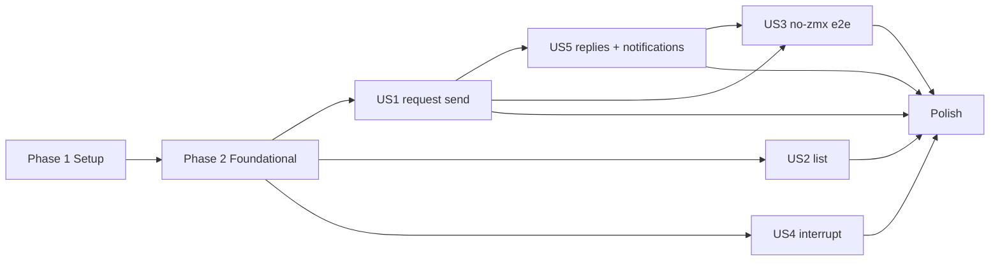

---

description: "Task list for Session Inbox"
---

# Tasks: Session Inbox

**Input**: Design documents from `specs/023-session-inbox/`

**Prerequisites**: plan.md, spec.md, research.md, data-model.md, contracts/inbox-ipc.md, contracts/session-inbox-tool.md, quickstart.md

**Tests**: The plan and the quickstart name the test files. Each test must prove a property (an invariant over generated or boundary inputs), not copy the implementation. Use temp dirs and the real `IpcServer`, as `packages/coding-agent/test/collab/registry.test.ts` does.

**Organization**: Tasks are grouped by user story. All source paths are under `packages/coding-agent/src/` unless a path says otherwise. Test paths are under `packages/coding-agent/test/`. Research IDs (R1–R10) refer to `research.md`.

## Format: `[ID] [P?] [Story] Description`

- **[P]**: Can run in parallel (different files, no dependencies)
- **[Story]**: The user story the task belongs to (US1–US5)

---

## Phase 1: Setup (Shared Infrastructure)

**Purpose**: Directory helper and setting that every later phase reads.

- [X] T001 [P] Add `getSessionInboxDir()` to `packages/utils/src/dirs.ts`, next to `getSessionOwnersDir`. It returns `dirs.baseRootSubdir(path.join("run", "session-inbox"), "state")` (R1). Add a case to `packages/utils/test/dirs.test.ts` that shows the path is the same under two different profiles.
- [X] T002 [P] Create `inbox/settings.ts`:
  - Register `cfgInboxEnabled`: `id: "inbox.enabled"`, `type: "boolean"`, `default: true`, `protocolDefault: ["rpc", "acp"]`, `ui: { tab: "interaction", group: "Session Inbox", label, description }`. Copy the shape of `advisor/settings.ts`.
  - Import it in `config/all-settings.ts` after the collab import.
  - Add a row to `docs/settings.md`.
  - Append `inbox:\n  enabled: true` to `~/.omp/agent/config.yml` (R9).

---

## Phase 2: Foundational (Blocking Prerequisites)

**Purpose**: Transport, discovery, the host lifetime, and the tool shell that every story uses.

**⚠️ CRITICAL**: No user story work can begin until this phase is complete.

- [X] T003 Move the module-private generic helpers from `collab/registry.ts` into a new `ipc/private-registry.ts` and export them (R1):
  - `assertPrivateDir`, `ensurePrivateDir`
  - `tokenMatches`, `pidAlive`
  - `endpointFiles`, `removeFilesSync`
  - `pruneEntry`
  - the one-request `query` skeleton that returns `ok` / `dead` / `skip`
  - the bounded worker pool

  Add a `label: string` parameter wherever an error text says "collab registry". Change `collab/registry.ts` to import the helpers, with no change in behavior. Delete the old private copies.
- [X] T004 [P] Create `test/ipc/private-registry.test.ts` with these properties:
  - `tokenMatches` is false for every token that differs in any byte or in length. Use a fixed-seed generator and print the seed.
  - `pruneEntry` never removes a path outside the given dir.
  - `query` classifies `ENOENT` and `ECONNREFUSED` as `dead`, and a timeout or a bad response as `skip`.
  - `assertPrivateDir` refuses a symlink and a non-directory.

  Then run `bun test test/collab/registry.test.ts` and make sure it stays green.
- [X] T005 Create `inbox/registry.ts` from data-model.md "Inbox entry" and contracts/inbox-ipc.md:
  - Constants: `INBOX_VERSION = 1`, `MAX_FRAME = 1 MiB`, `MAX_TEXT = 256 KiB`, `MAX_REPLY_TEXT = 16 KiB`, `CONNECT_TIMEOUT_MS = 3000`, `QUERY_TIMEOUT_MS = 1500`.
  - `inboxAddress(env, pid)` returns `env.ZMX_SESSION` or else `omp-<pid>`.
  - `parseInboxEntry(text)`.
  - `publishInboxEntry({ address, parent, onConnection })`. It uses `ensurePrivateDir`, a random `entryId` and `token`, and `IpcServer.listen(ipcEndpoint(dir, entryId), { framing: "lines", maxFrameBytes: MAX_FRAME }, …)`. It writes the metadata as a `*.json.tmp` file with mode 0600 and renames it into place. It cleans up with `process.once("exit")` plus `postmortem.register`. It returns `{ entry, close() }`, and `close()` also destroys the live connections.
  - `listInboxEntries()`. It runs a bounded pool of `snapshot` queries, prunes `dead` entries, hides `skip` entries, and sorts newest `createdAt` first.
  - `callInbox(entry, request)`. It connects, sends one line, reads one line, and destroys the connection.
- [X] T006 Create `inbox/host.ts` with `class InboxHost`:
  - `constructor(session: AgentSession)`, `start()`, `stop()`, getters `address` and `parent`.
  - A connection handler that checks the request in the contract order: `malformed_request`, then `unsupported_protocol`, then `authentication_failed` (via `tokenMatches`), then `invalid_operation`.
  - The `snapshot` op, with the fields from data-model.md "Reachable session". Branch comes from `vcs.git(cwd)?.currentBranch()`. Cap each string at 1024 chars.
  - `lookup(address)`, which returns `{ entry } | { ambiguous: entries } | { none }` and never returns the host itself.
  - An empty `pending: Map<id, { target, sentAt }>` that is cleared when the conversation changes (`/new` or resume).
  - `ops: send / interrupt / reply`, which answer `invalid_operation` until the story phases fill them in.
- [X] T007 Wire the host into the session:
  - Add `setSessionInbox(host | null)` and `getSessionInbox()` to `session/agent-session.ts`, next to `setSpawnHandler`.
  - Add `getSessionInbox?(): InboxHost | undefined` to `ToolSession` in `tools/index.ts`.
  - In `modes/interactive-mode.ts`, next to `setSpawnHandler` (about line 3059), create and start an `InboxHost` when `cfgInboxEnabled` is on.
  - Use `settings.onEffectiveChange([cfgInboxEnabled], …)` to start or stop the host while the session runs.
  - Stop the host on dispose.
- [X] T008 Add the tool shell (contracts/session-inbox-tool.md):
  - Create `tools/session-inbox.ts` with `class SessionInboxTool`: `name: "session_inbox"`, `approval: "read"`, `strict: true`, `intent: "omit"`, and the schema `{ op, to?, text?, kind?, delivery?, level? }`. Validate every field combination in `execute` with a `ToolError`. When `getSessionInbox()` is undefined, throw `ToolError("Session inbox is off")`.
  - Create `prompts/tools/session-inbox.md`.
  - Add `"session_inbox"` to `HIDDEN_TOOL_NAMES` in `tools/builtin-names.ts`.
  - Add the factory to `HIDDEN_TOOLS` in `tools/index.ts`.
  - Add a gate to `isToolAllowed`: `!restrictToolNames && session.tuiTranscript === true && cfgInboxEnabled.get(session.settings)`.
  - In `sdk.ts`, register the tool by copying the `spawn_session` block (about line 3922) and the extension wrap pass (about line 4055).
- [X] T009 [P] Create `test/inbox/registry.test.ts`:
  - A request with a wrong token is refused, and nothing changes in the session.
  - Error codes follow the contract order for every malformed input.
  - A dead entry is pruned.
  - A foreign `.json` file in the inbox dir never touches files in `run/collab-hosts`.
  - The socket mode is 0600.
  - `inboxAddress` returns `ZMX_SESSION` when it is set and `omp-<pid>` when it is not.

  In `test/settings-gated-tools-live.test.ts`, show that the tool is absent for a subagent, for RPC mode, and when `inbox.enabled` is false.

**Checkpoint**: A session publishes an entry, answers `snapshot`, and has a `session_inbox` tool that validates its input.

---

## Phase 3: User Story 1 - A master session sends an instruction to a child session (Priority: P1) 🎯 MVP

**Goal**: A sender sends a request, the target treats it as input from the sender, and the sender gets a delivery status at once.

**Independent Test**: Start two hosts. The sender sends "reply with PONG". The target shows a `«sender» ›` card and starts a turn. The sender gets `delivered` before the target's run ends.

- [X] T010 [US1] Implement `send` with `kind = request` in `inbox/host.ts` (R3):
  0. First write the `steer` case of T013 and run it against a real `AgentSession` before you write the code below. It proves that an `attribution: "agent"` steer sent during a running turn enters at the next step. When the case fails, stop and change the delivery design in research.md R3 before you continue.
  1. Check the field rules and `MAX_TEXT`. Answer `invalid` or `too_large` when a rule fails.
  2. Wait while `session.isSessionTransitioning` is true.
  3. Call `session.promptCustomMessage({ customType: COLLAB_PROMPT_MESSAGE_TYPE, content: "[from <name> (<address>)] <text>", display: true, details: { from: name }, attribution: "agent" }, { streamingBehavior: delivery === "after_turn" ? "followUp" : "steer", queueChipText: text, onPromptAdmitted, onPromptQueued })`. Do not await the returned promise.
  4. Map the outcome to the response:
     - `onPromptQueued` gives `queued`.
     - `onPromptAdmitted` gives `delivered`.
     - A `false` return gives `not_delivered`, with `cost_cap` or `aborted`.
     - A throw gives `not_delivered` with the error.
  5. Put `conversationId` in the response.
- [X] T011 [US1] Implement the `send` op in `tools/session-inbox.ts`:
  - Resolve the address with `host.lookup`.
  - Throw a `ToolError` for an unknown address, an ambiguous address, a send to the caller's own address, or an oversized text.
  - Add the ID to `host.pending` before you call `callInbox` when the kind is `request`. Remove the ID when the result is `not_delivered` or when `callInbox` fails. A reply can come back before `callInbox` returns, so a later add would refuse it as `unknown_id`.
  - Send `from: { address, name, entryId }`, with the caller's own entry ID.
  - Render the result text exactly as contracts/session-inbox-tool.md says.
- [X] T012 [P] [US1] Update master mode:
  - Add `session_inbox: true` to `ALLOWED_TOOLS` in `session/master-mode.ts`.
  - Add `` `session_inbox` `` to the toolset line in `prompts/system/master-mode-active.md`.
  - Replace the sentence "nothing comes back here" with: use `session_inbox` to steer a child, and its reply arrives by itself.
  - Add an allow case to `test/master-mode-guard.test.ts`.
- [X] T013 [US1] Create `test/inbox/host.test.ts` (request delivery):
  - An idle target gets `delivered`, and a turn starts.
  - A busy target gets `queued` for `after_turn`. For `steer`, the request enters at the next step, which proves the [INFERENCE] in R3. T010 step 0 writes this case first.
  - A cost-cap refusal gives `not_delivered` with `cost_cap`.
  - A request sent while an `ask` dialog is open does not close the dialog. A steered request sent while a tool runs does not stop that tool.
  - N requests in a row (N from 1 to 20, fixed seed) are delivered in send order.
  - The target's editor text is unchanged after every delivery.

**Checkpoint**: A master can steer a child, and two plain sessions can steer each other.

---

## Phase 4: User Story 2 - A session finds the sessions it can reach (Priority: P1)

**Goal**: `list` shows live sessions with their address, cwd, branch, state and parent links.

**Independent Test**: Start three hosts and stop one. `list` from a fourth host shows exactly the two live hosts and never shows the caller.

- [X] T014 [US2] Implement the `list` op in `tools/session-inbox.ts`:
  - Call `listInboxEntries()` and drop the caller's own entry.
  - Compute `startedByCaller` as `entry.parent === host.address` and `startedCaller` as `entry.address === host.parent`.
  - Render one line for each session in the contract format, or `No other sessions are reachable.` when there is none.
- [X] T015 [US2] Extend `test/inbox/registry.test.ts`:
  - For a generated set of hosts, some stopped and some live, the list equals exactly the live set minus the caller.
  - A stopped host disappears within one list call.
  - The parent-link flags are true only for a matching pair.
  - Two live entries with one address make `lookup` return `ambiguous`.

**Checkpoint**: An agent can find the target by name, directory or branch.

---

## Phase 5: User Story 5 - The sender gets the target's reply, and the target can report back (Priority: P1)

**Goal**:
- A request gets one reply when its turn ends, and the reply starts a turn in the sender.
- A notification is advice, follows the advisor rules, and gets no reply.

**Independent Test**:
- Send a request "reply with PONG" and end the sender's turn. The sender then gets `Reply from … completed` with `PONG` in a new turn.
- A `nit` notification sent to an idle target shows a card, starts no turn, and gets no reply.

- [X] T016 [P] [US5] In `modes/rpc/rpc-prompt-results.ts` (R4):
  - Add `text?: string` to `RunOutcome`.
  - Set it in `runOutcome` from the last assistant message with `extractVisibleAssistantText` (`modes/rpc/rpc-live.ts`).
  - Call `this.#output(frame, outcome.text)`. Keep the RPC frame unchanged.
  - Add a case to `test/rpc-prompt-result.test.ts`: the text passed to `output` equals the visible text of the final assistant message, and the frame has no text field.
- [X] T017 [P] [US5] In `session/agent-session.ts` (R5):
  - Register the YieldQueue kind `"inbox-reply"` next to `"async-result"` (about line 2865).
  - `build` makes one `custom` message (`attribution: "agent"`) with a `<system-notice>` body, in the format of contracts/session-inbox-tool.md "Reply delivered later". The body uses `escapeHarnessTags`.
  - `isStale` uses the async-delivery epoch.
  - The epoch bump (about line 3850) also calls `yieldQueue.clear("inbox-reply")`.
  - Add a public `queueInboxReply(reply)` that mirrors `queueLaunchCompletion` (about line 10483), including its dispose guard.
- [X] T018 [P] [US5] In `session/session-advisors.ts` (R6):
  - Split `#routeAdvice` into an advisor-agnostic `#routeNote(source, note, severity)` that returns the channel.
  - Add a public `routeExternalNote(source, note, severity): AdvisorDeliveryChannel`.
  - Register the `"advisor"` YieldQueue dispatcher even when no advisor is configured.
  - When the channel is `aside` and the agent is not streaming, use `preserve`.
  - Expose the method as `AgentSession.routeInboxNote(source, note, severity)`.

  Make sure the existing advisor tests `test/agent-session-advisor-suppression.test.ts` and `test/advisor-tool-call-loop-guard.test.ts` stay green.
- [X] T019 [US5] In `inbox/host.ts`, add reply tracking (depends on T016):
  1. Create one `RpcPromptResults(session, onReport)` for each host, and feed it from `session.subscribe`. Keep a side map from ticket ID to the sender's `from.entryId`.
  2. For a request, call `begin(id)` before `promptCustomMessage` and `settle(ticket)` from the admitted or queued callback. Call `discard` when the result is not delivered.
  3. Call `abortOpen()` when the conversation changes.
  4. In `onReport`:
     - Cut the text to `MAX_REPLY_TEXT` on a UTF-8 boundary and set `truncated`.
     - Find the sender's registry entry by `entryId`, not by address. When no entry has that ID, drop the reply.
     - Make one `callInbox` attempt with `op: "reply"`.
     - When it fails, log at debug and drop the reply.
- [X] T020 [US5] In `inbox/host.ts`, add the `reply` op (depends on T017):
  - Accept only an ID that is in `pending`, then delete the ID and call `session.queueInboxReply(reply)`.
  - Answer `unknown_id` for any other ID.
  - A reply never opens a ticket.
- [X] T021 [US5] In `inbox/host.ts` and `tools/session-inbox.ts`, add `send` with `kind = notification` (depends on T018):
  - Call `session.routeInboxNote("<name> (<address>)", text, level ?? "nit")`.
  - Map the channel to the result: `steer` gives `delivered`, `aside` gives `queued`, and `preserve` gives `delivered` with `shown: true`.
  - Open no ticket, and add nothing to `pending`.
  - Render the notification variants of the result text in the tool.
- [X] T022 [US5] Extend `test/inbox/host.test.ts` with these properties:
  - For K requests from K senders (K from 1 to 5, fixed seed) that enter one turn, each sender gets exactly one reply.
  - An idle request gets the reply of its own run, not of an earlier run.
  - `/new` in the target gives `aborted` replies.
  - A reply text over 16 KiB is cut to at most 16 KiB of valid UTF-8 with `truncated`.
  - A reply for an unknown ID is refused, and the sender's queue does not change.
  - A reply never causes another reply.
  - A notification never makes a reply.
  - A `nit` sent to an idle target shows a card and starts no turn.
  - A `concern` sent to an idle target starts a turn.
  - After a remote interrupt, a `concern` shows only as a card.
  - In a plan-mode target, a `concern` shows only as a card.
  - In the sender, `/new` drops a reply that is still pending.
  - A reply that the target sends before the sender's `callInbox` returns is accepted, not refused as `unknown_id`.
  - When two live sessions share the sender's address, the reply reaches the sender that sent the request.
  - After the sender's own user interrupt, a reply joins the sender's conversation and starts no turn.

**Checkpoint**: A master hears back from its children without polling, and a child can report to its parent.

---

## Phase 6: User Story 3 - A normal top-level session sends to another top-level session (Priority: P2)

**Goal**: Everything works with no zmx and no parent link.

**Independent Test**: Start two hosts with `ZMX_SESSION` and `OMP_SPAWN_PARENT` unset. A send and its reply work, and both parent-link flags are false.

- [X] T023 [US3] Add an end-to-end case to `test/inbox/host.test.ts`:
  - Start two in-process hosts with `ZMX_SESSION` and `OMP_SPAWN_PARENT` removed from the environment.
  - Each lists the other as `omp-<pid>` with both link flags false.
  - A request goes from A to B, and the reply comes back to A.

**Checkpoint**: The feature does not depend on zmx.

---

## Phase 7: User Story 4 - A session interrupts another session (Priority: P2)

**Goal**: A sender stops the current turn of a target. The target shows who stopped it.

**Independent Test**: The target runs a long turn. `interrupt` stops it, the target shows `<name> interrupted`, and an idle target answers `idle`.

- [X] T024 [US4] Implement `interrupt` in `inbox/host.ts` (R7):
  - When `session.isStreaming` is false and `session.queuedMessageCount` is 0, answer `idle`.
  - Otherwise call `session.abort({ reason: USER_INTERRUPT_LABEL })`, then `session.emitNotice("info", "<name> interrupted", "inbox")`, and answer `interrupted`.
- [X] T025 [US4] Add the `interrupt` op to `tools/session-inbox.ts` with the contract result text. Add cases to `test/inbox/host.test.ts`:
  - A busy target stops and emits the notice.
  - An idle target answers `idle` and does not call `abort`.

**Checkpoint**: Every story works on its own.

---

## Phase 8: Polish & Cross-Cutting Concerns

- [X] T026 [P] Write `docs/session-inbox.md`. It covers what the inbox does, the tool ops, the difference between a request and a notification, the setting, the accepted gaps (plan mode, approval modes, and loops the agents choose), the dialog behavior, and the reply that starts no turn after the sender's user interrupt.
- [X] T027 [P] Update `docs/master-mode.md`. At about line 69, replace "Its result does not come back to the master session" with the inbox reply flow.
- [X] T028 [P] Add a fork entry to `packages/coding-agent/CHANGELOG.md`, near the `/spawn` entries. Add an `UPSTREAM_DIVERGENCES.md` block with **Decision**, **Why**, **Key paths**, **Checks** and **Retire when**, in the style of the master-mode block.
- [X] T029 Run the checks from `packages/coding-agent`:
  - `bun test test/ipc/ test/collab/registry.test.ts test/inbox/ test/rpc-prompt-result.test.ts test/master-mode-guard.test.ts test/settings-gated-tools-live.test.ts test/agent-session-advisor-suppression.test.ts`
  - `bun check`
  - `omp --smoke-test`
- [X] T030 Run quickstart.md sections 2 and 3 on the real TUI. Record the observed results. Remove any throwaway scripts.

---

## Dependencies & Execution Order



**Phase order**
- Setup and Foundational run first. T003 comes before T005, and T005 before T006, T007 and T008.
- US1, US2 and US4 depend only on Foundational.
- US5 needs US1's request path (T010, T011).
- The US3 end-to-end test needs US1 and US5.

**Inside US5**
- T016, T017 and T018 touch different files and can run in parallel.
- T019 needs T016. T020 needs T017. T021 needs T018.

**Shared files**
- `inbox/host.ts` and `tools/session-inbox.ts` are edited by several stories. Tasks that touch them run one after another.

## Parallel Example: User Story 5

```text
T016 rpc-prompt-results text   ─┐
T017 agent-session inbox-reply  ├─ parallel (different files)
T018 session-advisors seam     ─┘
then T019 → T020 → T021 (same file: inbox/host.ts), then T022
```

## Parallel Example: Foundational

```text
T003 helper extraction → T004 (tests) ∥ T005 registry → T006 host → T007 wiring ∥ T008 tool shell → T009 tests
```

## Implementation Strategy

### MVP (US1 + US2)

1. Do Phase 1 and Phase 2.
2. Do US1 and US2. A master can find a child and steer it. Stop here and check it with quickstart section 2, steps 1 to 4, without the reply.

### Incremental Delivery

1. Add US5. Replies and notifications close the "nothing comes back" gap, which is the main value for master mode.
2. Add US3 (proof that zmx is not needed) and US4 (interrupt).
3. Do the Polish phase: docs, changelog, divergences, full checks and the real-TUI quickstart.

---

## Phase 9: Convergence

One agent owns `packages/coding-agent/test/inbox/host.test.ts` (T031–T035, T037). The tasks marked [P] touch other files and can run in parallel. A test that uses the registry MUST pass a temp dir, because `getSessionInboxDir()` points at the live `~/.omp/run/session-inbox`.

- [X] T031 Replace the vacuous dialog half of the "steered request never reads as user steering" case in `test/inbox/host.test.ts` with a real `ask` call. Give the target `hasUI: true` and a `ui` whose `select`/`editor` stay pending and record `dialogOptions.signal`. Assert that the stub was called before the steer, that the recorded signal is still not aborted after the steer, and that `ask` resolves only after the stub resolves. Keep the running-tool half, and assert the tool's real return value, not a skipped result. Per FR-006, US1/AC2 (partial)
- [X] T032 Add to `test/inbox/host.test.ts`: N requests in a row (N from 1 to 20, fixed printed seed, steer and after_turn mixed) reach the target in send order, and every send ends with exactly one of delivered, queued, or not_delivered. Per FR-014, SC-002 (partial)
- [X] T033 Add notification cases to `test/inbox/host.test.ts`: a `concern` to an idle target starts a turn; after a remote `interrupt`, a `concern` shows only as a card; in a plan-mode target (`setPlanModeState({ enabled: true, … })`), a `concern` shows only as a card. Per FR-018, US5/AC9 (partial)
- [X] T034 Add sender-side reply cases to `test/inbox/host.test.ts`: `/new` in the sender drops a pending reply (`unknown_id`); a reply that arrives before the sender's `callInbox` returns is accepted; after the sender's own user interrupt, a reply joins the conversation and starts no turn; a reply never causes another reply (the target gets nothing back). Per FR-015 (partial)
- [X] T035 Add to `test/inbox/host.test.ts`: two live hosts share one address, and the reply reaches the one that sent the request (routing by `from.entryId`). Also send a target answer over 16 KiB through the host, and assert that the delivered reply has `truncated` and at most 16 KiB of valid UTF-8. Per FR-015, FR-017 (partial)
- [X] T036 [P] In `test/settings-gated-tools-live.test.ts`, show that `session_inbox` is absent for a subagent, in RPC mode, and when `inbox.enabled` is false. Touch only this file. Per FR-002, FR-011, FR-016 (partial)
- [X] T037 Prove that a delivered request does not change the target user's editor draft. Use an InteractiveMode-level test if the harness allows it. If it does not, record a real-TUI check in quickstart.md. Per FR-013 (partial)
- [X] T038 [P] Add these cases to `test/inbox/registry.test.ts`, with a temp dir: the inbox endpoint socket has mode 0600; a foreign `.json` in the inbox dir never touches files in `run/collab-hosts`; a wrong-token `send`, `interrupt` and `reply` are refused and change nothing in the session; a non-JSON or non-object line answers `malformed_request`. Touch only this file. Per FR-012, T009 (partial)
- [X] T039 [P] Create `test/inbox/tool.test.ts` for `SessionInboxTool`: a send to the caller's own address is refused; an unknown address throws "No reachable session"; two entries with one address give the ambiguous error; an oversized text names the limit; the `interrupt` result texts follow the contract; in a two-host no-zmx setup, each host lists the other with no link flags. Touch only this file. Per plan: test/inbox/tool.test.ts, T015, T023, T025 (missing)
- [X] T040 [P] Add the `getSessionInboxDir()` case to `packages/utils/test/dirs.test.ts`: the path is the same under two different profiles. T001 is marked done, but this case does not exist. Touch only this file. Per T001 (missing)
- [X] T041 [P] In `test/ipc/private-registry.test.ts`, add a stale socket file with no listener (`ECONNREFUSED` → `dead`), and a non-JSON or closed-connection response (→ `skip`). Touch only this file. Per T004 (partial)
- [X] T042 Resolve the frame-size mismatch. The plan says 1 MiB, and `inbox/registry.ts` uses 2 MiB because a 256 KiB text can grow up to 6 times when JSON-escaped. Keep 2 MiB and record the reason in research.md, or lower the text limit so that 1 MiB holds. Per plan: Constraints (contradicts)
- [X] T043 In a plan-mode target, a `concern` or `blocker` notification is only shown, but the host maps the advisor channel `steer` to `delivered` with no `shown` flag. Make the result say "(shown, no turn started)" when no turn starts. Per FR-008, US5/AC9 (partial)

---

## Phase 10: Convergence

- [X] T044 Add a case to `test/inbox/host.test.ts`: the target's turn on a request ends with a model error, and the sender's reply has `outcome: "error"` and the error text. The existing cases cover only `completed` and `aborted` through the host. Per US5/AC4, FR-017 (partial)
- [X] T045 Add a case to `test/inbox/host.test.ts`: the sender's host stops before the target's turn ends. The target finishes its turn, drops the reply, and makes no further model call, with no error that changes its state. Per US5/AC5 (partial)
- [X] T046 [P] Add `packages/coding-agent/test/inbox/tool.test.ts`, `packages/utils/test/dirs.test.ts` and `packages/coding-agent/test/agent-session-advisor-suppression.test.ts` to the **Checks** list of the `### Session inbox` block in `UPSTREAM_DIVERGENCES.md`. Add `session/session-advisors.ts` (the router now reports a kept card as `preserve`) to its **Key paths** if it is missing. Per T028 (partial)
