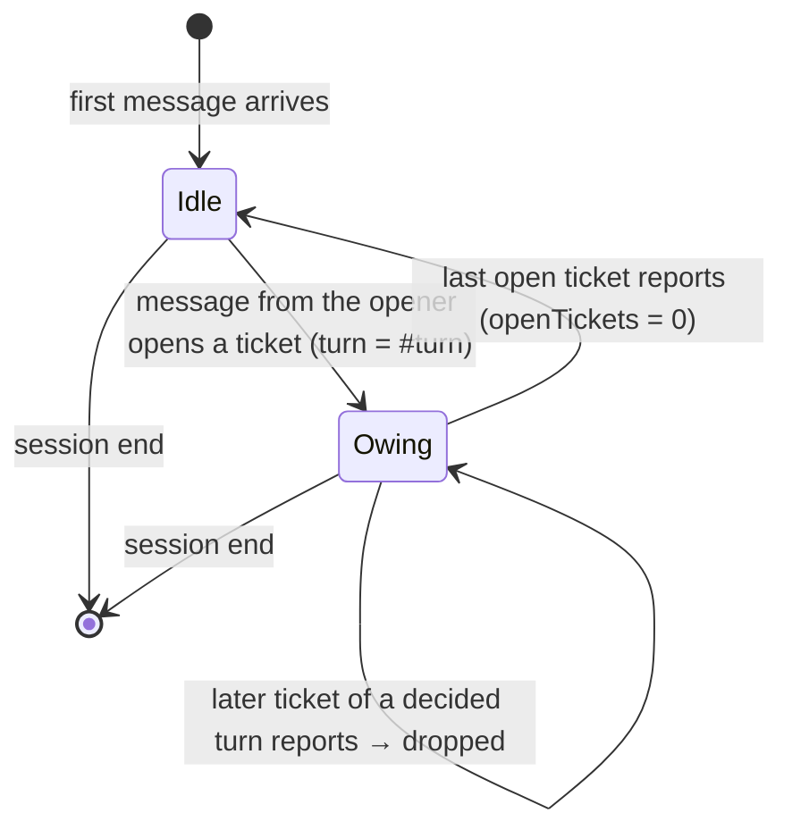

# Data Model: Inbox Threads

These types replace the request and reply types of the 023 inbox. The inbox entry and the snapshot do not change (see `specs/023-session-inbox/data-model.md`).

## Thread (in memory, one map per `InboxHost`)

| Field | Type | Rule |
|---|---|---|
| `id` | string | `t-` + 8 lowercase hex characters. The opener creates it (research R2). |
| `peer` | `InboxIdentity` (`address`, `name`, `entryId`) | The other session. Replies go to `peer.entryId`, never to the address. |
| `opened` | boolean | True in the session that sent the first message. |
| `openTickets` | number | The answer tickets that are open in this session for messages from the opener. A value above 0 means that this session owes the opener an answer. It is always 0 when `opened` is true. |
| `repliedTurns` | `Set<number>` | The turn keys in which this session sent a `reply` that is not a progress note while `openTickets > 0`. A progress note adds nothing. A decision for turn K deletes every key up to K (research R4). |
| `decidedTurn` | number | The last turn key that got a decision. It starts at -1. A ticket report with `turn <= decidedTurn` is dropped (research R4). |

**State transitions** (in the session that did not open the thread):

## Answer ticket (in memory)

`#tickets: Map<messageId, { thread: Thread; turn: number }>`. `thread` is the `Thread` record itself, so a report needs no second lookup. `turn` is the value of `#turn` at `begin`.

`#turn` counts finished turns. It goes up by 1 at each yielded `agent_end` that leaves the queue empty, at each `settledWithoutRun` call, and after `abortOpen` on a conversation change (research R4). A run and its tail run are one turn. A conversation change does not clear `#threads` (clarification B). `abortOpen` reports the cut tickets as `aborted`, and R4 sends exactly one failure notice for each thread (research R7).

## Thread message (wire, `send` with `kind: "thread"`)

| Field | Type | Rule |
|---|---|---|
| `id` | string | A random id for this message. 1 to 128 characters. |
| `from` | `InboxIdentity` | The sender. |
| `thread` | string | It must match `^t-[0-9a-f]{8}$`. |
| `type` | `"message"` \| `"progress"` \| `"auto"` \| `"failure"` | `auto` and `failure` come only from the system. |
| `first` | `true` or absent | Only on the first message of a thread. Only with `type: "message"`. |
| `text` | string | 1 byte to 256 KiB. For `auto`, at most 16 KiB of whole characters. When the turn's answer text is empty, the `auto` text is `(empty answer)`. For `failure`, it can be empty. |
| `delivery` | `"steer"` \| `"after_turn"` or absent | It is used only when the message takes the request path. |
| `outcome` | `"aborted"` \| `"error"` | Only on `failure`. |
| `error` | string or absent | Only on `failure`. |
| `truncated` | `true` or absent | Only on `auto`. |

**Validation on the receiver:**
1. A thread id that is not known: the receiver accepts it only with `first: true` and `type: "message"`, and the result is a new thread with `opened: false`. Otherwise the answer is `unknown_thread`.
2. A known thread id: `from.entryId` must equal `peer.entryId`. Otherwise the answer is `unknown_thread`. `first: true` on a known id gives `thread_conflict`.
3. `auto` and `failure` are accepted only in a thread with `opened: true`. They are answers to the opener.

## Notification (wire, unchanged)

`send` with `kind: "notification"`, `level`, and no thread. See 023.

## Send result (tool side)

| Status | Fields |
|---|---|
| `delivered`, `queued` | `conversationId`, `thread` (for a thread message), `shown` (for a notification that was only shown) |
| `not_delivered` | `reason`: `unknown_thread`, `thread_conflict`, `cost_cap`, `aborted`, `too_large`, or another wire error code |
| `gone` | The peer session ended. |
| `no_answer` | No answer before the timeout. The message can still arrive. |
