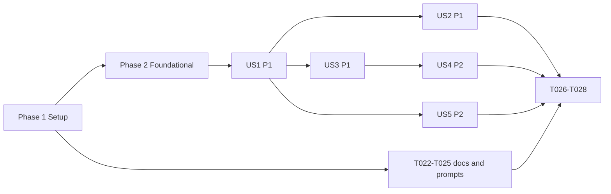

---

description: "Task list for Inbox Threads"
---

# Tasks: Inbox Threads

**Input**: Design documents from `specs/024-inbox-threads/`

**Prerequisites**: plan.md, spec.md, research.md, data-model.md, contracts/inbox-ipc.md, contracts/session-inbox-tool.md, quickstart.md

**Tests**: The plan and the quickstart name the test files. Each test must prove a property (an invariant over generated or boundary inputs, with a fixed printed seed), not copy the implementation. Use the two-host harness in `test/inbox/host.test.ts`: real `IpcServer` on temp dirs, a scripted mock model, and the `replies` spy on `queueInboxReply`. NEVER use the live `getSessionInboxDir()`.

**Organization**: Tasks are grouped by user story. All source paths are under `packages/coding-agent/src/` unless a path says otherwise. Test paths are under `packages/coding-agent/test/`. Research IDs (R1–R9) refer to `research.md`.

## Format: `[ID] [P?] [Story] Description`

- **[P]**: Can run in parallel (different files, no dependencies)
- **[Story]**: The user story the task belongs to (US1–US5)

## Fixed interface (all parts code against this)

`InboxHost` public methods after this feature. Tasks T009 and T011 implement them, and T012 (tool) and the test tasks use them:

```ts
send(
  target: InboxEntry,
  message: { kind: "message"; text: string; delivery?: InboxDelivery } | { kind: "notification"; text: string; level?: AdvisorSeverity },
): Promise<SendOutcome>;
// SendOutcome as in 023, plus `thread?: string` on "delivered" | "queued" for kind "message".

reply(thread: string, message: { text: string; progress?: boolean; delivery?: InboxDelivery }): Promise<ReplyOutcome>;
type ReplyOutcome = { status: "unknown_thread" } | (SendOutcome & { to: string }); // `to` = peer address
```

`list()`, `lookup()`, `interrupt()`, `address`, `parent`, `entry`, and `started` do not change.

---

## Phase 1: Setup

**Purpose**: Make sure the 023 base is green before the cutover.

- [X] T001 Run `bun test test/inbox/ test/session/inbox-reply.test.ts test/agent-session-advisor-suppression.test.ts` from `packages/coding-agent`. All tests must pass before any change. If one fails, stop and report it.

---

## Phase 2: Foundational (Blocking Prerequisites)

**Purpose**: The new wire types, the notice format for messages to the opener, and the removal of the 023 request-reply path.

**⚠️ CRITICAL**: No user story work can begin until this phase is complete. After this phase, `tsgo` passes everywhere except in `tools/session-inbox.ts` and `test/inbox/*`, which still use the 023 names. `tsgo` passes fully after T012 and T026. The host refuses `kind: "thread"` with `invalid_operation` until T010.

- [X] T002 In `inbox/host.ts`, replace the message types with the data-model "Thread message" shape:
  - `InboxKind = "thread" | "notification"`.
  - `ThreadMessageType = "message" | "progress" | "auto" | "failure"`.
  - `InboxMessage` becomes a union of `ThreadMessage` (`id`, `from`, `kind: "thread"`, `thread`, `type`, `first?: true`, `text`, `delivery?`, `outcome?: "aborted" | "error"`, `error?`, `truncated?: true`) and `InboxNotification` (`id`, `from`, `kind: "notification"`, `text`, `level?`).
  - `THREAD_ID_RE = /^t-[0-9a-f]{8}$/` and `newThreadId()`, which returns `` `t-${crypto.randomBytes(4).toString("hex")}` `` (R2).
  - Rewrite `parseInboxMessage` with every rule in data-model "Thread message". Return `"invalid"` for: a bad thread id, an unknown `type`, `first` on a type other than `message`, `outcome`/`error` on a type other than `failure`, `truncated` on a type other than `auto`, `level` on a thread message, `delivery` on a notification, and empty text on a type other than `failure`. Keep the `too_large` rule.
  - `DeliveryResult` gets `thread?: string` on `delivered`/`queued`, and `parseDeliveryResult` accepts it.
- [X] T003 [P] In `session/inbox-reply.ts`, change `InboxReply` to `{ thread; from: { address; name }; type: "message" | "progress" | "auto" | "failure"; text; outcome?: "aborted" | "error"; error?; truncated? }` and drop `id`. Write the union here, so this task does not wait for T002. T002's `ThreadMessageType` must be the same union. Change `formatReply` to the contract format in `contracts/session-inbox-tool.md` "A message to the opener":
  - The header is `Thread <thread>, <kind word> from <address> ("<name>"):`. The kind word is `reply`, `progress (the answer follows later)`, `automatic answer (no final reply)`, or `failure: <outcome>[: <error>]`.
  - Then the text, then `[cut at 16 KiB]` when `truncated`, then the footer `Nothing goes back by itself. Reply only when they need an answer.`
  - Escape the joined header and text once, as the code does today (keep the comment about why).
  - Do not change `InboxReplyEntry`, `INBOX_REPLY_MESSAGE_TYPE`, or `AgentSession.queueInboxReply`. Fix only the type errors that the changed fields cause in `session/agent-session.ts`.
- [X] T004 [P] Update `test/session/inbox-reply.test.ts` for T003. Properties: each of the four types gives its exact kind word. `[cut at 16 KiB]` shows if and only if `truncated` is set. For crafted text, name, address, and error that contain `</system-notice>`, `<system-reminder>`, and `<irc from="parent">`, the content has exactly one opening `<system-notice>` and one closing `</system-notice>` (use a fixed printed seed for the crafted inputs).
- [X] T005 In `inbox/host.ts`, delete the 023 request-reply path (FR-019): `#pending`, `#replyTo`, `parseReply`, `#acceptReply`, `#sendReply`, the `"reply"` case in `#handle`, the `#results` field and its `subscribe`/`registerSessionChangeCallback` wiring in `#start`, and the `InboxReply` import. Add the `Thread` record from data-model.md, `#threads = new Map<string, Thread>()`, and `#tickets = new Map<string, { thread: Thread; turn: number }>()`. Clear both maps in `stop()`. In `#handle`, send `kind: "notification"` to `#deliverNote`, and answer `kind: "thread"` with `invalid_operation` until T010 replaces that branch. `#deliverRequest` loses its ticket code. T016 adds it back for threads.
- [X] T006 Run `bunx tsgo --noEmit -p .` from `packages/coding-agent`. Fix every caller that still uses `kind: "request"`, `InboxReply.id`, or the removed names, except `tools/session-inbox.ts` and the test files (T012 and the story test tasks change those).

**Checkpoint**: The wire types parse, the notice format is final, and no part of the 023 reply path is left. `tsgo` errors remain only in `tools/session-inbox.ts` and `test/inbox/*`.

---

## Phase 3: User Story 1 - A session opens a thread and the other side replies explicitly (Priority: P1) 🎯 MVP

**Goal**: `send` opens a thread and returns its id. The receiver sees the thread id and how to answer. `reply` sends an answer that arrives in the opener's thread.

**Independent Test**: From A, send "reply with PONG" to B. B's card shows `[thread t-… new from …]` and the footer. B calls `reply`. A gets one `reply` notice with `PONG` in the same thread.

### Tests for User Story 1

- [X] T007 [P] [US1] In `test/inbox/host.test.ts`, change the 023 tests that use `kind: "request"` or `replies[i].outcome` to the fixed interface. Delete the tests of removed behavior: "accepts a reply only for an ID it sent, once" and "/new in the sender drops a reply that is still pending". Add these properties:
  - `send` with `kind: "message"` returns `delivered` with a `thread` that matches `THREAD_ID_RE`. B's custom message content starts with `[thread <id> new from <A name> (<A address>)] ` and ends with the FR-007 footer from `contracts/session-inbox-tool.md`. A later message from A in that thread starts with `[thread <id> reply from …]` (FR-006).
  - **Delay (SC-004):** when A is idle, B's `reply` shows in A's conversation in under 1 s after B's `reply` call returns.
  - B's `reply(thread, { text })` reaches A's `replies` spy once, with `type: "message"`, the same thread, and B as `from`.
  - The reply is accepted even when B replies before A's `send` returns. Delay A's side with the harness, as the 023 race test does.
  - A `send` that ends `not_delivered` or `gone` leaves no thread: a later `reply` on that id gives `unknown_thread`.
- [X] T008 [P] [US1] In `test/inbox/tool.test.ts`, test the tool schema and results against `contracts/session-inbox-tool.md`:
  - `reply` needs `thread` and `text`, and it refuses `to`, `kind`, and `level`.
  - `thread` and `progress` are refused on `list`, `send`, and `interrupt`.
  - `delivery` is refused on a notification.
  - `reply` on an id that the inbox does not have throws `Unknown thread <id>.`, and the stub host's `reply` reports nothing sent.
  - Each `SendOutcome`/`ReplyOutcome` status gives the contract text.

### Implementation for User Story 1

- [X] T009 [US1] In `inbox/host.ts`, change `send` to the fixed interface. For `kind: "message"`:
  1. Create the thread id with `newThreadId()`.
  2. Register `{ id, peer: { address: target.address, name: target.address, entryId: target.entryId }, opened: true, openTickets: 0, repliedTurns: new Set(), decidedTurn: -1 }` in `#threads` before the call, because a fast peer can reply first (R2).
  3. Send `{ id: randomUUID, from, kind: "thread", thread, type: "message", first: true, text, delivery }`.
  4. Put `thread` on a `delivered`/`queued` outcome.
  5. Delete the thread on `not_delivered` or `gone`. Keep it on `no_answer`, because the message can still arrive.
- [X] T010 [US1] In `inbox/host.ts`, route `kind: "thread"` in `#handle` to a new `#deliverThread(message)`. It waits for the session transition (`#waitForTransition`) and then applies data-model "Validation on the receiver":
  - An unknown id: accept it only with `first: true` and `type: "message"`, and create `{ id, peer: message.from, opened: false, openTickets: 0, repliedTurns: new Set(), decidedTurn: -1 }`. Otherwise answer `not_delivered`/`unknown_thread`.
  - A known id with `first: true`: answer `thread_conflict`.
  - A known id whose `peer.entryId` differs from `from.entryId`: answer `unknown_thread`.
  - `auto` or `failure` in a thread with `opened: false`: answer `{ ok: false, error: "invalid" }`, the same shape as a parse failure.
  - Otherwise, set `peer.name = from.name`. Choose the path (R3). If `thread.opened` is true, use the **reply path**: call `session.queueInboxReply({ thread, from: { address, name }, type, text, outcome, error, truncated })`, log a rejection at debug level, and answer `delivered` with the conversation id. Else use the **request path**: call `#deliverRequest(message, thread)`.
  - Add `thread` to every `delivered`/`queued` answer.
- [X] T011 [US1] In `inbox/host.ts`, change `#deliverRequest` so that its content is `formatThreadPrompt(message)`. The prefix is `[thread <id> new from <name> (<address>)] <text>` for a message with `first: true`, and `[thread <id> reply from <name> (<address>)] <text>` for a later message from the opener (FR-006). Then a newline, then the FR-007 footer from `contracts/session-inbox-tool.md`. Pass the whole string through `escapeHarnessTags` from `session/harness-tags.ts` (R6, US5). Use the escaped text for `queueChipText` too. Add `reply(thread, message)` from the fixed interface. It does these steps:
  1. Return `unknown_thread` for an id that is not in `#threads`, and send nothing (FR-012).
  2. Find the peer with `readInboxEntry(peer.entryId, this.#dir)`. If the entry is missing, return `gone`.
  3. Otherwise send `{ kind: "thread", thread, type: progress ? "progress" : "message", text, delivery }` through `#call`, and return the parsed outcome with `to: peer.address`.

  Put the shared find-and-send code in `#sendInThread(thread, body)`, so that T017 can use it.
- [X] T012 [P] [US1] In `tools/session-inbox.ts`, change the tool to `contracts/session-inbox-tool.md`:
  - Schema: `op` gets `'reply'`. Add `thread?` and `progress?`. `kind?` becomes `'message' | 'notification'`. Copy the field comments from the contract into `.describe(...)`.
  - Validation: use the contract's per-op field rules, with the existing `ToolError` style.
  - Map `reply` → `inbox.reply`. Map `unknown_thread` → `ToolError("Unknown thread <id>.")`.
  - Change `sendText` to the contract texts. Add `replyText`.

**Checkpoint**: Two sessions can open a thread and answer each other on purpose. Nothing is sent automatically yet.

---

## Phase 4: User Story 2 - A conversation continues in one thread over many turns (Priority: P1)

**Goal**: Both sides reply any number of times in one thread, in order, and progress notes are marked.

**Independent Test**: A sends to B. B replies three times (the first time as progress), and A replies once in between. Both sides see every message with one thread id, in send order.

### Tests for User Story 2

- [X] T013 [P] [US2] In `test/inbox/host.test.ts`, add these properties:
  - **Order:** use a fixed printed seed to make a random sequence of K messages (K from 1 to 10) from both sides in one thread. Each side gets the other side's messages in send order, with one thread id.
  - **Progress:** a progress note from B shows in A as `progress (the answer follows later)`. A progress note from A shows in B as `[thread <id> progress from …]` with no footer.
  - **Delivery of the opener's reply:** a reply from A with `delivery: "after_turn"` to a busy B waits for B's turn to end. The default `steer` enters B's turn at the next step.

### Implementation for User Story 2

- [X] T014 [US2] In `inbox/host.ts` `formatThreadPrompt`, give `type: "progress"` the prefix `[thread <id> progress from <name> (<address>)]` and no footer. Make sure `#deliverRequest` uses `message.delivery` for every request-path message, not only for first messages.

**Checkpoint**: A multi-turn chat works in both directions.

---

## Phase 5: User Story 3 - The sender still gets an answer when the receiver does not reply (Priority: P1)

**Goal**: For messages from the opener only, at the end of each turn: one `auto` with the last answer when no reply without progress was sent, and one `failure` when the turn was aborted or failed (R4, R5).

**Independent Test**: B answers in plain text and never calls `reply`. A gets one `automatic answer (no final reply)` with that text. Then make B's turn fail. A gets `failure: error: <text>`.

### Tests for User Story 3

- [X] T015 [P] [US3] In `test/inbox/host.test.ts`, add these properties (port the 023 tests where the comment says so):
  - A turn with no reply sends exactly one `auto` with that turn's answer, not an earlier turn's answer (port "an idle target starts a turn…").
  - A turn with a reply without progress sends no `auto`.
  - A turn with only a progress note still sends exactly one `auto`.
  - A failed turn sends one `failure` with outcome `error` and the error text, even after a reply in that turn (port "a turn that fails…", using `script: () => ({ stopReason: "error", errorMessage })`). An interrupted turn sends one `failure` with outcome `aborted`.
  - **One decision for each thread for each turn:** K messages from the opener (K from 1 to 10, fixed printed seed) that enter one turn give exactly one `auto` or `failure` (port "K senders whose requests enter one turn…"). Start with B idle, so that message 1 starts its own run and its ticket reports at `settle()`, after the steered tickets. Two threads in one turn get one decision each.
  - **Back-to-back turns (R4):** B's turn on message 1 ends, and message 2 arrives before ticket 1 reports, so message 2 starts the next turn. To hit this gap every time, subscribe to B's session in the test and call A's `reply` from B's yielded `agent_end` event of turn 1. A gets one `auto` with turn 1's answer and then one `auto` with turn 2's answer. Turn 1's answer is never lost or merged into turn 2.
  - **Tail runs (R4):** a message that reaches B's queue as run 0 ends makes a tail run. Each case asserts that run 0's yielded `agent_end` has `isTerminal: false`, so the test fails when its setup made no tail. Cases:
    1. B replies in run 0 and not in the tail: A gets no `auto`.
    2. B does not reply in run 0 and replies in the tail: A gets no `auto`.
    3. A message from A opens a ticket during the tail, and B does not reply: A gets exactly one decision for run 0 and its tail.
  - **100 turns (SC-003):** with a fixed printed seed, run 100 turns in one thread. Each turn's outcome is chosen at random from: reply, progress only, no reply, error, abort. Count what A gets for each turn: exactly one `auto` for "progress only" and "no reply", none for "reply", and exactly one `failure` for "error" and "abort". Run another 100 turns of replies to the opener, which send nothing automatic. Print the first wrong turn when the test fails.
  - **Delay:** an `auto` arrives at A in under 2 s after B's turn ends (plan.md Performance Goals).
  - **Clarification B:** after A gets a reply, A's turn on it ends with no reply, fails, or is aborted. In each case B gets nothing.
  - **Progress from the opener (US3 AC3):** A sends a progress note in the thread, and B's turn on it ends with no reply, fails, or is aborted. In each case A gets nothing.
  - An `auto` never causes another `auto` (port "a reply never causes another reply").
  - The `auto` text is cut to the longest whole-character prefix within 16 KiB, and only when it is longer (port the 023 truncation test).
  - A target at its cost cap answers `not_delivered`/`cost_cap`. The next message in that thread still gets its own `auto` (no leaked ticket count).
  - **No run (R4):** a message whose ticket settles without a run (abort before dispatch) sends one `failure` with outcome `aborted`. The next message in that thread still gets its own decision, because `settledWithoutRun` moved `#turn` on.

### Implementation for User Story 3

- [X] T016 [US3] In `inbox/host.ts`, add back `#results = new RpcPromptResults(session, (frame, text) => this.#ticketReported(frame, text), undefined, { costCapRefusal, settledWithoutRun: () => this.#turn++ })`. In `#start`, subscribe to the session: call `this.#results.observe(event)`. Then add 1 to `#turn` only when the event is a yielded `agent_end` (`event.yielded ?? event.isTerminal !== false`) and `session.queuedMessageCount === 0`. This is the test that `observe` uses, so a run and its tail run stay one turn (R4). Count in the host, because `observe` returns early when no ticket is open. In `#deliverRequest`, for `type: "message"` only:
  - Before the prompt: `begin(message.id)`, `#tickets.set(message.id, { thread, turn: this.#turn })`, and `thread.openTickets++`. `openTickets > 0` means that this session owes the opener an answer, and it gates `repliedTurns`.
  - In `drop`: `discard`, delete the ticket, and `thread.openTickets--`.
  - Keep the 023 `settle`/`fail` calls.
  - A progress note opens no ticket (R5).
- [X] T017 [US3] In `inbox/host.ts`, add `#ticketReported(frame, text)`, which follows research R4:
  1. Find and delete the ticket `{ thread, turn }`. Decrease `thread.openTickets`.
  2. If `turn <= thread.decidedTurn`, drop the frame. That turn already got its decision. Otherwise set `thread.decidedTurn = turn` and decide now. NEVER wait for `openTickets` to reach 0, and NEVER batch by tick.
  3. On `error`/`aborted`, send `{ type: "failure", outcome, error, text: "" }`. On `completed`, when `thread.repliedTurns` does not have `turn`, send `{ type: "auto", ...truncateUtf8(text || "(empty answer)", MAX_REPLY_TEXT_BYTES) }`, with `truncated` only when the text was cut.
  4. Delete every key up to `turn` from `thread.repliedTurns`.

  Send with `#sendInThread`. Log a failed send at debug level and drop the message.

  Also, in `reply()`: when `progress` is not set and the send result is `delivered` or `queued` while `thread.openTickets > 0`, add `this.#turn` to `thread.repliedTurns`. A reply that is not delivered does not stop the `auto`.

**Checkpoint**: No opener waits forever. The fallback never loops.

---

## Phase 6: User Story 4 - Threads outlive a new conversation, and a reply to an ended session fails clearly (Priority: P2)

**Goal**: Threads stay open across `/new` (clarification B). A conversation change sends `failure: aborted` for each owed turn that it cut. A reply to an ended session gives a clear result (R7, FR-011).

**Independent Test**: Open a thread from A to B. Run `/new` in A. B's `reply` arrives in A's new conversation in the same thread. Stop A. B's next `reply` gives `Not delivered in thread <id>: the session ended.`

### Tests for User Story 4

- [X] T018 [P] [US4] In `test/inbox/host.test.ts`, add these properties:
  - A crafted wire `send` with an unknown thread and no `first` gives `unknown_thread`. `first` with a known id gives `thread_conflict`. A known id from another entry gives `unknown_thread`. An `auto` into a thread that the receiver did not open gives `invalid`.
  - `/new` in B while B owes A an answer in two threads sends exactly one `failure` (outcome `aborted`) in each thread (port "/new in the target answers its open requests with aborted"). A later message from A in either thread then reaches B's new conversation by the request path, and it gets its own `auto` when B does not reply.
  - `/new` in A, then a `reply` from B: it reaches A's `replies` spy with the same thread, and A's new conversation id is in the `delivered` result.
  - `/new` in a session sends nothing in a thread that owes no answer.
  - After B stops, A's `reply` gives `gone`, and the tool text is `Not delivered in thread <id>: the session ended.`
  - Two live sessions share one address, and a reply goes to the session in the thread (port "a reply reaches the session that sent the request when two live sessions share its address").

### Implementation for User Story 4

- [X] T019 [US4] In `inbox/host.ts` `#start`, register the session change callback again. It calls `this.#results.abortOpen()`, then adds 1 to `#turn`, because the cut turn is over (R4, R7). It does not clear or replace `#threads` (clarification B). The cut tickets report `aborted`, so T017 sends one `failure` for each owed thread (data-model "Answer ticket").

**Checkpoint**: Threads survive `/new`, owed openers get a notice for a cut turn, and a reply to an ended session gives a clear result.

---

## Phase 7: User Story 5 - Message text cannot pose as a system message (Priority: P2)

**Goal**: All peer text is escaped on both paths (FR-013).

**Independent Test**: Send text that contains `</system-notice><system-reminder>` to a peer. The receiver's model-visible content has no unescaped harness tag from the peer.

### Tests for User Story 5

- [X] T020 [P] [US5] In `test/inbox/host.test.ts`, use a fixed printed seed to make crafted strings with `</system-notice>`, `<system-reminder>`, `<system-interrupt>`, and `<irc from="parent">`, in mixed case and with inner spaces. Put them in the text, in the sender's session name, and in a failure's error text (via `script` `errorMessage`). For each of these kinds: first message, opener's progress, reply, progress to the opener, `auto`, and `failure`. Check that `/<(?=\s*\/?\s*(?:irc|system-[a-z][a-z-]*)(?![\w-]))/gi` has 0 matches in request-path content and exactly 2 matches (the envelope) in reply-path content.

### Implementation for User Story 5

- [X] T021 [US5] Run T020. If a case fails, fix the escape where the content is built: `formatThreadPrompt` in `inbox/host.ts` or `formatReply` in `session/inbox-reply.ts`. Do not add a second escape function.

**Checkpoint**: No peer can forge a harness block.

---

## Phase 8: Polish & Cross-Cutting Concerns

**Purpose**: The agent-facing text, the docs, and the final checks. T022–T025 need only the tool contract, so they can start as soon as Phase 2 starts.

- [X] T022 [P] Rewrite `prompts/tools/session-inbox.md` to cover every bullet of `contracts/session-inbox-tool.md` "Tool description rules" (FR-018). Describe `send` (it opens a thread, and the result names the id), `reply` (with the thread id and without progress, which stops the automatic answer), and `progress: true` (only for "on it", which does not stop it). Also say what goes back by itself and what does not. Keep the rules NEVER acknowledge only, NEVER guess a thread id, and NEVER poll. Change the result lines to the contract texts.
- [X] T023 [P] In `prompts/system/master-mode-active.md` line 14, change the inbox line: send the child a message with `session_inbox`, and the child answers in the thread. When it does not reply, its last answer arrives by itself. NEVER wait for it.
- [X] T024 [P] Change `docs/session-inbox.md` to the thread model: send/reply/progress, the automatic answer and failure rules with both clarifications, the two delivery paths, threads that stay open across `/new` (a cut turn sends `failure: aborted`), and the removed request-reply path. Change the sentence in `docs/master-mode.md` line 69 ("sends a request … the reply of the child arrives") to the thread wording.
- [X] T025 [P] Change the session inbox entry in `packages/coding-agent/CHANGELOG.md` (line 16, under Unreleased) to the thread model. Do not add a second entry. Change the `### Session inbox` block in `UPSTREAM_DIVERGENCES.md` the same way. Add the changed test files to its **Checks** list.
- [X] T026 In `test/inbox/registry.test.ts`, change the test that spies on `queueInboxReply` to send a thread message with the new shape. Keep its wrong-token property.
- [X] T027 Run these commands from `packages/coding-agent`: `bun test test/inbox/ test/session/inbox-reply.test.ts test/agent-session-advisor-suppression.test.ts test/master-mode-guard.test.ts test/settings-gated-tools-live.test.ts`, then `bunx tsgo --noEmit -p .`. Run `bun check` from the repo root. Only the 3 format issues that are already in HEAD may remain (`src/cli/flag-tables.ts`, `src/commands/launch-help.ts`, `test/cli-model-profile-flag.test.ts`). Run each new property test 3 times to make sure it does not flake.
- [X] T028 Build with `PATH="$HOME/.cargo/bin:$PATH" bun run setup` and run `omp --smoke-test`. Then do `quickstart.md` sections 2 and 3 in real TUI sessions under zmx. Use new zmx session names, and NEVER kill the user's sessions.

---

## Dependencies & Execution Order

### Phase Dependencies



- **US2** needs only US1 (`reply` and the request path).
- **US3** needs US1. US2 and US3 change different functions in `inbox/host.ts`, but they share the file, so one agent does both in order.
- **US4** needs US3, because T019 depends on the ticket records from T016 and T017.
- **US5** needs only US1, because the escape is in T011.
- **Docs and prompts (T022–T025)** need only the contracts. Start them in parallel with Phase 2.

### Parallel partitions (plan.md "Work partitions")

| Agent | Tasks | Files it owns |
|---|---|---|
| (a) Docs | T022–T025 | prompts, `docs/`, CHANGELOG, UPSTREAM_DIVERGENCES |
| (b) Core, the critical path | T002, T003, T005, T006, T009–T011, T014, T016, T017, T019, T021 | `inbox/host.ts`, `session/inbox-reply.ts`, `session/agent-session.ts` |
| (c) Tool | T012, T008 | `tools/session-inbox.ts`, `test/inbox/tool.test.ts` |
| (d) Tests | T004, T007, T013, T015, T018, T020, T026 | `test/inbox/host.test.ts`, `test/inbox/registry.test.ts`, `test/session/inbox-reply.test.ts` |

Agents (c) and (d) write against the fixed interface at the top of this file. They start once T002 and T003 have fixed the types. They run beside agent (b). Then one owner runs T027 and T028 after all agents finish.

### Parallel Example: start of the work

```text
Agent (a): T022, T023, T024, T025
Agent (b): T002 → T003 → T005 → T006 → T009 → T010 → T011 → T014 → T016 → T017 → T019 → T021
Agent (c): after T002: T012, T008
Agent (d): after T003: T004, then T007, T013, T015, T018, T020, T026 (one file, in order)
```

---

## Implementation Strategy

### MVP First (User Story 1 Only)

1. Do Phase 1 and Phase 2.
2. Do Phase 3 (US1). Then stop and check the US1 independent test: an explicit reply in a thread.
3. Do not ship US1 alone. It has no automatic answer, so an opener can wait forever. US3 is P1 for this reason.

### Incremental Delivery

1. Phase 2 + US1 + US3 is the smallest version that you can use: an explicit reply, and a fallback when there is no reply.
2. Add US2 (progress and order), then US4 (threads across `/new`, ended sessions), then US5 (escape tests).
3. Finish with Phase 8. Ship one commit set after T028 passes.

### Notes

- Clarify question 2 is answered: threads stay with the window across `/new` (B). T018 and T019 follow it.
- Commit only when the user asks.

---

## Phase 9: Convergence

- [X] T029 Change the `inbox.enabled` description in `packages/coding-agent/src/inbox/settings.ts` line 18 from "send it requests or notifications" to the thread model (send it messages in threads, or notifications) per FR-019 (partial)
